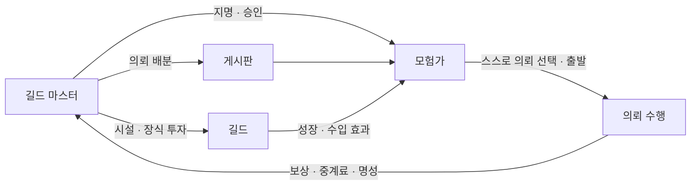

# 한 장으로 보는 게임

## v2 변경 — 개방형 길드 + 선택적 계약

> **GAME-01 · 기획: 제안(유지 사항 별도 명시) / 게임: 신규 규칙 미반영**

자율 의뢰·파티·장비 구매와 간접 육성은 유지합니다. 플레이어의 결정에 일부 인재와의 정식 계약, 지원 책임, 요율·거래 정책을 추가하는 제안입니다. 정식 여부는 마왕 토벌 자격이 아닙니다.

[상세 규칙과 근거](../ch03/contracts.md)

## v1에서 이어받은 설명

> **v1에서 유지한 설명.** 이 본문은 기존 문서의 기록이며 이번에 게임 구현을 재확인한 결과가 아닙니다. 새 제안은 별도 표시합니다. [상태 읽는 법](../reading.md) · [변경 비교표](../changes.md)

**플레이어의 손은 "의뢰를 어떻게 배분할지, 어디에 돈을 쓸지, 누구를 보낼지" 세 군데에만 닿습니다.** 의뢰를 고르고, 파티를 짜고, 장비를 사는 것은 모험가가 스스로 합니다.

| 항목 | 내용 |
| --- | --- |
| 장르 | 실시간 경영 시뮬레이션 + 육성 |
| 플레이어 | 길드 마스터(전직 B급 궁수). 직접 싸우지 않음 |
| 최종 목표 | 마왕을 무찌르는 모험가 파티가 길드에서 나오는 것 |
| 비주얼 | HD-2D 분위기의 마을 · 길드 배경 + SD 캐릭터 |
| 플레이 시간 | 첫 엔딩 10~15시간, 부가 요소 포함 25~40시간 |
| 게임 안 기간 | 첫 엔딩까지 약 15년 [가안] |
| 세계 규칙 | 화약이 없는 세계. 검 · 창 · 활 · 지팡이 · 맨손 |
| 레퍼런스 | 던전 마을(카이로소프트) 외 7개 → [레퍼런스 게임](references.md) |

## 플레이어가 하는 일

1. **의뢰 배분:** 게시판에 어느 등급 의뢰를 얼마나 걸지 정합니다. 이것이 곧 육성 전략입니다.
2. **투자:** 시설 · 장식 · 테이블을 사서 모험가의 성장과 길드 수입을 키웁니다.
3. **결정:** 리퀘스트(마을 사람의 부탁)에 누구를 보낼지, 전직을 승인할지 정합니다.

## 설계 원칙 두 가지

1. **육성은 경영의 일부입니다.** 플레이어는 투자와 방침으로 성장 환경을 만듭니다.
2. **모험가는 스스로 판단합니다.** 의뢰 선택, 장비 구매, 훈련 종목, 파티 결성은 모험가가 정합니다.

이 두 원칙 때문에 경제 설계도 "길드의 돈"과 "모험가의 돈"이 나뉩니다. 자세한 내용은 [9장](../ch09/README.md)에 있습니다.
