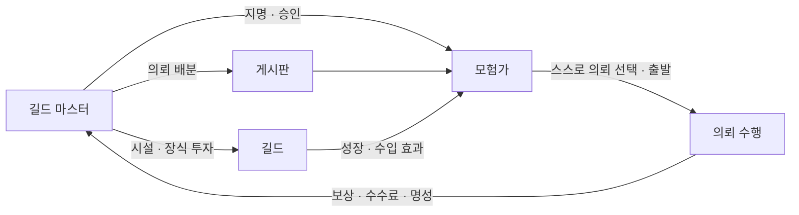

# 한 장으로 보는 게임

**플레이어의 손은 "의뢰를 어떻게 배분할지, 어디에 돈을 쓸지, 누구를 보낼지" 세 가지 기본 결정에 닿고, 선택 계약·거래 결정을 더합니다 [제안].** 의뢰를 고르고, 파티를 짜고, 장비를 사는 것은 모험가가 스스로 합니다.

| 항목 | 내용 |
| --- | --- |
| 장르 | 실시간 경영 시뮬레이션 + 육성 |
| 플레이어 | 길드 마스터(전직 B급 궁수). 직접 싸우지 않음 |
| 최종 목표 | 마왕을 무찌르는 모험가 파티가 길드에서 나오는 것 |
| 비주얼 | HD-2D 분위기의 마을 · 길드 배경 + SD 캐릭터 |
| 플레이 시간 | 첫 엔딩 10~15시간, 부가 요소 포함 25~40시간 |
| 게임 안 기간 | 첫 엔딩까지 약 15년 [가안] |
| 세계 규칙 | 화약이 없는 세계. 검 · 창 · 활 · 지팡이 · 맨손 |
| 레퍼런스 | 던전 마을(카이로소프트) 외 7개 → [레퍼런스 게임](references.md) |

## 플레이어가 하는 일

1. **의뢰 배분:** 게시판에 어느 등급 의뢰를 얼마나 걸지 정합니다. 이것이 곧 육성 전략입니다.
2. **투자:** 시설 · 장식 · 테이블을 사서 모험가의 성장과 길드 수입을 키웁니다.
3. **결정:** 리퀘스트(마을 사람의 부탁)에 누구를 보낼지, 전직을 승인할지 정합니다.

## 설계 원칙 두 가지

1. **육성은 경영의 일부입니다.** 플레이어는 투자와 방침으로 성장 환경을 만듭니다.
2. **모험가는 스스로 판단합니다.** 의뢰 선택, 장비 구매, 훈련 종목, 파티 결성은 모험가가 정합니다.

이 두 원칙 때문에 경제 설계도 "길드의 돈"과 "모험가의 돈"이 나뉩니다. 자세한 내용은 [9장](../ch09/README.md)에 있습니다.

## 플레이어의 결정

| 결정 | 얻는 것 | 감당하는 것 |
| --- | --- | --- |
| 게시판 등급 배분 | 신인·정예 성장 방향 | 의뢰 소화 능력 |
| 시설·물품 투자 | 육성·서비스 기반 | 현금·소재 |
| 자유 모험가 지명 | 필요한 임무 수행 | 섭외비·거절 가능성 |
| 일부 인재 정식 계약 | 합의 범위의 가용성 | 보수·지원·약정 책임 |
| 매입·위탁·수수료 정책 | 거래와 수익 선택 | 재고 위험·개인 구매력 |

계약·거래·정책은 **신규 제안 / 게임 미반영**입니다.

| 유지하는 원칙 | 계약을 해도 바뀌지 않는 것 |
| --- | --- |
| 자율 육성 | 비배치 시간의 의뢰·장비·파티 선택 |
| 개인 인격·소유 | 성향·개인 지갑·장비·전리품 |
| 자유로운 최종 목표 | 자유 모험가도 마왕 토벌 후보 가능 |
| 기존 첫해 진행 | 계약 모험가 0명으로도 F→E 승급 가능 |
