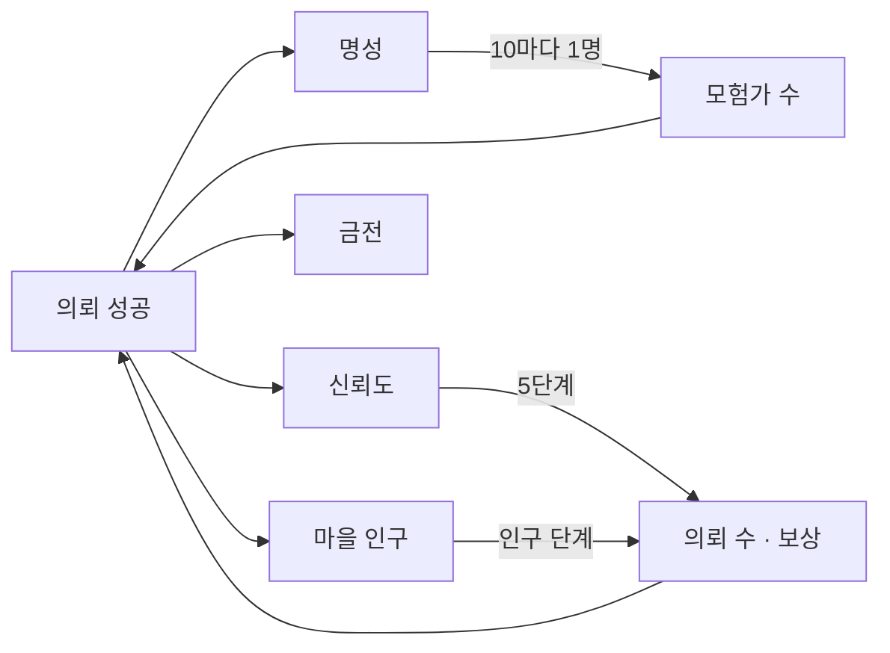

# 핵심 수치 다섯 가지

**길드는 금전 · 명성 · 신뢰도 · 길드 등급 네 수치로, 마을은 인구 하나로 상태를 나타냅니다.** 화면에 보이는 수치는 모두 정수입니다.

| 수치 | 시작값 | 오르는 방법 | 하는 일 |
| --- | --- | --- | --- |
| 금전 | 500G | 중계료 · 보조금 · 식당/주점 매출 · 리퀘스트 보상 | 시설 · 장식 · 테이블 · 지명 섭외비 |
| 명성 | 0 | 의뢰 성공 (F급 +1, E급 +2), 메인 퀘스트 +10 | **명성 10마다 모험가 1명 합류** |
| 신뢰도 | 50 (0~100) | 의뢰 성공 +1 / 실패 −2 / 만료 −1 | 5단계로 의뢰 수 · 보상 · 경험치 조정 |
| 길드 등급 | F | 그 등급의 메인 퀘스트 클리어 | 보조금, 모험가 수 상한, 시설 해금 |
| 마을 인구 | 150 | 매달 +2, 의뢰 성공, 정착 모험가 | 의뢰 유입 ×1.0 ~ ×2.5, 마을 건물 |

## 수치끼리의 관계

- **성공이 모든 수치를 함께 올리는 구조입니다.** 그래서 의뢰 성공률이 밸런스의 중심 지표가 됩니다. 지금은 94.9%로 목표 범위(80~95%)의 상한에 붙어 있습니다([9장 7절](../ch09/issues.md)).
- 명성과 신뢰도는 길드 승급의 직접 조건이 아닙니다. 모험가 수와 의뢰 공급을 통해 간접적으로 승급 속도에 영향을 줍니다.
