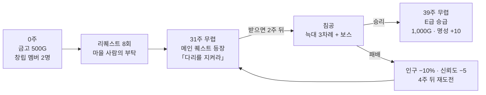

# 첫해 진행표

> **v1에서 유지한 설명.** 이 본문은 기존 문서의 기록이며 이번에 게임 구현을 재확인한 결과가 아닙니다. 새 제안은 별도 표시합니다. [상태 읽는 법](../reading.md) · [변경 비교표](../changes.md)

**첫해는 "모험가 2명으로 시작 → 리퀘스트 8회 → 침공 방어 → E급 승급"의 한 줄 이야기입니다.** 100판 측정에서 침공은 중앙 31주에 등장하고, 승급은 중앙 39주에 이뤄집니다.

| 시기 | 일어나는 일 | 플레이어의 결정 |
| --- | --- | --- |
| 1~4주 | 창립 멤버 2명이 F급 의뢰 수행, 첫 수입 | 의뢰 배분, 테이블 · 장식 첫 구매 |
| 명성 10 · 20 · 30… | 모험가 1명씩 합류 (F급 상한 8명) | — |
| 수시 | 리퀘스트 등장 (매주 50%, 동시 최대 4개) | 들어줄지, 누구를 보낼지 |
| 집무실 건설 뒤 | 지명형 리퀘스트(전투 · 탐색) 가능 | 집무실 1,000G 투자 시점 |
| 리퀘스트 8회 | 메인 퀘스트 등장 (마감 없음) | **언제 받을지** |
| 침공 1주 전 | 모든 의뢰 출발 금지, 준비 주 | 식사 · 물약 · 대열 |
| 침공 | 마을 화면에서 자동 전투, 차례 사이 정비 | 정비 창 물약 구매(1개 20G) |
| 승급 뒤 | E급: 모험가 상한 12명, 관리소 해금 | 관리소 2,000G |
| 48주 | 첫해 종료 | — |

## 첫해 결과 (100판 평균)

| 지표 | 값 |
| --- | --- |
| 월 운영 순이익 | 573G |
| 1년 뒤 금고 | 3,409G |
| 1년 뒤 모험가 | 10.4명 |
| 의뢰 수행 | 76건, 성공률 94.9% |
