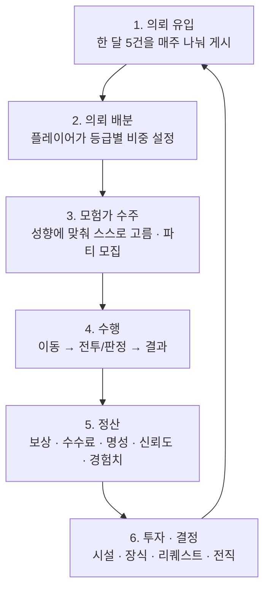

# 핵심 루프: 한 주에 일어나는 일

**한 주의 루프는 6단계이고, 플레이어가 개입하는 곳은 2단계(배분)와 6단계(투자 · 결정)입니다.** 나머지는 모험가의 자율 판단과 자동 계산입니다.

| 단계 | 누가 | 내용 |
| --- | --- | --- |
| 1. 의뢰 유입 | 자동 | 한 달 5건 × 신뢰도 보정 × 인구 보정. 게시 후 4주 지나면 만료 |
| 2. 의뢰 배분 | 플레이어 | F~S 등급마다 없음 · 적게 · 보통 · 우선 |
| 3. 수주 | 모험가 | 예상 성공률이 기준을 넘는 의뢰를 고름. 모자라면 동료를 찾음 |
| 4. 수행 | 자동 | 전투 의뢰는 전투 계산, 비전투는 능력치 판정. 미니 뷰로 관찰 |
| 5. 정산 | 자동 | 기본 일반 수수료 10% 유지. 선택 수수료·정식 계약은 개인별 기준액에 적용 [제안] |
| 6. 투자 · 결정 | 플레이어 | 금고로 시설 · 장식 구매, 리퀘스트 지명, 전직 승인 |

## 한 달마다 일어나는 일

- 월말 결산: 주점 매출 · 왕국 보조금이 들어오고 장부가 마감됩니다.
- 접수원 리나가 그달 실적과 전직 제안을 보고합니다.
- 인구가 늘고(매달 +2 + 정착 모험가), 민가 2채가 레벨업합니다.

## 계약·발주 추가 처리 — 제안·미반영

기존 자동 의뢰 유입·배분·수행은 유지합니다. 리퀘스트의 길드 발주는 별도 예산을 예약하고, 출발 전에 계약 업무·가용성을 확인합니다. 참가자·수수료·계약 조건은 출발 시 고정합니다.

## 월말과 경계 처리 — 신규 제안 / 미반영

| 상황 | 처리 |
| --- | --- |
| 월말 | 근무 주수 보수 지급, 실제 지원비·시설·사업 결산 |
| 반기 | 적격 외부 의뢰 실적 보조금. 기존 확정안의 코드 반영 별도 |
| 계약 만료 | 발생 보수 정산, 예약 정리, 자유 복귀·갱신 |
| 귀환 지연 | 출발 조건과 추가 근무분 유지 |
| 이번 주 귀환자 | 기존 지명 가능 예외 보존 |
| 인구 | 기본 +2와 지역 활동 기여. 계약 인원 중복 가산 없음 |

실제 주간 함수 순서는 기존 귀환·침공 예외를 확인하며 구현합니다. [정산](../ch09/adventurer.md) · [검증](../ch09/ledger.md)
