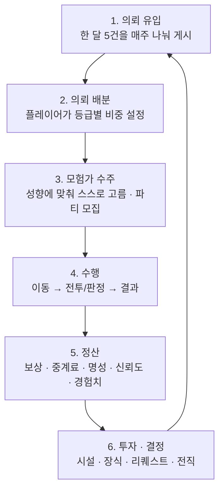

# 핵심 루프: 한 주에 일어나는 일

## v2 변경 — 주간 예약과 월말 보수

> **ADV-02 · 기획: 제안(유지 사항 별도 명시) / 게임: 신규 규칙 미반영**

귀환 정산 → 계약 종료·예약 정리 → 월말 보수·사업 정산 → 침공·예약 가용성 확인 → 남은 인원의 자율 의뢰 순서를 검토합니다. 기존 stepWeek를 그대로 교체하라는 구현 지시가 아니며, 이번 주 귀환 지명·침공 예외를 구현 전에 재확인해야 합니다.

[상세 규칙과 근거](../proposal/section-13.md)

## v1에서 이어받은 설명

> **v1에서 유지한 설명.** 이 본문은 기존 문서의 기록이며 이번에 게임 구현을 재확인한 결과가 아닙니다. 새 제안은 별도 표시합니다. [상태 읽는 법](../reading.md) · [변경 비교표](../changes.md)

**한 주의 루프는 6단계이고, 플레이어가 개입하는 곳은 2단계(배분)와 6단계(투자 · 결정)입니다.** 나머지는 모험가의 자율 판단과 자동 계산입니다.

| 단계 | 누가 | 내용 |
| --- | --- | --- |
| 1. 의뢰 유입 | 자동 | 한 달 5건 × 신뢰도 보정 × 인구 보정. 게시 후 4주 지나면 만료 |
| 2. 의뢰 배분 | 플레이어 | F~S 등급마다 없음 · 적게 · 보통 · 우선 |
| 3. 수주 | 모험가 | 예상 성공률이 기준을 넘는 의뢰를 고름. 모자라면 동료를 찾음 |
| 4. 수행 | 자동 | 전투 의뢰는 전투 계산, 비전투는 능력치 판정. 미니 뷰로 관찰 |
| 5. 정산 | 자동 | 길드는 중계료 10%, 모험가는 나머지 90%를 인원수로 나눔 |
| 6. 투자 · 결정 | 플레이어 | 금고로 시설 · 장식 구매, 리퀘스트 지명, 전직 승인 |

## 한 달마다 일어나는 일

- 월말 결산: 주점 매출 · 왕국 보조금이 들어오고 장부가 마감됩니다.
- 접수원 리나가 그달 실적과 전직 제안을 보고합니다.
- 인구가 늘고(매달 +2 + 정착 모험가), 민가 2채가 레벨업합니다.
