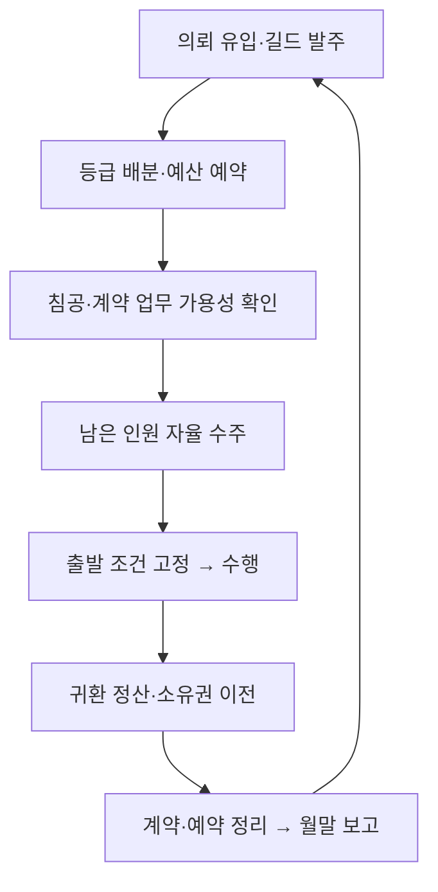

# 핵심 루프: 한 주에 일어나는 일

**자율 수주를 유지하고, 출발 전에 업무 예약과 지급 책임을 확인합니다.**

| 단계 | 담당 | 규칙 |
| --- | --- | --- |
| 유입 | 자동 | 외부 의뢰는 기존 월 5건 × 신뢰·인구 보정 |
| 게시 | 플레이어 | 기존 등급 비중 유지. 길드 발주는 예산 확보 |
| 가용성 | 자동 + 플레이어 | 부상·원정·예약·침공 제약 확인 |
| 수주 | 모험가 | 지정 업무가 없는 시간에는 자율 선택 |
| 출발 | 자동 | 참가자·요율·계약·보상 조건 저장 |
| 정산 | 자동 | 개인별 길드 몫·실수령·전리품·실비 처리 |
| 투자 | 플레이어 | 시설·장식·지명·계약·매입 선택 |

## 월말과 경계 처리 — 신규 제안 / 미반영

| 상황 | 처리 |
| --- | --- |
| 월말 | 근무 주수 보수 지급, 실제 지원비·시설·사업 결산 |
| 반기 | 적격 외부 의뢰 실적 보조금. 기존 확정안의 코드 반영 별도 |
| 계약 만료 | 발생 보수 정산, 예약 정리, 자유 복귀·갱신 |
| 귀환 지연 | 출발 조건과 추가 근무분 유지 |
| 이번 주 귀환자 | 기존 지명 가능 예외 보존 |
| 인구 | 기본 +2와 지역 활동 기여. 계약 인원 중복 가산 없음 |

실제 주간 함수 순서는 기존 귀환·침공 예외를 확인하며 구현합니다. [정산](../ch09/adventurer.md) · [검증](../ch09/ledger.md)
