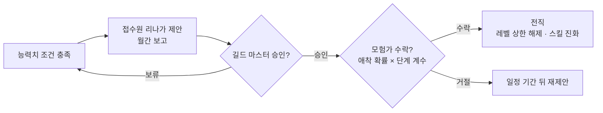

# 직업과 전직

> **v1에서 유지한 설명.** 이 본문은 기존 문서의 기록이며 이번에 게임 구현을 재확인한 결과가 아닙니다. 새 제안은 별도 표시합니다. [상태 읽는 법](../reading.md) · [변경 비교표](../changes.md)

**직업은 48개이고, 전직은 "어느 능력치가 높은가"로만 정해집니다.** 출신 직업과 관계없이 같은 능력치 조합이면 같은 직업이 됩니다. 프로토타입 첫해에는 1차 직업 5개가 주로 등장합니다.

| 단계 | 수 | 정하는 방식 |
| --- | --- | --- |
| 1차 기본 | 5 | 주력 능력치 1개 |
| 1차 종결 특수 | 3 | 특수 조건 |
| 2차 | 15 | 능력치 2개 조합 (5×5 표의 위쪽 절반) |
| 3차 심화 | 12 | 2차를 더 깊게 |
| 3차 확장 | 10 | 능력치 3개 조합 |
| 전설 | 3 | 특별 조건 |

## 1차 직업 5개

| 직업 | 주력 능력치 | 첫 스킬 |
| --- | --- | --- |
| 전사 | 힘 | 더블 스윙 |
| 궁수 | 민첩 | 연사 |
| 마법사 | 지력 | 파이어볼 |
| 성직자 | 정신 | 힐 |
| 도적 | 기교 | 급소 찌르기 |

## 2차 직업 15개 (두 능력치의 조합)

| | 힘 | 민첩 | 지력 | 정신 | 기교 |
| --- | --- | --- | --- | --- | --- |
| **힘** | 광전사 | 레인저 | 마검사 | 기사 | 쌍검사 |
| **민첩** | | 사냥꾼 | 마궁사 | 수도사 | 추적자 |
| **지력** | | | 마도사 | 점성술사 | 연금술사 |
| **정신** | | | | 신관 | 광대 |
| **기교** | | | | | 괴도 |

대각선(같은 능력치 두 번)은 "종결 직업"으로, 3차로 더 올라가지 않습니다.

## 3차 심화 12개 (2차를 더 깊게)

| 2차 | 3차 | 2차 | 3차 |
| --- | --- | --- | --- |
| 레인저 | 레인저 로드 | 추적자 | 저격수 |
| 마검사 | 마검성 | 마도사 | 대마도사 |
| 기사 | 성기사 | 점성술사 | 예언자 |
| 쌍검사 | 검무사 | 연금술사 | 연성술사 |
| 마궁사 | 마궁성 | 신관 | 대신관 |
| 수도사 | 권성 | 광대 | 바드 |

## 3차 확장 10개 (세 능력치의 조합)

| 능력치 조합 | 3차 | 거쳐 올 수 있는 2차 |
| --- | --- | --- |
| 힘 + 민첩 + 지력 | 배틀메이지 | 레인저 · 마검사 · 마궁사 |
| 힘 + 민첩 + 정신 | 용기사 | 레인저 · 기사 · 수도사 |
| 힘 + 민첩 + 기교 | 검객 | 레인저 · 쌍검사 · 추적자 |
| 힘 + 지력 + 정신 | 룬 기사 | 마검사 · 기사 · 점성술사 |
| 힘 + 지력 + 기교 | 마도 공학자 | 마검사 · 쌍검사 · 연금술사 |
| 힘 + 정신 + 기교 | 검성 | 기사 · 쌍검사 · 광대 |
| 민첩 + 지력 + 정신 | 신궁 | 마궁사 · 수도사 · 점성술사 |
| 민첩 + 지력 + 기교 | 명사수 | 마궁사 · 추적자 · 연금술사 |
| 민첩 + 정신 + 기교 | 무희 | 수도사 · 추적자 · 광대 |
| 지력 + 정신 + 기교 | 환술사 | 점성술사 · 연금술사 · 광대 |

## 1차 종결 특수 직업 3개

| 직업 | 담당하는 축 | 고유 능력 |
| --- | --- | --- |
| 짐꾼 | 길드 수입 | 파티의 소재 획득량 증가 |
| 상인 | 모험가 경제 | 파티 보상 증가, 마을 상점 할인 |
| 정보꾼 | 시간 | 지름길로 의뢰 기간 단축 |

등장 조건은 아직 정하지 않았습니다. 셋 모두 경제와 직접 닿는 직업이라 경제 개편 때 함께 보셔야 합니다.

## 전설 직업 3개

| 직업 | 축 | 전설의 물건 | 각성 |
| --- | --- | --- | --- |
| 용사 | 빛 · 운명 | 전설의 검 | 확률로 나오는 특별 퀘스트를 달성하면, 조건을 갖춘 파티원 중 검이 주인을 고름 |
| 현자 | 지혜 · 탐구 | 현자의 지팡이 | 대도서관 발견 → 조사 의뢰로 단서 수집 → 특별 퀘스트 |
| 마인 | 어둠 · 상실 | 마왕의 파편 | 마왕 전조 때 부모가 언데드 간부로 나타나고, 2세가 있는 파티가 쓰러뜨리면 각성 |

전설 직업은 마왕 토벌의 필수 조건이 아닙니다. 마인의 세부 규칙은 [5장 습격 · 마인 · 무술 대회](../ch05/extra.md)에 있습니다.

## 전직은 어떻게 일어나는가

| 애착 단계 | 수락 기본 확률 | 1차 → 2차 (×1.2) |
| --- | --- | --- |
| 방랑자 (0~29) | 40% | 48% |
| 새내기 (30~69) | 65% | 78% |
| 동반자 (70~99) | 90% | 100% |
| 토박이 (100) | 100% | 100% |

- 레벨이 성장의 엔진이고 직업은 방향입니다. 전직해야 레벨 상한이 풀리고, 가진 스킬이 새 직업에 맞게 진화합니다(스킬 82개).
- 같은 단계 안에서 직업을 바꾸려면 1차로 돌아갔다가 다시 올라갑니다. 능력치 · 레벨 · 장비 · 애착은 유지되고, 이전 직업 패시브는 잃습니다.
- 첫 2차 전직 제안은 시험 측정에서 중앙 48주(하위 20% 40주 ~ 상위 20% 60주)입니다. 즉 **첫해 끝 무렵이 첫 전직 시점**입니다.
