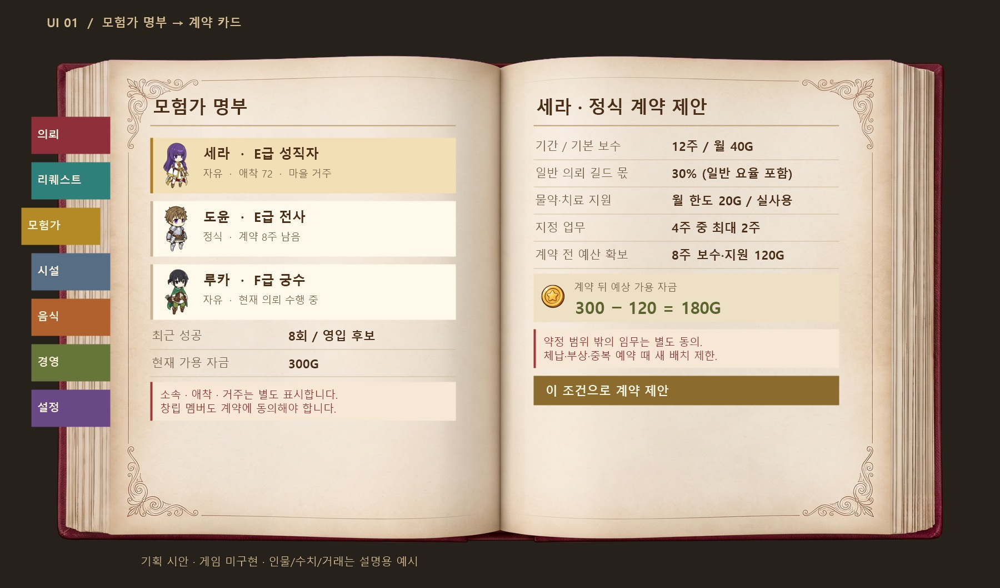

# 합류 · 계약 · 파티 · 사망과 계승

**모험가는 자유롭게 합류합니다. 정식 계약은 일부 인재와 맺는 선택적 약속입니다.**

## 합류와 정원

| 항목 | 규칙 |
| --- | --- |
| 시작 | 창립 2명. 기존 상주 혜택을 가진 자유 모험가 |
| 합류 | 명성 10 · 20 · 30 … 마다 1명, 확률 없음 |
| 전체 정원 | F 8 · E 12 · D 16 · C 20 · B 24 · A 28 · S 32 |
| 계약 해금 | E급 + 관리소 건설 [제안] |
| 정식 정원 | E급 2명 [검증용]. 전체 정원 안에 포함 |
| 필수 여부 | 선택. 정식 0명으로도 기존 승급 진행 |

## 자유와 정식 — ADV-01 · ADV-02 / 제안·미반영

| 항목 | 자유 모험가 | 정식 계약원 |
| --- | --- | --- |
| 비배치 시간 | 자율 의뢰·파티·장비 구매 | 동일 |
| 정기 보수 | 없음 | 약정 보수 |
| 일반 의뢰 길드 몫 | 일반 중계료 | 개인 기준액 × 계약 최종 요율 |
| 지명 | 섭외비·수락/거절 | 범위·가용 조건 충족 시 우선 배치 |
| 지원 | 개인 부담 또는 공개 정책 | 약정 한도 내 실제 사용 |
| 개인 소유 | 지갑·장비·전리품 | 유지. 길드 대여품만 별도 |
| 토벌 후보 | 가능 | 가능 |

## 계약 화면

[큰 이미지 보기](../assets/ui/contract.jpg) · **기획 시안 / 게임 미구현 / 수치 검증용**

| 계약서 항목 | 최초 시험값·규칙 |
| --- | --- |
| 후보 | 애착 30 이상 + 성공 3회 + 계약 가능한 상태 [검증용] |
| 표준 계약 | 1종으로 시작. 상담 결과 저장, 같은 조건 반복 재추첨 금지 |
| 기간 | 12주 [검증용] |
| 보수 | 월 보수·지급일 명시. 주별 적립 → 월말 지급 |
| 길드 몫 | 일반 중계료를 포함한 최종 비율. 계약 중 일방 변경 금지 |
| 지정 업무 | 4주 중 최대 2주 [검증용], 위험·종류·시간 한도 |
| 지원·장비 | 식사·물약·치료 한도, 선물/대여, 분실·반환 |
| 예산 | 앞으로 8주 보수·지원 전망 [검증용], 가용 자금으로 확보 |

## 배치와 종료

| 상태 | 처리 |
| --- | --- |
| 부상·원정·예약 충돌 | 신규 배치 불가. 호위와 방어 대기 중복 금지 |
| 위험·조건·시간 초과 | 범위 밖 동의 필요. 무조건 복종 아님 |
| 부상 | 기본 보수 유지, 약정 치료비만 실비 지원 |
| 체납 | 채무 유지 + 신규 지정 업무 중지. 경고 후 4주 유예 [검증용] |
| 월중 영입·종료 | 근무 주수만큼 보수 발생, 실제 지급 1회 |
| 종료일을 넘는 임무 | 연장 동의 후 배치. 예기치 않은 지연은 추가 근무 인정 |
| 해지 | 미지급 보수 정산. 개인 소유는 유지, 대여품만 회수 |

## 파티

| 항목 | 내용 |
| --- | --- |
| 결성 | 모험가가 스스로. 예상 성공률이 부족하면 주점에서 동료 모집, 최대 2주 |
| 최대 인원 | 5명 [가안] |
| 보상 | 개인 배분 기준액에 각자의 자유/계약 요율 적용 |
| 친밀도 0~49 | 임시 파티, 의뢰 뒤 해산 |
| 친밀도 50~99 | 단골 동료 |
| 친밀도 100 | 고정 파티, 이름·동반 방문. 마왕 토벌 후보 |
| 혼성 파티 | 허용. 한 사람의 계약으로 다른 파티원을 강제 고용하지 않음 |

## 사망과 계승

| 항목 | 규칙 |
| --- | --- |
| 기본 사망 확률 | 실패 시 F·E 1%, D·C 3%, B·A 5%, S 8% × 성향 0.5~1.5 |
| 2세 합류 | 사망 24주 후 Lv1·F급, 부모 1차 계열 70% |
| 계승 | 유품 + 스킬 1개. 첫해 애착과 관계없이 자주 방문 |
| 정식 사망 정산 | 그 주까지 발생 보수 + 약정 위로금. 이후 급여 중지 |
| 자녀의 계약 | 부모의 고용·채무·대여 의무 자동 상속 없음. 별도 제안 |

[개인별 보상 계산](../ch09/adventurer.md) · [관계와 거주](personality.md)
