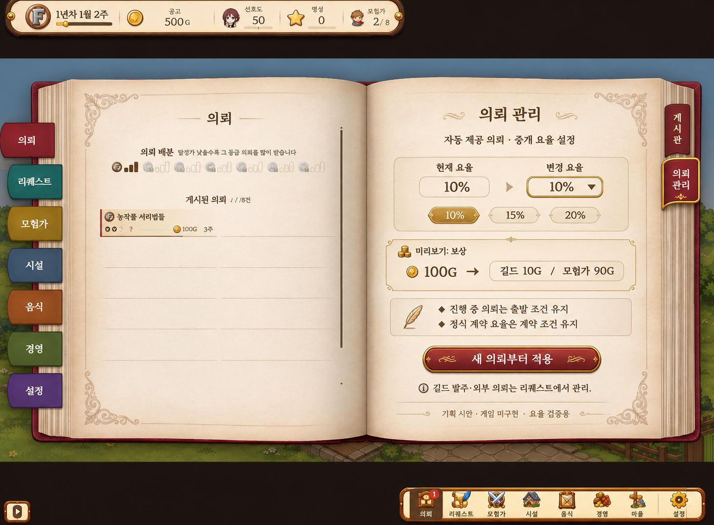

# 의뢰 유입과 게시판

**의뢰는 한 달 5건이 들어와 매주 나뉘어 게시되고, 4주 안에 아무도 받지 않으면 사라집니다.** 플레이어는 어느 등급을 얼마나 게시할지만 정합니다.

## 유입량

> 월간 유입량 = 기본 5건 × 신뢰도 보정 × 인구 단계 보정

| 요소 | 값 |
| --- | --- |
| 기본량 | 한 달 5건 (2026-11-12에 10 → 5) |
| 신뢰도 보정 | 5단계. 1단계는 수입 · 성장이 보통의 약 60%, 5단계는 약 2.25배 |
| 인구 보정 | 개척촌 ×1.0 · 마을(300) ×1.3 · 읍(1,000) ×1.6 · 도시(2,000) ×2.0 · 성채 도시(3,500) ×2.5 |

**왜 5건인가:** 10건일 때는 모험가 8명이 다 소화하지 못해 1년에 42건이 만료되고 신뢰도가 50 → 27로 떨어졌습니다. 5건으로 줄이자 만료는 연 약 10건, 연말 신뢰도는 약 54가 되었습니다. 유입량은 나중에 아이템 · 시설로 늘리는 구조로 갑니다.

## 게시판 규칙

| 항목 | 규칙 |
| --- | --- |
| 칸 수 | 처음부터 18칸 |
| 기한 | 게시 순간부터 4주. 만료되면 신뢰도 −1 |
| 직접 취소(떼기) | 신뢰도 −2 + 위약금(보상의 10%) |
| 수주 | 모험가가 스스로 고름 |

## 의뢰 배분: 플레이어의 육성 전략

**등급마다 "없음 · 적게 · 보통 · 우선"을 고르면, 그 비율대로 칸이 나뉩니다.** 고등급을 우선하면 정예 집중, 저등급 칸을 남기면 신인 · 2세 육성이 됩니다.

| 버튼 | 없음 | 적게 | 보통 | 우선 |
| --- | --- | --- | --- | --- |
| 비중 | 0 | 1 | 2 | 4 |

예: 8칸에서 F 보통 · E 우선 → F 3칸 · E 5칸. 모든 등급을 "없음"으로 둘 수는 없습니다.

## 의뢰 관리 — QUEST-01 · ECON-03 / 제안·미반영

기존 의뢰는 자동 제공되는 게시판 의뢰입니다. 유입·배분·수주·취소 규칙은 유지합니다. 우측에 **게시판 / 의뢰 관리** 탭을 두며, 의뢰 관리에서 일반 수수료만 선택합니다.

| 설정 | 규칙 |
| --- | --- |
| 기본값 | 10% |
| 선택 | 10 / 15 / 20% 검증용. 해금·범위는 별도 검증 |
| 높은 수수료 거름 | 돈이 필요한 모험가는 10%보다 높은 의뢰를 확률로 거름: (수수료 − 10%) ÷ 10% × 0.5 [임시] → 15% 25% · 20% 50%, 다 거르면 그 주는 쉼. 모두 20%면 수수료 수입은 두 배지만 월 순이익 431G(10%는 435G) · 승급 65 → 54판 [결정 22] |
| 적용 | 새 의뢰부터. 이미 출발한 의뢰·기존 계약은 조건 유지 |
| 경영 | 적용 수수료와 수익 조회·관리 화면 바로가기만 제공. 별도 설정값 중복 없음 |
| 추가 발주 | [리퀘스트의 길드 발주·외부 의뢰](requests.md)에서 관리 |

기획 시안·게임 미구현. [수수료 정산 규칙](../ch09/income.md).
