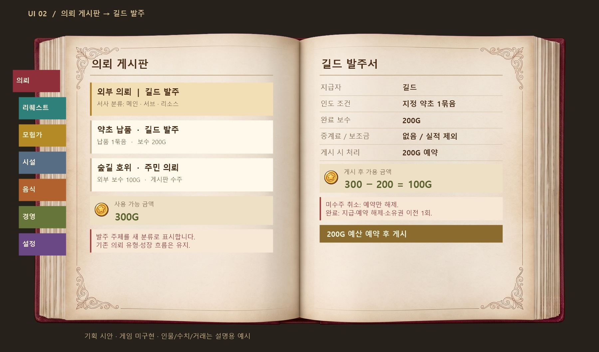

# 의뢰 유입과 게시판

**외부 의뢰는 수입을 연결하고, 길드 발주는 필요한 물품·업무에 예산을 씁니다.**

## 의뢰의 네 가지 속성 — QUEST-01 / 제안·미반영

| 구분 | 값 | 결정하는 것 |
| --- | --- | --- |
| 서사 | 메인 / 서브 / 리소스 | 이야기·승급·반복 역할 |
| 발주자 | 주민 / 상단 / 왕국 / 길드 | 비용 부담자 |
| 수행 | 자율 수주 / 지명 / 계약 배치 | 인력 선택 방식 |
| 정산 | 외부 보상 / 길드 예산 / 장기 계약 / 탐사 | 금전·물품 권리 |

## 외부 의뢰 유입

> 월간 유입량 = 기본 5건 × 신뢰도 보정 × 인구 단계 보정

| 요소 | 값 |
| --- | --- |
| 기본량 | 한 달 5건 |
| 신뢰도 | 5단계. 1단계 약 60%, 5단계 약 2.25배 |
| 인구 보정 | 개척촌 ×1.0 · 마을(300) ×1.3 · 읍(1,000) ×1.6 · 도시(2,000) ×2.0 · 성채 도시(3,500) ×2.5 |
| 게시판 | 18칸 · 게시 후 4주 · 만료 신뢰 −1 |
| 외부 의뢰 직접 취소 | 신뢰 −2 + 보상의 10% 위약금 |
| 수주 | 가용한 모험가의 자율 선택 |

| 등급별 비중 | 없음 | 적게 | 보통 | 우선 |
| --- | --- | --- | --- | --- |
| 값 | 0 | 1 | 2 | 4 |

모든 등급을 ‘없음’으로 둘 수 없습니다. 8칸에서 F 보통·E 우선이면 F 3칸·E 5칸입니다.

## 길드 발주 화면

[큰 이미지 보기](../assets/ui/guild-order.jpg) · **기획 시안 / 미구현 / 금액 예시**

| 시점 | 200G 소재 발주 예시 |
| --- | --- |
| 게시 전 | 납품품·수량·보수·기한·수행 방식·보조금 제외 표시 |
| 게시 | 길드 소유 현금 중 200G 예약. 현금은 아직 차감하지 않음 |
| 완료 | 현금 −200G, 수행자 합계 +200G, 예약 해제·물품 인도 1회 |
| 미수주 취소 | 예약만 해제. 환급 명목의 돈 생성 없음 |
| 길드 수입 | 중계료 0, 자가 실적 보조금 0 |
| 정식 업무 | 급여 포함 업무+실비 또는 명시한 별도 보수 중 하나로 표시 |

자가 납품 반복으로 외부 실적·보조금·무한 성장을 만들지 않습니다. 난도·기간·위험·기준 가격에 따른 발주 보수 공식은 미결입니다.

## 장기 계약·탐사

| 사업 | 처리 | 범위 |
| --- | --- | --- |
| 상단 호위 | 관리비·수행 보수·선수금·실패 책임 분리 | P3 |
| 길드 투자 탐사 | 출발 전에 투자·전리품 지분 합의 | 후속 |
| 던전·자원 독점 | 권리뿐 아니라 의무·기간·실패 책임 정의 | 최소판 제외 |

[지명·예약](nomination.md) · [정산](../ch09/adventurer.md)
