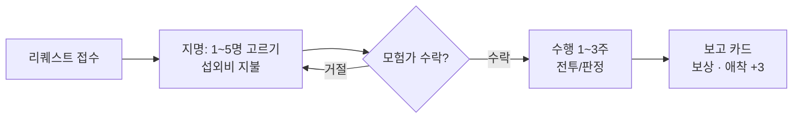

# 지명 퀘스트

**지명은 마스터가 모험가를 직접 골라 보내는, 기존 자유 모험가에게 적용하는 "직접 지시"입니다.** 리퀘스트와 메인 퀘스트가 이 틀을 씁니다.

| 항목 | 규칙 |
| --- | --- |
| 조건 | 퀘스트마다 최소 능력치. **파티 중 1명만** 채우면 됨 |
| 수락 확률 | 전직과 같은 규칙: 애착 단계(40 / 65 / 90 / 100%) × 위험 보정, 정수 %로 표시 |
| 거절당하면 | 다음 주에 바로 다시 지명 가능. 성향 말풍선 한 줄 |
| 섭외비 | 모험가 등급별 F 20G · E 40G · D 80G · C 150G · B 250G · A 400G · S 600G. **거절당해도 나감** |
| 보상 | 기존 보상·개인 몫 유지. 일반 외부 보상은 개인별 요율, 길드 발주는 명시한 별도 지급 조건 [제안] |
| 대열 | 항상 자동(직업 순) |
| 성공 | 참가자 애착 +3 |

- 지명 중인 모험가는 그 기간 게시판 의뢰를 받지 않습니다.
- **섭외비는 연 약 1,400G**(첫해 월 평균 62G)로, 처음 어림(550G)보다 컸지만 금액은 그대로 두기로 했습니다(2026-11-16).

## 소속별 처리 — QUEST-01 / 제안·미반영

| 항목 | 자유 | 정식 계약 범위 안 |
| --- | --- | --- |
| 선택 | 마스터가 후보 지정 | 동일 |
| 수락 | 기존 애착·위험 기반 수락/거절 | 가용·조건 충족 시 확률 재추첨 없음 |
| 비용 | 기존 섭외비. 거절해도 지출 | 별도 섭외비 없음 |
| 범위 밖 | 기존 규칙 | 별도 동의 필요 |
| 소유·보상 | 의뢰 정산 방식 적용 | 동일, 개인 계약 요율은 외부 일반 보상에만 |

| 공통 조건 | 규칙 |
| --- | --- |
| 능력치 | 파티 중 1명이 최소 조건 충족 |
| 대열·전투·후퇴 | 기존 규칙 유지 |
| 성공 애착 | +3 |
| 중복 업무 | 지명 기간 게시판 수주·다른 예약 불가 |
| 침공 | 기존 출발 제한 우선 |
| 귀환 주 | ‘이번 주 귀환’ 지명 가능 예외 보존 |

## 지명·업무 예약 화면

[큰 이미지 보기](../assets/ui/assignment.jpg) · **기획 시안 / 미구현**

| 표시 | 예시 |
| --- | --- |
| 자유 후보 | 수락률·섭외비·최근 거절 사유 |
| 계약 모험가 후보 | 계약 범위·업무 점유·예약 가능 여부 |
| 불가 후보 | 부상 / 이미 원정 / 다른 예약 / 금고 적자 (위험 한도 · 체납 규칙은 없음, 결정 2026-11-17) |
| 배치 버튼 | 인원·기간·조건을 충족했을 때 활성 |
| 외부 호위와 방어 충돌 | 대체 인원·일정 변경·위약금 선택 필요 |

| 미결·주의 | 처리 방향 |
| --- | --- |
| 섭외비 수취인 | **부탁받은 자유 모험가 지갑**(거절해도 받음, 개인 대기료). 길드 지출은 그대로 [결정 2026-11-17] |
| 개인 대기료로 변경 | 개인 지갑 입금과 거절 반복 이득을 별도 검증 |
| 애착 구간 불일치 | [성향과 애착도](../ch03/personality.md)에서 분리 관리 |

정식 계약은 전투 직접 조작권이나 사망 면역을 주지 않습니다.
