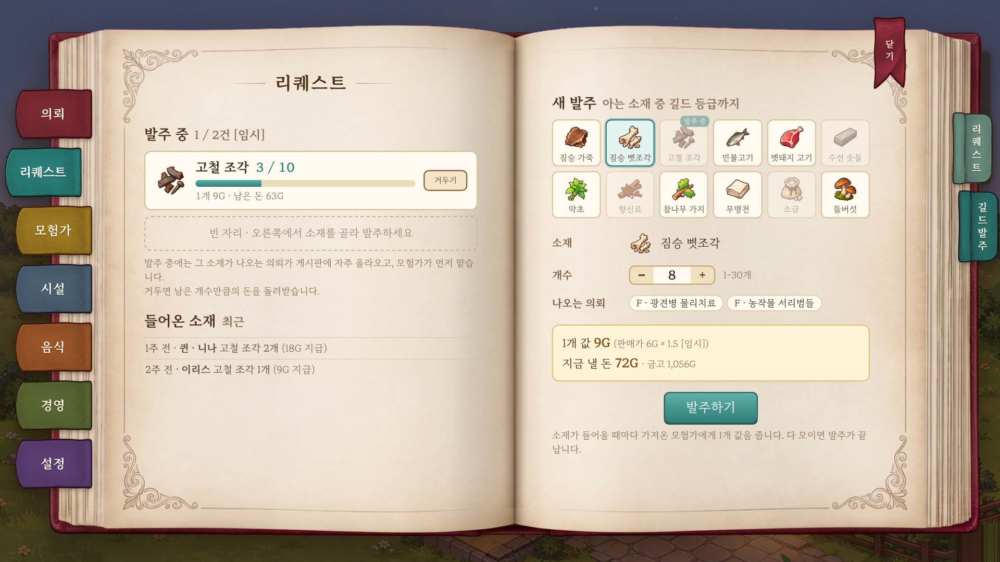
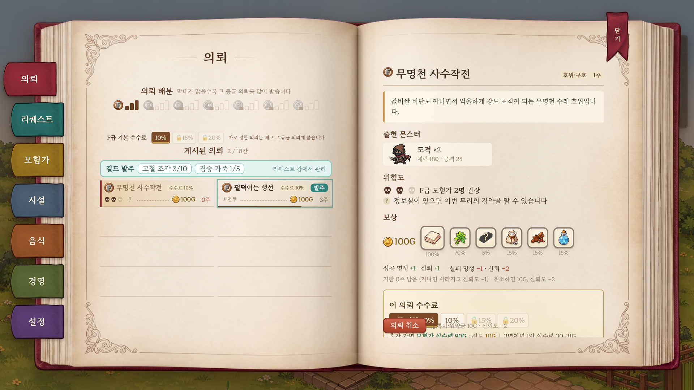

# 리퀘스트(서브 퀘스트)

**리퀘스트는 마을 사람 · 외지인 · 모험가가 길드에 가져오는 부탁이고, F급에는 28개가 있습니다.** 들어주면 마을 이야기가 진행되고, 잠긴 설비와 마을 건물이 열립니다. 8개를 들어주면 메인 퀘스트가 나옵니다.

## 의뢰인 세 종류

| 의뢰인 | 예 | 주로 맡기는 일 |
| --- | --- | --- |
| 마을 사람 | 촌장 · 농부 · 목수 · 수녀 · 할머니 | 마을 문제, 공사 후원 |
| 외지인 | 떠돌이 상인 · 학자 · 대장장이 | 물건 주문, 정착 지원 → 마을 건물 해금 |
| 모험가 | 길드 소속 모험가 | 자기 사연, 길드 안 불편함 |

## 서브 퀘스트 유형 8종 (설계)

| # | 유형 | 의뢰인 | 하는 일 | 지명 | 보상 성격 |
| --- | --- | --- | --- | --- | --- |
| 1 | 기부 | 주민 · 영주 | 돈을 냄 | 없음 | 마을 · 길드의 영구 확장 |
| 2 | 납품 | 상인 · 주민 | 소재 n개 | 없음 | 금전 + 레시피 · 상품 해금 |
| 3 | 토벌 지명 | 주민 · 영주 | 네임드 몬스터 처치 | 2~4명 | 전리품 장식 |
| 4 | 호위 | 상인 | 2주 동행 | 2~3명 | 금전 + 상점 할인 (E급) |
| 5 | 수색 | 주민 | 실종자 찾기 | 1~3명 | 인구 + 애착 |
| 6 | 모험가 개인 | 모험가(애착 65 이상) | 그 사람의 사연 | 본인 포함 1~3명 | 애착 +10, 능력치 · 전직 보정 |
| 7 | 시설 · 장식 요청 | 모험가 · 주민 | "○○를 놓아 주세요" | 없음 | 명성 · 신뢰도 |
| 8 | 영주 요청 | 영주 | 상납금 또는 지명 토벌 | 0 또는 3~5명 | 영주 태도, 신뢰도 (E급) |

F급 28개는 이 8종을 아래 "해결 방법 6가지"로 묶어 씁니다.

## 해결 방법 여섯 가지

| 종류 | 사람을 보내나 | 해결 |
| --- | --- | --- |
| 전투 | 지명 1~3명 | 게시판 의뢰와 같은 전투, 1~2주 |
| 탐색 | 지명 1~2명 | 탐색 판정 + 전투 0~1회 |
| 납품 | 아니요 | 창고의 소재를 바로 냄 |
| 돈 내기 | 아니요 | 금고에서 지불 |
| 설치 요청 | 아니요 | 해당 설비를 놓으면 완료 |
| 마을 건물 해금 | 단계별 | 납품 → 돈 내기 2단계 |

- 지명형(전투 · 탐색)은 **집무실(1,000G)** 이 있어야 받을 수 있습니다.
- 기한은 접수 뒤 6주입니다.

## 등장 규칙 (카이로소프트 방식)

| 항목 | 규칙 |
| --- | --- |
| 판정 | 매주, 조건을 채운 퀘스트 중 하나가 50% 확률로 등장 |
| 동시에 열린 수 | 상한 없음. 받은 부탁은 사라지지 않고 쌓임 (첫해 평균 2건 안팎, 한 판 최대 중앙 4건) |
| 조건 | 인구 · 명성 · 계절 · 앞 퀘스트 · "능력치 기준 이상인 모험가 1명 이상" |
| 힌트 | 아직 안 나온 것 중 조건에 가장 가까운 2개를 흐린 카드로 표시 |
| 반복 | 축제 3개만 매년, 나머지는 한 번 |

> 2026-11-16 결정: **리퀘스트는 거절할 수 없습니다.** 들어줄 때 책에 "들어주기" · "보내기" 도장이 찍히고, 끝나면 완료 카드(의뢰인 초상 · 마을의 변화 · 받은 보상)가 뜹니다.

## 보상으로 열리는 설비 10개

처음에는 테이블 2세트만 지을 수 있습니다. 테이블 3 · 4세트와 장식 8종(화분 · 게시판 장식 · 사물함 · 현수막 · 대기 벤치 · 낡은 지도 · 벽난로 · 트로피 장식장)이 리퀘스트 보상으로 하나씩 열립니다. 마을 건물 2개(대장간 · 물약 상점)도 리퀘스트로 생깁니다.

## 경제와 닿는 곳

- **돈 내기**는 장부에서 "시설 건설비"처럼 투자 지출로 잡혀 운영 순이익에서 빠집니다.
- 납품 금화 보상은 수입 "리퀘스트 보상"으로 잡힙니다. 첫해 월 평균 95G입니다([9장](../ch09/measure.md)).

## 길드 발주 — QUEST-01 / 결정·게임 반영 (2026-11-18)

**급한 소재를 돈으로 앞당기는 기능입니다.** 마스터가 소재와 개수를 정하면 그 값을 금고에서 먼저 내고, 개수가 다 찰 때까지 게시판이 그 소재 쪽으로 기울어 모험가가 먼저 가져옵니다. 외부 의뢰(주민 · 상단 · 왕국의 추가 제안)는 **보류**입니다.

| 규칙 | 내용 | 근거 |
| --- | --- | --- |
| 1개 값 | 소재 판매가 × **1.5 [임시]** — 고철 조각(6G)이면 9G. 평소 자동 매입(70% [임시])보다 2배 넘게 비쌈 | 결정 24 |
| 선지급 | 발주할 때 개수 × 1개 값을 **금고에서 바로 냄**. 기한 없음 | 결정 25 |
| 지급 | 그 소재를 가져온 파티에 1개 값씩 지급, 소재는 길드 창고로. 다 차면 발주 끝, 이후는 평소 매입 | 결정 25 |
| 거두기 | 도중에 거두면 **남은 개수만큼의 돈**을 돌려받음 (화면에서 한 번 더 확인) | 결정 25 |
| 동시 건수 | **2건까지 [임시]** · 같은 소재 중복 불가 · 1~30개 · 지금 길드 등급 의뢰에서 나오지 않는 소재는 불가 | 결정 25 |
| 게시판 쏠림 | 발주 중에는 새 의뢰의 <b>50% [임시]</b>가 그 소재가 나오는 의뢰로 바뀜(의뢰 수 · 수입은 그대로) | 결정 26 |
| 모험가 | 발주 소재가 나오는 의뢰를 **가장 먼저** 맡음 | 결정 26 |
| 한 번에 모아 오는 양 | 몬스터 1마리 · 탐색 포인트 1곳마다 1개, 발주 중이면 모두 발주 소재 ([물약과 소재](../ch06/potion.md)) | 결정 27 |
| 길드 실적 | 명성 · 신뢰 · 보조금 실적은 오르지 않음. 맡은 사람이 따로 없어 실패 · 취소 처리 없음 | 결정 25 |

**예시 — 고철 조각 10개 발주**

1. 리퀘스트 장 → 길드 발주에서 고철 조각 10개를 고르면 **90G**(9G × 10)가 금고에서 나갑니다.
2. 게시판에 "고철이나 줍자" 같은 의뢰가 자주 올라오고, 카드에 **발주** 표시가 붙습니다.
3. 퀸 · 니나 파티가 슬라임 2마리 의뢰를 성공하면 고철 2개를 가져오고, 두 사람이 18G를 나눠 받습니다. 게시판 띠가 "고철 조각 2/10"이 됩니다.
4. 급한 일이 끝나 6/10에서 거두면 남은 4개 값 **36G**가 금고로 돌아옵니다.

측정(50판): 10개가 다 모이는 기간은 처음 규칙(돈 보너스만) 17주 → 게시판 쏠림 + 소재 뽑기 후 **중앙값 8주**입니다. 발주를 하지 않으면 경제는 그대로입니다(관문 1 479G · 96.0%).

## 길드 발주 화면 (게임 반영)

[큰 이미지 보기](../assets/ui/guild-order-v2.png) · **게임 화면 시안, 2026-11-18 사용자 확인 후 연결**

- **왼쪽 쪽:** 발주 중(진행 막대 · 1개 값 · 남은 돈 · 거두기) · 빈 자리 · 들어온 소재(누가 몇 개, 지급액).
- **오른쪽 쪽:** 아는 소재 중 길드 등급까지 고르기(발주 중 · 나오지 않는 소재는 흐림) → 개수 1~30 → 나오는 의뢰 → 1개 값과 지금 낼 돈 → 발주하기. 막히면 이유를 버튼 아래에 적음.

의뢰 게시판에는 "길드 발주: 고철 조각 3/10" 띠가 붙고, 발주 소재가 나오는 의뢰 카드에 청록 테두리와 **발주** 표시가 붙습니다.

## 장기 계약·탐사

| 사업 | 처리 | 범위 |
| --- | --- | --- |
| 상단 호위 | 관리비·수행 보수·선수금·실패 책임 분리 | P3 |
| 길드 투자 탐사 | 출발 전에 투자·전리품 지분 합의 | 후속 |
| 던전·자원 독점 | 권리뿐 아니라 의무·기간·실패 책임 정의 | 최소판 제외 |

[지명·예약](nomination.md) · [정산](../ch09/adventurer.md)
