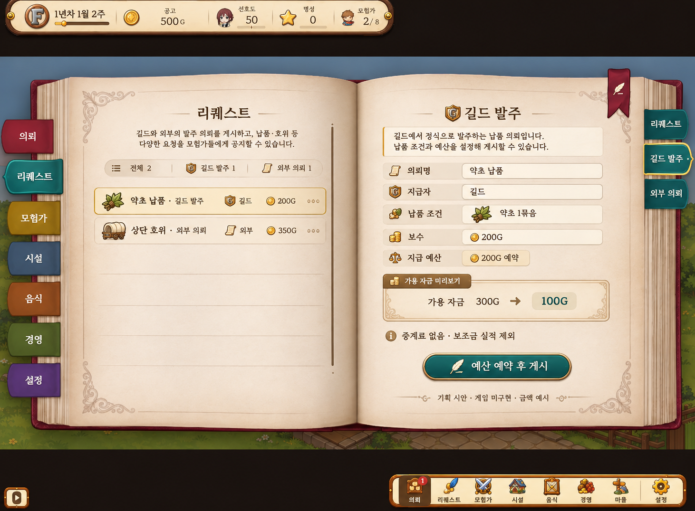

# 리퀘스트(서브 퀘스트)

**리퀘스트는 마을 사람 · 외지인 · 모험가가 길드에 가져오는 부탁이고, F급에는 28개가 있습니다.** 들어주면 마을 이야기가 진행되고, 잠긴 설비와 마을 건물이 열립니다. 8개를 들어주면 메인 퀘스트가 나옵니다.

## 의뢰인 세 종류

| 의뢰인 | 예 | 주로 맡기는 일 |
| --- | --- | --- |
| 마을 사람 | 촌장 · 농부 · 목수 · 수녀 · 할머니 | 마을 문제, 공사 후원 |
| 외지인 | 떠돌이 상인 · 학자 · 대장장이 | 물건 주문, 정착 지원 → 마을 건물 해금 |
| 모험가 | 길드 소속 모험가 | 자기 사연, 길드 안 불편함 |

## 서브 퀘스트 유형 8종 (설계)

| # | 유형 | 의뢰인 | 하는 일 | 지명 | 보상 성격 |
| --- | --- | --- | --- | --- | --- |
| 1 | 기부 | 주민 · 영주 | 돈을 냄 | 없음 | 마을 · 길드의 영구 확장 |
| 2 | 납품 | 상인 · 주민 | 소재 n개 | 없음 | 금전 + 레시피 · 상품 해금 |
| 3 | 토벌 지명 | 주민 · 영주 | 네임드 몬스터 처치 | 2~4명 | 전리품 장식 |
| 4 | 호위 | 상인 | 2주 동행 | 2~3명 | 금전 + 상점 할인 (E급) |
| 5 | 수색 | 주민 | 실종자 찾기 | 1~3명 | 인구 + 애착 |
| 6 | 모험가 개인 | 모험가(애착 65 이상) | 그 사람의 사연 | 본인 포함 1~3명 | 애착 +10, 능력치 · 전직 보정 |
| 7 | 시설 · 장식 요청 | 모험가 · 주민 | "○○를 놓아 주세요" | 없음 | 명성 · 신뢰도 |
| 8 | 영주 요청 | 영주 | 상납금 또는 지명 토벌 | 0 또는 3~5명 | 영주 태도, 신뢰도 (E급) |

F급 28개는 이 8종을 아래 "해결 방법 6가지"로 묶어 씁니다.

## 해결 방법 여섯 가지

| 종류 | 사람을 보내나 | 해결 |
| --- | --- | --- |
| 전투 | 지명 1~3명 | 게시판 의뢰와 같은 전투, 1~2주 |
| 탐색 | 지명 1~2명 | 탐색 판정 + 전투 0~1회 |
| 납품 | 아니요 | 창고의 소재를 바로 냄 |
| 돈 내기 | 아니요 | 금고에서 지불 |
| 설치 요청 | 아니요 | 해당 설비를 놓으면 완료 |
| 마을 건물 해금 | 단계별 | 납품 → 돈 내기 2단계 |

- 지명형(전투 · 탐색)은 **집무실(1,000G)** 이 있어야 받을 수 있습니다.
- 기한은 접수 뒤 6주입니다.

## 등장 규칙 (카이로소프트 방식)

| 항목 | 규칙 |
| --- | --- |
| 판정 | 매주, 조건을 채운 퀘스트 중 하나가 50% 확률로 등장 |
| 동시에 열린 수 | 상한 없음. 받은 부탁은 사라지지 않고 쌓임 (첫해 평균 2건 안팎, 한 판 최대 중앙 4건) |
| 조건 | 인구 · 명성 · 계절 · 앞 퀘스트 · "능력치 기준 이상인 모험가 1명 이상" |
| 힌트 | 아직 안 나온 것 중 조건에 가장 가까운 2개를 흐린 카드로 표시 |
| 반복 | 축제 3개만 매년, 나머지는 한 번 |

> 2026-11-16 결정: **리퀘스트는 거절할 수 없습니다.** 들어줄 때 책에 "들어주기" · "보내기" 도장이 찍히고, 끝나면 완료 카드(의뢰인 초상 · 마을의 변화 · 받은 보상)가 뜹니다.

## 보상으로 열리는 설비 10개

처음에는 테이블 2세트만 지을 수 있습니다. 테이블 3 · 4세트와 장식 8종(화분 · 게시판 장식 · 사물함 · 현수막 · 대기 벤치 · 낡은 지도 · 벽난로 · 트로피 장식장)이 리퀘스트 보상으로 하나씩 열립니다. 마을 건물 2개(대장간 · 물약 상점)도 리퀘스트로 생깁니다.

## 경제와 닿는 곳

- **돈 내기**는 장부에서 "시설 건설비"처럼 투자 지출로 잡혀 운영 순이익에서 빠집니다.
- 납품 금화 보상은 수입 "리퀘스트 보상"으로 잡힙니다. 첫해 월 평균 95G입니다([9장](../ch09/measure.md)).

## 길드 발주·외부 의뢰 — QUEST-01 / 제안·미반영

기존 리퀘스트와 28개 부탁을 유지하고, 우측 하위 탭으로 추가 업무를 구분합니다. 자동 게시판 의뢰는 기존 **의뢰** 메뉴에 남습니다.

| 우측 탭 | 역할 |
| --- | --- |
| 기존 리퀘스트 | 기존 부탁 목록·해결·지명 |
| 길드 발주 | 길드가 지급자. 납품·업무 조건과 예산 예약 |
| 외부 의뢰 | 주민·상단·왕국의 추가 제안. 지급자·기간·대가·실패 책임 |

## 길드 발주 화면

[큰 이미지 보기](../assets/ui/request-tabs.png) · **기획 시안 / 미구현 / 금액 예시**

| 시점 | 200G 소재 발주 예시 |
| --- | --- |
| 게시 전 | 납품품·수량·보수·기한·수행 방식·보조금 제외 표시 |
| 게시 | 길드 소유 현금 중 200G 예약. 현금은 아직 차감하지 않음 |
| 완료 | 현금 −200G, 수행자 합계 +200G, 예약 해제·물품 인도 1회 |
| 미수주 취소 | 예약만 해제. 환급 명목의 돈 생성 없음 |
| 길드 수입 | 수수료 0, 자가 실적 보조금 0 |
| 계약 모험가 업무 | 급여 포함 업무+실비 또는 명시한 별도 보수 중 하나로 표시 |

자가 납품 반복으로 외부 실적·보조금·무한 성장을 만들지 않습니다. 난도·기간·위험·기준 가격에 따른 발주 보수 공식은 미결입니다.

## 장기 계약·탐사

| 사업 | 처리 | 범위 |
| --- | --- | --- |
| 상단 호위 | 관리비·수행 보수·선수금·실패 책임 분리 | P3 |
| 길드 투자 탐사 | 출발 전에 투자·전리품 지분 합의 | 후속 |
| 던전·자원 독점 | 권리뿐 아니라 의무·기간·실패 책임 정의 | 최소판 제외 |

[지명·예약](nomination.md) · [정산](../ch09/adventurer.md)
