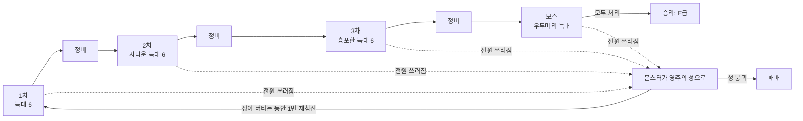

# 침공: 다리를 지켜라

**F급 메인 퀘스트는 마을 화면에서 보는 방어전입니다. 늑대가 3차례 + 보스로 마을 왼쪽 다리를 건너오고, 모험가 전원이 막습니다.** 막으면 E급으로 승급합니다.

| 항목 | 규칙 |
| --- | --- |
| 참가 | 살아 있는 모험가 전원 (의뢰 중 · 부상 중 제외) |
| 정비 창 | 차례 사이에 물약 구매: 1개 20G, 한 사람 3개까지 |
| 쓰러짐 | 기본은 기절(침공 뒤 부상), 사망은 아주 낮은 확률 |
| 역전 수단 | 영주의 성이 버티는 동안 쓰러진 모험가가 1번 다시 일어남 |
| 승리 | E급 · 관리소 해금 · 1,000G · 명성 +10 |
| 패배 | 인구 −10% · 신뢰도 −5 · 4주 뒤 재도전 |

## 허들의 크기

- 설계 목표는 "빠르게 하면 1년 안에, 그래도 어느 정도 허들은 있게"입니다.
- 받자마자 도전하면 두 번에 한 번은 지도록 맞췄습니다. 몇 주 더 키우고 식사 · 물약을 준비하는 것이 허들입니다.
- 100판 측정: 등장 중앙 31주, 승급 중앙 39주.
- 침공 정비 창 물약은 장부에 "침공 대비 물약"으로 잡힙니다.
