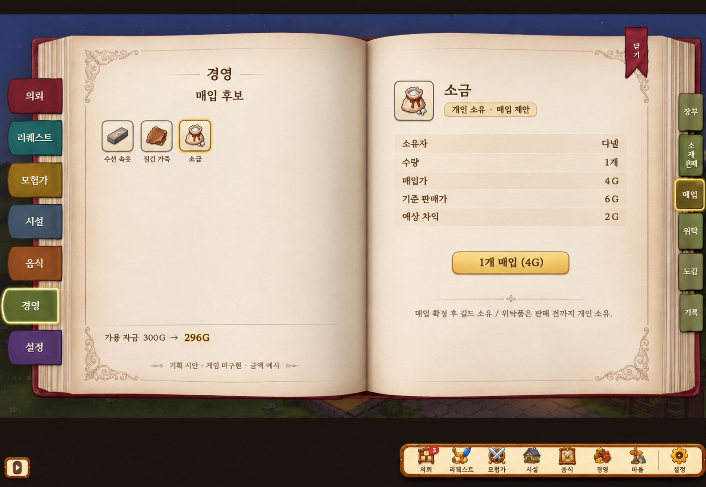
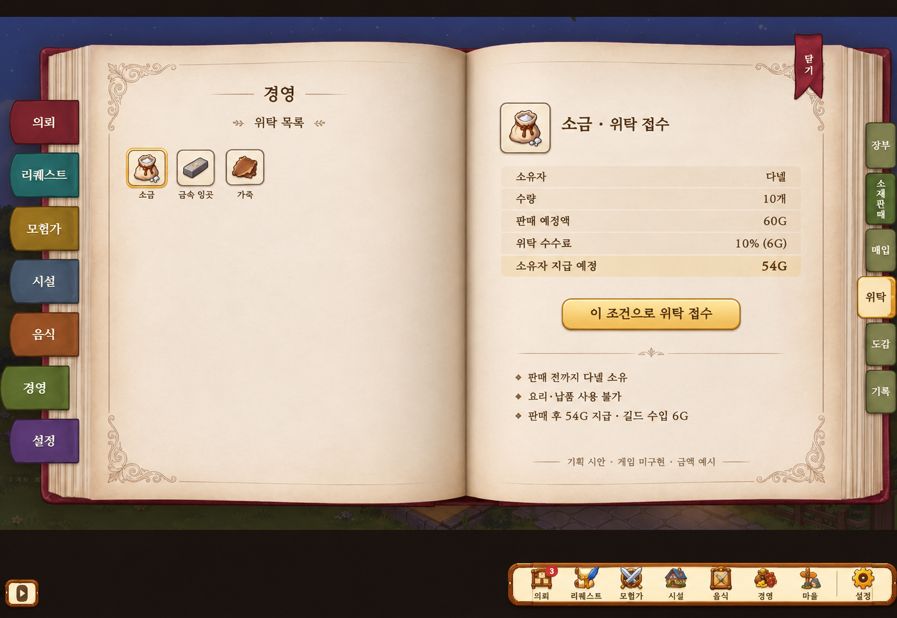

# 물약과 소재

**물약은 모험가가 출발 전에 사서 들고 가고, 소재는 의뢰에서 얻어 소유자 동의에 따라 길드 창구에서 거래합니다 [제안].**

## 물약

| 항목 | 규칙 |
| --- | --- |
| 가격 | F 20 · E 30 · D 40 · C 80 · B 100 · A 130 · S 250G |
| 회복량 | 최대 체력의 30%(F) ~ 70%(S) |
| 들고 가는 수 | 소비 성향: 절약 1 · 보통 2 · 낭비 3 |
| 쓰는 때 | 체력이 후퇴선(신중 50% · 보통 30% · 무모 10%) 아래 |
| 순서 | 출발 때 식사 → 물약 구매 |

## 소재

| 항목 | 내용 |
| --- | --- |
| 종류 | 장비 제작용 35종(의뢰 등급 7 × 유형 5) + 복원 재료 + 음식 소재(F · E 9종) |
| 판매가 | F 6 · E 9 · D 12 · C 30 · B 36 · A 48 · S 90G |
| 쓰는 곳 | 소재 판매 창구에서 팖, 대장간 제작 · 강화, 리퀘스트 납품, 요리 |

> **지금 코드에는 "소재 자동 차익"(의뢰 성공 때 보상의 8%가 저절로 길드 수입)이 남아 있습니다.** 설계상으로는 없애고 직접 판매만 남기기로 했지만 아직 정리하지 않았습니다. 첫해 월 평균 55G로 운영 수입의 약 9%입니다([9장](../ch09/issues.md)).

## 소재 소유·지원 추가 — ITEM-01 / 제안·미반영

물약 지원은 개인 잔액과 약정 한도를 확인해 실제 구입액만 분담합니다. 길드 소유 소재만 요리·제작·시설 개방·지원·납품에 쓸 수 있습니다. 실제 매입·판매·위탁 거래를 도입하면 해당 거래의 자동 차익 8%는 대체합니다. 가격·매입가·수수료·수량부터 검증하고 큰 시세 변동은 제외합니다.

| 획득 상황 | 소유자 / 제한 |
| --- | --- |
| 일반 전리품 | 개인 또는 파티 공동 소유 |
| 의뢰인 납품품 | 의뢰 조건에 따라 인도. 판매 불가 |
| 길드 발주 납품품 | 보수 지급·인도 완료 후 길드 |
| 매입 / 자발적 기증 | 거래·기증 확정 후 길드 |
| 위탁품 | 판매 전까지 원소유자. 요리·제작·납품 사용 불가 |
| 길드 투자 탐사 | 출발 전 합의한 지분 |
| 기존 저장 재고 | 기존 길드 보유분 보존. 원가 미상은 별도 표시 |

## 기존 소재 판매 + 매입·위탁 우측 탭

[큰 이미지 보기](../assets/ui/purchase-tabs.png) · **기획 시안 / 미구현 / 거래 금액 예시**

기존 소재 판매의 격자 목록·선택 상세·1개 팔기·전부 팔기를 유지합니다. 우측 탭은 **장부 / 소재 판매 / 매입 / 위탁 / 도감 / 기록**. 매입은 후보 소유자·매입가, 위탁은 소유자·수량·수수료·지급 예정액을 표시합니다. 그림의 소금 4G→6G는 소액 거래 예시이며 아래 70G→100G는 별도 계산 예시입니다.

| 거래 예시 | 모험가 지급 | 길드 현금 | 길드 거래 이익 |
| --- | ---: | --- | ---: |
| 70G 매입 → 100G 판매 | 매입 때 70G | −70G → +100G | 30G |
| 100G 위탁, 10% 수수료 | 판매 때 90G | 수수료 10G만 귀속 | 10G |

- 매출 100G와 차익 30G를 둘 다 수입에 합치지 않습니다.
- 공동 전리품은 지분을 기록해 판매대금을 배분합니다.
- 매입 예산·보관 한도·최소 예비금을 둡니다. 현금이 부족하면 위탁 또는 외부 상인 판매.
- 정식 계약의 금전 배분은 개인 전리품 소유권을 자동 이전하지 않습니다.
- 대장간·물약 상점은 독립 경제. 길드는 납품·별도 서비스 대가만 얻습니다.

[장비 선물·대여](gear.md) · [현금과 손익](../ch09/ledger.md)
