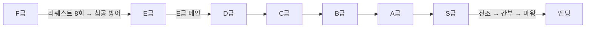

# 길드 승급

**길드는 그 등급의 메인 퀘스트를 깨면 한 등급 오릅니다(2026-11-09 결정).** 명성 · 신뢰도는 직접 조건이 아니고, 모험가 수와 의뢰 공급을 통해 간접적으로 영향을 줍니다.

## 계약 해금 — PROGRESS-01 / 제안·미반영

| 조건 | 내용 |
| --- | --- |
| E급 + 관리소 | 정식 계약 메뉴 개방 |
| 정식 0명 | F→E 포함 기존 성장·승급 가능 |
| 마왕 토벌 | 자유/정식에 따른 후보 자격 제한 없음 |

## 등급이 바꾸는 것

| 항목 | F | E | D | C | B | A | S |
| --- | --- | --- | --- | --- | --- | --- | --- |
| 모험가 수 상한 | 8 | 12 | 16 | 20 | 24 | 28 | 32 |
| 모험가 등급 상한 | E | D | C | B | A | S | S |
| 시설 건설비 | 기본 | 2,000 | 4,000 | 8,000 | 15,000 | 30,000 | — |
| 열리는 공간 | 1층 로비 | 1층 확장 | 지하 1층 | 2층 | 지하 2층 | 3층 · 옥상 | — |

- 보조금은 승급 자동 월수입 표에서 분리합니다. 반기 실적형 기존 확정안과 추가 적격 조건은 [경제](../ch09/income.md)에서 관리하며, 기존 코드는 아직 월 고정액입니다.
- 원래 설계(2026-10-20)의 승급은 "한 단계 위 보스급 의뢰 N건 → 대규모 침공 방어"였습니다. E → D 이후에 어떻게 쓸지는 아직 정하지 않았습니다.
## 명예의 전당 · S급 후보 · 다회차

| 항목 | 내용 |
| --- | --- |
| S급 후보 | A급이면서 Lv 45 이상인데, 길드 등급 상한 때문에 S급에 못 오른 모험가 |
| A → S 추가 조건 | S급 후보 2명 이상 (마왕전 고정 파티 핵심 전력) |
| 승급 순간 | 길드가 S급이 되면 후보가 자동으로 S급이 되고 명예의 전당에 이름이 새겨짐 |
| 이후 | S급에 오를 때마다 등재. 죽은 S급도 이름이 남음 |

**다회차는 "더 쉽게, 다른 엔딩을" 보게 하는 장치입니다.** 난이도는 올리지 않습니다.

| 항목 | 내용 |
| --- | --- |
| 데려올 영웅 | 지금까지 본 엔딩 수만큼 (최대 3명), 명예의 전당에서 고름 |
| 상태 | 능력치 · 스킬 · 애착 단계 유지, 초반에 등장. 등급은 길드 상한에 맞춤 |
| 사망 | 그 회차에서는 다시 오지 않음 |

- "관문 1 · 관문 2"는 밸런스 검증 단계의 이름이며 길드 승급과는 관계없습니다.
