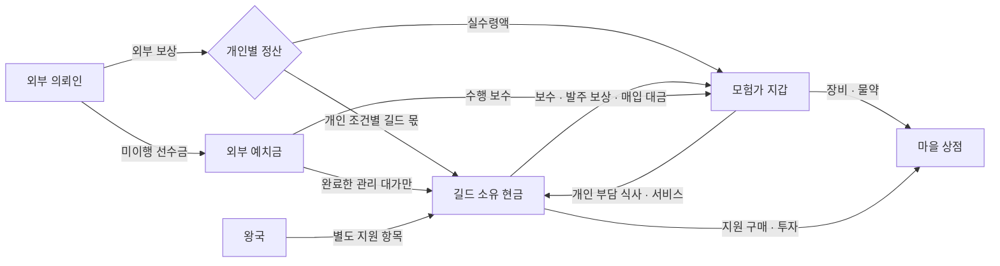

# 돈의 흐름 한눈에 보기

> **변경 · ECON-01~06 · 기획: 제안 / 게임: 미반영** 
> 근거: [첨부 8절](../proposal/section-08.md), [11절](../proposal/section-11.md)

**길드 소유 현금, 개인 지갑, 외부 예치금을 구분합니다.**

외부 보상은 총액이 길드 몫과 개인 몫의 합과 같아야 합니다. 개인 조건은 출발 시 고정해 귀환 시 정책 변경으로 바꾸지 않습니다.

길드 발주는 외부 수입이 아니라 지출입니다. 위탁금과 미이행 선수금은 사용할 수 있는 길드 돈이 아닙니다. 길드가 지원한 식사에서 내부 자금 순환만으로 이익이 생겨서는 안 됩니다.

소재 소유권 이전과 현금 거래는 [아이템 장](../ch06/ownership.md), 현금·예약액은 [장부](ledger.md)를 봅니다.
