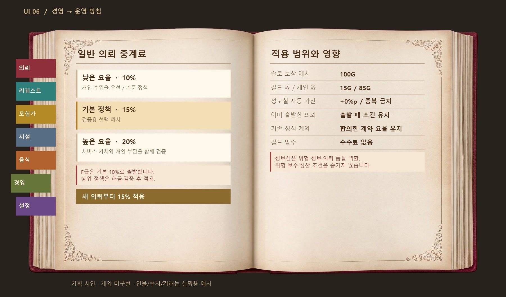

# 길드 수입

**수익은 실제 서비스와 거래에서 발생합니다. 예치금·자가 발주·내부 지원은 수입으로 만들지 않습니다.**

| 수입 | 정산 | 상태 |
| --- | --- | --- |
| 외부 의뢰 길드 몫 | 참가자 개인 기준액 × 일반/계약 요율 | 제안 / 미반영 |
| 매입 판매 | 판매액 − 해당 매입원가 | 제안 / 미반영 |
| 위탁 판매 | 판매대금 중 수수료만 귀속 | 제안 / 미반영 |
| 시설 운영 | 실제 결제 − 직접 원가, 지원 부담 분리 | 제안 / 미반영 |
| 장기 사업 | 이행한 관리 대가. 수행자 보수와 분리 | 후속 제안 |
| 보조금 | 반기 적격 외부 실적, 지원 수입 별도 | 기존 확정 + 추가 제안 / 코드 차이 |
| 리퀘스트·메인 | 실제 금화만 별도 수입. 시설·인구는 매출 아님 | 유지 + 정산 제안 |

## 일반 중계료 정책 — ECON-03 / 제안·미반영

[큰 이미지 보기](../assets/ui/policy.jpg) · **기획 시안 / 요율 검증용**

| 항목 | v2 규칙 |
| --- | --- |
| F급 출발점 | 기본 10% 유지 |
| 정책 단계 | 10 / 15 / 20% [검증용], 해금·서비스 조건 검토 |
| 높은 요율의 대가 | 개인 구매력·수주·관계 영향 |
| 정보실 | 자동 +2%p 대신 정보·의뢰 품질·계약 기회 역할 |
| 새 정책 | 새 의뢰 조건에 반영, 출발 시 확정 |
| 진행 중 의뢰 | 출발 조건 유지 |
| 기존 정식 계약 | 갱신 전까지 합의 요율 유지 |
| 위험 의뢰 | 외부 위험 보수·관리 대가 명시, 이중 수수료 금지 |

기본 위험 고지·안전 정보는 서비스에 포함합니다. 추가 지도·희귀 탐사 정보만 선택 서비스로 다룹니다.

## 보조금 — ECON-05

| 구분 | 규칙 / 상태 |
| --- | --- |
| 기존 확정 기획 | 반기 성공 의뢰 실적 × 기준 보조금(보상 기준 80%) |
| 기존 코드 기록 | 월 고정액 지급. 반기형 미반영 |
| 새 적격 조건 [제안] | 외부 의뢰 실제 성공, 의뢰 ID·평가 기간별 1회 |
| 제외 [제안] | 길드 자가 발주, 별도 지원 없는 장기 계약의 중복 실적 |
| 보상 ×2·개인 요율 | 보조금까지 자동 증액하지 않음 |
| 검증 | 보조금 단독 → 계약 단독 → 결합. 80% 적정성 재검증 |

시작 자금·시설비를 임의로 올리지 않습니다. [초기 예산](spending.md) · [개인별 정산](adventurer.md)
