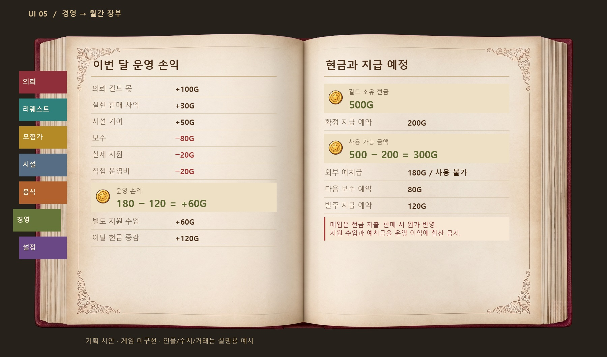

# 장부와 관문 1

**현금 증감·운영 손익·사용 가능 금액을 각각 보여 줍니다.**

## 월간 장부 — ECON-06 · UI-01 / 제안·미반영

[큰 이미지 보기](../assets/ui/ledger.jpg) · **기획 시안 / 미구현 / 수치 예시**

| 숫자 | 포함하는 것 | 제외·구별 |
| --- | --- | --- |
| 현금 증감 | 실제 길드 현금 유입·유출, 건설·매입 포함 | 외부 소유 예치금 |
| 운영 손익 | 수수료·실현 차익·시설·이행 대가 − 보수·실비·직접비 | 지원·일회성 수입 별도 |
| 사용 가능 금액 | 길드 소유 현금 − 확정 지급 예약 | 위탁금·미이행 선수금 사용 불가 |
| 원가 미상 재고 | 기존 재고 표식 | 가짜 정밀 이익 산출 금지 |

기존 ‘건설비 포함 화면 순이익’과 ‘건설비 제외 관문 지표’는 새 운영 손익과 다릅니다. 전환기에는 기존 지표도 함께 기록합니다.

## 정산 검증 — 향후 구현 시험, 아직 미실행

| 시험 묶음 | 통과 조건 |
| --- | --- |
| 일반·혼성·101G/3명 | 총액 보존, 정수 잔액 재현 가능 |
| 출발 후 요율·계약 변경 | 출발 조건 유지 |
| 길드 발주·취소·반복 납품 | 지급·인도 1회, 자가 수수료·보조금·무한 성장 없음 |
| 위탁품·매입 재판매 | 타인 물품 사용 불가, 원가·매출 중복 없음 |
| 식사·술·지원 물약 | 잔액 검사, 부담 합계=가격, 내부 지원으로 이익 생성 없음 |
| 월중 영입·종료·부상·사망 | 근무분·기본 보수·유족 정산 일치 |
| 호위·침공·귀환 주 지명 | 중복 배치 없음, 기존 귀환 예외 보존 |
| 저장·재정산·상담 재클릭 | 거래·급여 중복 없음, 동일 조건 무한 재추첨 없음 |
| 기존 저장·창립·정식 인원 | 소급 급여·강제 고용 없음, 재고·상주 혜택·정원 보존 |
| 정식 0명 | 기존 F→E 진행 가능 |

## 비교 실험

| 범위 | 비교할 정책 | 측정 |
| --- | --- | --- |
| 첫 48주 | 기존 / 보조금 단독 / 계약 단독 / 결합 | 현금 저점·순이익·성공률·승급 |
| 동일 E급 진입 +96주 | 정식 0 / 핵심 1~2 / 최대 계약 | 가용성·보수·유휴 비용 |
| 요율·지원 | 고요율·저지원 / 저요율·고지원 | 개인 구매력·수주·성장·재정 |

기준 커밋·초기 설정을 함께 기록합니다. 후반 미구현 효과는 임의로 넣지 않습니다. [v1 과거 측정](measure.md)은 비교 기준일 뿐 v2의 통과 결과가 아닙니다.
