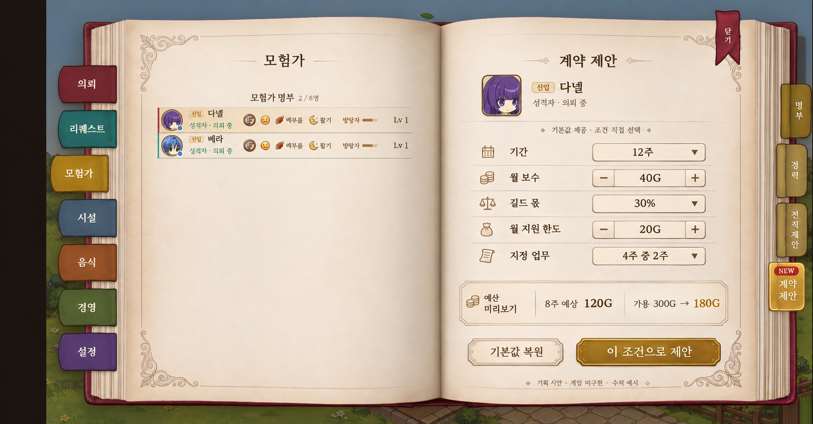

# 길드 업무 일지(책 UI)

**모든 운영 화면은 펼친 책 한 권에 담겨 있고, 왼쪽 책갈피 7장으로 넘깁니다(2026-11-13).** 책을 펼치면 시간이 멈추고 HUD가 숨습니다.

| 책갈피 | 담긴 화면 |
| --- | --- |
| 의뢰 | 게시판, 의뢰 배분, 의뢰 카드 |
| 리퀘스트 | 부탁 목록, 지명 창, 메인 퀘스트 카드, 힌트 카드 |
| 모험가 | 명부, 상세, 전직 제안 |
| 시설 | 시설 카드, 장식 · 테이블 |
| 음식 | 메뉴판, 소재 보관함, 조리대 |
| 경영 | 장부, 소재 판매, 도감, 길드 기록, 길드 승급 칸 |
| 설정 | 소리, 화면, 저장 |

## 장별 화면

| 장 | 핵심 화면 요소 |
| --- | --- |
| 의뢰 | 등급마다 막대 3개(없음 · 적게 · 보통 · 우선)로 배분. 의뢰 카드(약 210×72px, 한 줄 5장)에 해골 위험도 · ▲▼ 개체 표시. 마우스를 올리면 상세 창 |
| 리퀘스트 | 의뢰인 대사창(초상 · 이름표), 지명 창(모험가별 수락 확률 · 섭외비 · "이번 주 귀환"), 계절이 지난 부탁은 잠긴 카드로 남음 |
| 모험가 | 명부 줄(등급 배지 · 이름 · 직업 · 상태), 능력치 10칸 막대, 장비 · 물약 · 소지금, 파티 색, 성향 쪽지 |
| 전직 제안 | 왼쪽 제안 목록 / 오른쪽 상세. 조건 10칸 + 목표선 + ✓/✕, 성장 변화(초록/빨강), 스킬 진화 미리 보기, 금색 "○○로 전직 승인" 버튼 |
| 시설 | 한 줄 = [등급] [이름] [효과] [운영 또는 금액]. 운영 중 → 지을 수 있음 → 잠김 순서. 지을 돈이 있으면 금빛 테두리 |
| 음식 | 소재 보관함(모르는 소재는 실루엣), 조리대 3칸 + "만들어 보기", 큰 솥 연출(퐁당 → 젓기 → 성공/검은 연기), 리나 힌트 토스트 |
| 경영 · 장부 | 지난달 / 이번 달 두 열, 수입(초록 띠) · 지출(빨간 띠) · 순이익, 항목에 마우스를 올리면 내역 |
| 경영 · 기록 | 월 카드(머리 = 그 달 결산) + 줄마다 아이콘 12종 · 주차 · 글. 필터 전체 · 의뢰 · 모험가 · 길드 · 중요 |
| 경영 · 도감 | 몬스터 · 소재 · 아이템 · 직업 · 요리 · 장비 탭, 모든 항목을 아이콘 칸으로 (모르는 것은 실루엣) |
| 경영 · 승급 칸 | 리퀘스트 N / 8 막대, 메인 퀘스트 상태(전갈 대기 · 받을 수 있음 · 침공까지 N주) |
| 설정 | 소리(전체 · 배경음악 · 효과음 · 음소거), 화면 효과, 저장 칸 3개(날짜 · 등급 · 금고 · 모험가 수) |

## 공통 규칙

- 공통 부품: 등급 배지 · 10칸 막대 · 아이콘 칸 · 마우스 오버 창.
- 보이는 수치는 모두 정수입니다. 확률은 숫자 대신 문장으로 보여 주는 경우가 많습니다(예: 성향 "늘 신중하게 의뢰를 고릅니다").
- 책 배치는 조절 도구(`prototype/tools/book_layout_editor.html`)로 맞춥니다.

## 기존 화면에 추가하는 탭 — UI-01 / 제안·미반영

기존 목록·상세·힌트·승급 칸과 공통 부품을 유지하고, 아래 탭을 추가합니다. 장부의 표시 지표만 현금·손익·가용액으로 구분합니다.

**펼친 책과 7개 책갈피를 유지합니다. 새 정보는 기존 목록·상세·경영 화면 안에 넣습니다.**

| 책갈피 | v2 구성 |
| --- | --- |
| 의뢰 | 기존 자동 게시판 유지 · 우측 의뢰 관리(중개 요율) |
| 리퀘스트 | 기존 부탁 목록 · 우측 길드 발주 / 외부 의뢰 · 지명·예약 |
| 모험가 | 기존 명부 / 경력 / 전직제안 유지 · 그 아래 계약제안 탭 |
| 시설 | 시설 · 집무실 계약 관리 · 장식/테이블 |
| 음식 | 메뉴 · 조리대 · 지원 부담·소유권 |
| 경영 | 기존 장부 / 소재 판매 / 도감 / 기록 유지 · 우측 매입 / 위탁 추가 |
| 설정 | 소리 · 화면 · 저장 |

## 화면 예시 — UI-01 / 제안·미반영

| 시안 | 기존 동선 | 설계 확인점 |
| --- | --- | --- |
| [UI 01 계약](../ch03/lifecycle.md) | 모험가 → 우측 계약제안 | 소속/애착/거주, 기간·급여·지원, 계약 후 가용액 |
| [UI 02 발주](../ch04/requests.md) | 리퀘스트 → 우측 길드 발주 | 지급자·보수·예산 예약·자가 실적 제외 |
| [UI 03 지명](../ch04/nomination.md) | 리퀘스트 → 지명 | 자유 수락·비용 / 계약 모험가 가용 조건·예약 |
| [UI 04 거래](../ch06/potion.md) | 경영 → 우측 매입 / 위탁 | 소유자·매입원가·위탁·사용 제한 |
| [UI 05 장부](../ch09/ledger.md) | 경영 → 장부 | 현금·운영 손익·가용액·예치금 |
| [UI 06 의뢰 관리](../ch04/board.md) | 의뢰 → 우측 의뢰 관리 | 정책 단계·적용 시점·기존 계약 보호 |

[큰 이미지 보기](../assets/ui/contract-tabs.png) · 이미지의 인물·금액은 설명용. 실제 게임 화면이 아닙니다.

첨부한 실제 게임 화면을 기준으로 계약·발주·요율·매입·위탁 시안을 수정했습니다. 계약 조건은 기본값에서 유저가 직접 선택합니다. 새 PNG 5개는 imagegen으로 제작한 기획 예시이며, 실제 조작 화면이 아닙니다.

## 공통 배치

| 영역 | 기준 |
| --- | --- |
| 펼침면 | 기존 1600×879 종이·문양. 접힘선과 모서리 비움 |
| 왼쪽 | 대상 목록·필터·현황 |
| 오른쪽 | 선택 대상 조건·비용·결과·행동 |
| 책갈피 | 기존 의뢰/리퀘스트/모험가/시설/음식/경영/설정 색 유지 |
| 수치 | 정수 G, 기간은 주. 세부 계산은 펼쳐 보기 |
| 상태 | 선택 가능·불가 이유를 문장으로 표시 |
| 조작 | 책을 열면 시간 정지·HUD 숨김 유지 |

## 계약·장부의 메시지

| 상황 | 보여 줄 문구 |
| --- | --- |
| 자금 | “이 계약 뒤 사용 가능한 돈은 180G입니다.” |
| 위탁품 | “타인 소유 물품입니다. 요리·납품에 쓸 수 없습니다.” |
| 예약 충돌 | “외부 호위와 방어 대기가 겹칩니다.” |
| 요율 변경 | “새 의뢰부터 적용합니다. 진행 중 보상은 유지됩니다.” |
| 금고 적자 | “금고가 적자입니다. 0G 이상이 될 때까지 새 계약 · 건설 · 지명을 할 수 없습니다.” (결정 2026-11-17) |

## 재사용한 리소스

| 자산·기준 | 사용 |
| --- | --- |
| `prototype/assets/ui/book/book_spread.png` | 실제 펼친 책 배경 |
| `prototype/js/ui.js`의 BOOK 색 | 7개 책갈피 |
| `prototype/assets/chr/chr_*_front.png` | 전사·성직자·궁수 명부 |
| `prototype/assets/ui/hud/icon_coin.png` | 금액 카드 |
| `prototype/assets/icons/mat_x021.png` | 거래 물품 표시용 예시 |
| `prototype/css/book.css`, `docs/design/popup_*.md` | 좌우 구성·장부·목록/상세 원칙 |

기존 JPG 예시는 맑은 고딕으로 제작했고, 새 PNG 예시는 첨부 화면의 서체·탭 배치를 참고했습니다. 실제 구현은 기존 MaruBuri·공통 UI 부품에 맞춥니다.