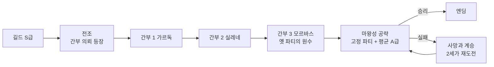

# 엔딩 · 마왕 · 간부

**길드가 S급이 되면 마왕의 전조가 시작되고, 간부 3명을 거쳐 고정 파티가 마왕을 토벌하면 엔딩입니다.** 실패하면 사망과 계승 뒤 2세가 다시 도전합니다.

| 항목 | 내용 |
| --- | --- |
| 마왕 | 녹투스. 봉인을 덜 푼 채 무리하게 나섬. 지더라도 깊은 상처를 입고 물러남 |
| 마왕 전투력 [가안] | 마왕전 때 마을 단계로 정함: 읍 이하 100% · 도시 85% · 성채 도시 70% |
| 필수 간부 | 3명, 순서대로. 마지막이 옛 파티를 죽인 원수 |
| 선택 간부 | 1명(베르크). 히든 서브로 열림, 보상은 옛 용사의 방패 |
| 마왕전 자격 | 고정 파티(친밀도 100) + 평균 A급 이상. 파티가 스스로 수주 |
| 연출 | 침공과 같은 탑뷰 지켜보기. 마왕군 웨이브 → 마왕 |

**마을 단계가 마왕의 힘을 깎습니다.** 인구를 키운 길드일수록 마왕전이 쉬워져, 마을 경영이 엔딩까지 이어집니다.

## 멀티엔딩 (플래그 누적형)

메인 16개의 큰 흐름은 같고, 분기점 4곳의 선택이 쌓여 마왕전 뒤 엔딩이 갈립니다. 분량은 메인 16 + 변형 장면 약 10 + 엔딩 3입니다.

| 엔딩 | 내용 | 범위 |
| --- | --- | --- |
| 1. 토벌 | 마왕을 토벌. 마왕이 세상 마력의 근원이라 마력이 사라지고 새 시대로 | 프로토타입 목표 |
| 2. 재봉인 | 마왕이 마력의 근원임을 알고, 세상이 너무 크게 바뀌지 않게 다시 봉인 | 이후 확장 |
| 3. 계승 | 지친 마왕이 자리를 물려줌 (간부들이 독자적으로 움직였다는 방향) | 이후 확장 |

**마력 복선:** A급 전후 메인에서 "다른 마을의 봉인이 깨질 때마다 마력이 들끓었다"는 소식을 흘립니다. 1번 루트에서는 복선, 2번 루트에서는 진실의 단서입니다.

## 전생자: 구제용 합류 모험가 [가안]

| 항목 | 내용 |
| --- | --- |
| 등장 | 15년 차가 시작될 때 마왕을 토벌하지 못했으면 |
| 이름 | 한도윤. 다른 세계에서 온 사람, 고유 전설 직업 "전생자" |
| 능력치 | 3차 직업 수준(총합 약 300). 혼자서는 마왕을 이길 수 없음 |
| 등급 | 길드 등급 +2 |
| 파티 | 친밀도 조건 없이 기존 고정 파티에 바로 합류 |
| 사망 | 다시 오지 않고 2세도 없음 |
| 엔딩 | 참가한 채 토벌하면 에필로그에 "이방인의 도움" |

가칭 제목 「이세계 모험가 길드」의 "이세계"와 이어지는 인물입니다.
