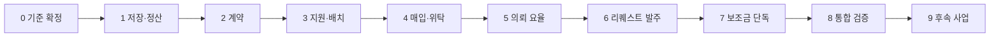

# 개발 순서와 완료 기준

**기존 플레이를 보존하는 기반부터 만들고, 계약 → 거래 → 발주 → 통합 검증 순서로 확장합니다.** 아래는 개발 계획이며 신규 게임 기능은 아직 미구현입니다. 문서·UI 시안 작성 완료와 게임 개발 완료를 구분합니다.

| 순서 | 단계 | 결과물 | 다음 단계로 넘어가는 조건 |
| --- | --- | --- | --- |
| 0 | 현재 코드·미결 확인 / P0 | 기준 커밋·수치·결정표 | 과거 기록과 현행 코드 차이 분리 |
| 1 | 저장·정산 기반 / P0 | 소속·소유·예약·거래 기록 | 저장 재실행·정산 중복 없음 |
| 2 | 계약 / P1 | 계약제안 탭·조건 선택·체결 | F급·집무실·정원 1명·예산·후보 검사 |
| 3 | 지원·배치 / P1 | 주별 보수·지원·업무 예약·종료 | 혼성 정산·부상·금고 마이너스·사망 검증 |
| 4 | 소재 거래 / P2 | 기존 판매 + 매입·위탁 탭 | 소유권·원가·실제 현금 일치 |
| 5 | 자동 의뢰 관리 / P2 | 우측 요율 설정 | 진행 중 의뢰·기존 계약 보호 |
| 6 | 리퀘스트 발주 / P2 | 길드 발주·외부 의뢰 탭 | 예산 예약·완료 지급 각각 1회 |
| 7 | 보조금 단독 시험 | 반기형·적격 실적 집계 | 기존/단독/결합 정책별 비교 가능 |
| 8 | 통합 검증·문서 갱신 | F급48주·E급+96주 결과 | 저장·UI·경제 완료 기준 충족 |
| 9 | 후속 사업 / P3~P4 | 호위·장기 계약 등 | 최소판 검증 후 별도 설계 확정 |

## 진행 규칙

- 단계마다 **실패 사례 작성 → 규칙 구현 → 시뮬레이터 동기화 → UI 연결 → 검증·커밋** 순으로 완료합니다.
- 기본값·해금·급여·요율은 검증용입니다. 숫자 확정 없이 임의의 상수를 코드에 흩어 넣지 않습니다.
- 상태는 `계획 → 설계 확정 → 구현 중 → 검증 완료`로 기록합니다. 검증 완료에는 코드 커밋·검증 명령·결과가 필요합니다.
- 기존 V1은 역사적 원본입니다. 최신 main 변경은 V2의 현행 기준·결정 이력에 반영하며 원본을 소급 수정하지 않습니다.

| 관련 문서 | 용도 |
| --- | --- |
| [기반 작업](foundation.md) | 현재 main과 설계 차이, 저장·정산 계약 |
| [계약 작업](contracts.md) | 제안 UI부터 급여·종료까지 |
| [운영 작업](operations.md) | 소재 거래·자동 의뢰·리퀘스트 분리 |
| [검증 작업](validation.md) | 실적 보조금·48주/96주 검증 |
| [후속 범위](later.md) | 장기 사업과 최소판 제외 |

기획 근거: [적용 범위](../ch01/scope.md) · [검증 항목](../ch09/ledger.md) · [결정 대기](../appendix/pending.md). 공개 배포는 이 개발 계획의 완료 조건에 포함하지 않습니다.
