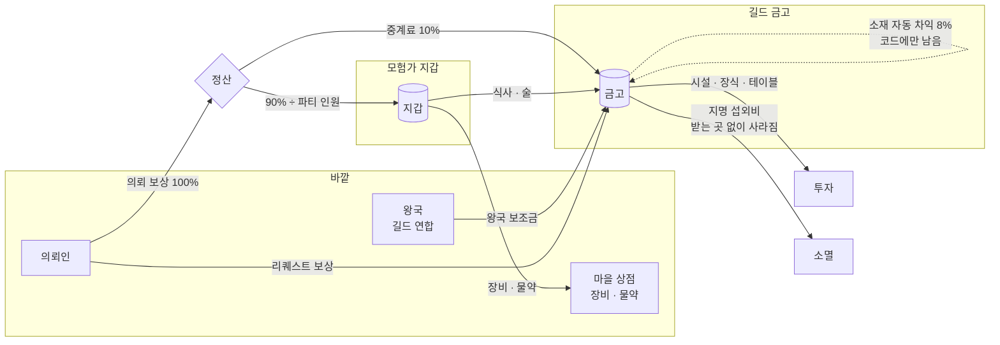
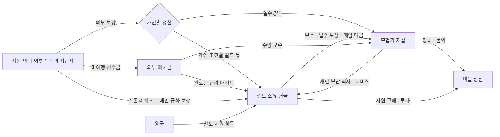
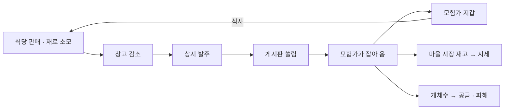

# 돈의 흐름 한눈에 보기

> 아래는 V1의 기존 자동 제공 의뢰와 경제 흐름입니다. 월 고정 보조금·자동 차익 등 코드 기록도 보존하며, V2 추가·교체 항목은 뒤에서 구분합니다. 보존한 V1 문장의 "중계료"는 지금 용어로 **수수료**입니다(결정 21).

**돈 주머니는 "길드 금고"와 "모험가 지갑" 두 개입니다.** 의뢰 보상은 의뢰인이 내고, 길드는 그중 10%(중계료)만 가져갑니다. 나머지 90%는 모험가 지갑으로 가서 장비 · 물약 · 식사에 쓰입니다.

## 읽는 법

- **길드가 직접 버는 돈:** 중계료, 식사 · 술 마진, 소재 판매, 리퀘스트 보상.
- **길드가 받는 돈:** 왕국 보조금. 의뢰 실적과 거의 무관하게 들어옵니다(지금 코드).
- **모험가가 쓰는 돈 중 길드로 돌아오는 것:** 식사 · 술뿐입니다. 장비 · 물약은 마을 상점으로 빠집니다.
- **섭외비**는 금고에서 빠져나가고 누구에게도 가지 않습니다(지금 코드). 모험가 지갑에 들어가지 않습니다.

## 설계 의도

1. 길드와 모험가의 돈을 나눈 것은 "모험가는 스스로 판단한다"는 원칙 때문입니다. 장비를 사는 것도 모험가입니다.
2. 길드는 모험가를 "부자로 만들어" 식당 · 주점에서 다시 쓰게 하는 구조를 의도했지만, 지금 측정에서 주점 매출은 월 4G로 거의 작동하지 않습니다.

## V2 추가 흐름 — 기존 자동 의뢰 유지

| 흐름 | 처리 | 메뉴 |
| --- | --- | --- |
| 자동 제공 일반 의뢰 | 기존 월 5건·자율 수주 유지. 기본 10%, 선택 수수료·개인 계약 정산 추가 | 의뢰 → 의뢰 관리 |
| 기존 리퀘스트·메인 보상 | 기존 해결·보상 흐름 유지 | 리퀘스트 |
| 추가 외부 의뢰 | 의뢰인 지급·수행자 보수·길드 대가를 조건별 표시 | 리퀘스트 → 외부 의뢰 |
| 길드 발주 | 길드 예산 지출. 수수료·자가 보조금 없음 | 리퀘스트 → 길드 발주 |
| 매입·위탁 | 기존 소재 판매에 거래 경로 추가. 실제 거래의 자동 차익은 대체 | 경영 → 매입·위탁 |

> **변경 · ECON-01~06 · 기획: 제안 / 게임: 미반영** 
> 근거: [개인별 정산](adventurer.md), [지출과 예산](spending.md)

**길드 소유 현금, 개인 지갑, 외부 예치금을 구분합니다.**

외부 보상은 총액이 길드 몫과 개인 몫의 합과 같아야 합니다. 개인 조건은 출발 시 고정해 귀환 시 정책 변경으로 바꾸지 않습니다.

길드 발주는 외부 수입이 아니라 지출입니다. 위탁금과 미이행 선수금은 사용할 수 있는 길드 돈이 아닙니다. 길드가 지원한 식사에서 내부 자금 순환만으로 이익이 생겨서는 안 됩니다.

소재 소유권 이전과 현금 거래는 [아이템 장](../ch06/potion.md), 현금·예약액은 [장부](ledger.md)를 봅니다.

## V4 변경 — 닫힌 순환

> **V4 변경 · 결정 36 (2026-11-19) · 기획: 제안 / 게임: 미반영** — [소재 시장과 식당 순환](market.md)

V3의 "모험가가 쓰는 돈 중 길드로 돌아오는 것은 식사 · 술뿐" 구조에, 식당 재료가 다시 모험가 수입이 되는 고리를 더합니다.
