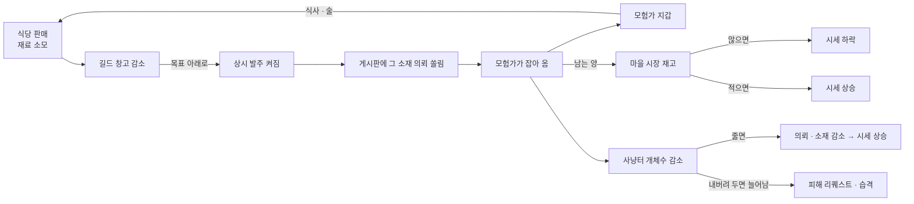

# 소재 시장과 식당 순환 (V4)

> **V4 변경 · 결정 36~46 (2026-11-19) · 기획: 방향 · 규칙 결정, 수치 [임시] / 게임: 1~3단계 반영(브랜치 `feature/market-stage1`, PR #9 · main 미병합)** 
> 원본 제안서: `docs/design/proposal_market_v1.md`

**V4는 소재가 "무한히 나오고 무한히 팔리는" 구조를 닫힌 시장으로 바꿉니다.** 결정 36으로 V2 적용 범위의 "완전한 시세 경제 제외"를 뒤집었습니다. 식당이 재료를 쓰고, 재료가 모자라면 발주가 다시 켜지고, 모험가가 가져온 양과 사냥터 개체수에 따라 소재 값이 움직입니다.

## 왜 바꾸나

| 지금 (V3, 코드 확인) | 문제 |
| --- | --- |
| 귀환 때 판매가 70%로 무조건 자동 매입, 판매 창구는 고정가로 무제한 | 70% 매입 → 100% 판매 = 30% 보장 차익. 같은 의뢰를 반복하면 끝없이 이득 |
| 식당은 요리를 발견한 뒤 소재 없이 판매 (의뢰 보상 25% · 마진 60% 고정) | 음식 소재 9종이 발견 뒤 창고에 쌓임. 가격 판단이 없음 |
| 길드 발주는 N개 모으면 끝 | 다시 발주할 이유가 없어 연계 의뢰가 이어지지 않음 |
| 수수료 10 · 15 · 20% | 늦추기만 가능. 빨리 처리하는 선택이 없음 |
| 위탁은 금고가 모자랄 때만 자동 | 플레이어 결정이 없는 장치 |

측정(2026-11-18, 100판 · 48주): 소재 월 16.2개 · 매입 65G · 판매 12G · 식사 약 5그릇 · 48주 금고 중앙 2,646G.

## 목표 순환

## 바뀌는 규칙 7가지

| # | 규칙 | 핵심 [모두 임시] | 단계 |
| --- | --- | --- | --- |
| 1 | 식당 재료 소모 (결정 37) | 레시피 재료 1세트 = **요리마다 정한 그릇 수** (F 멧돼지 스테이크 정식 2 · 들버섯 수프 3 · 민물고기 구이 정식 2 / E 늑대 고기 스튜 3 · 산딸기 파이 4 · 숲 버섯 파이 4 [임시]), 재료 없으면 품절, 요리별 하루 준비량 0~10그릇 | 1 |
| 2 | 메뉴 가격 (결정 39) | 플레이어가 **1G 단위로 입력**(1G ~ 기준가 × 3). 사 먹을 확률 × 가격 계수 = 1 + 1.5 × (1 − 가격 ÷ 기준가), 0.1 ~ 1.6. 메뉴판에 원가 · 마진 표시 | 1 |
| 3 | 잡화 상인 (양념, 결정 38) | 소금 · 향신료 · 신선한 물 · 밀가루는 시세 × 1.5로 언제든 구매. 고기 · 버섯 · 생선 · 열매는 의뢰로만 | 1 |
| 4 | 상시 발주 (결정 41) | 소재별 목표 창고 재고. 아래로 떨어질 때마다 자동으로 켜짐. 1개 값 = 시세 × 1.2 · 1.5 · 2.0, 들어올 때 지급, 동시 3건 | 1 |
| 5 | 수수료 5% (결정 42) | 5 · 10 · 15 · 20%. 5%는 처음부터 열리고 모험가가 먼저 맡음. 카드에 예상 처리 주 | 1 |
| 6 | 소재 시세 (결정 40) | 마을 시장 재고 M, 시세 배수 = 1 + 0.6 × (목표 − M) ÷ 목표 (0.5 ~ 2.0배). 마을 소비 = 주마다 M × 10% + 인구 ÷ 100. 매입 = 시세 × 70%, 판매 창구 = 시세(팔수록 내려감) | 2 |
| 7 | 소재 처리 선택 · 개체수 (결정 43 · 44) | 소재마다 **매입(시세 50 · 70 · 90%) / 위탁(길드가 대신 팔고 수수료 10%) / 안 받음(모험가 직접 판매)**, 창고 상한 30 (2단계). 자원지 개체수 0~100: 1개 가져올 때 −3, 주마다 +4, 30 미만이면 의뢰 · 소재 감소, 80 넘으면 피해 리퀘스트, 화면에는 많음 · 보통 · 적음 (3단계) | 2 · 3 |

## 플레이어가 하는 일

| 손잡이 | 결과가 보이는 곳 |
| --- | --- |
| 메뉴 가격 · 준비량 | 메뉴판 마진 · 품절 표시 · 식사 판매 |
| 발주 목표 재고 · 1개 값 | 게시판 발주 표시 · 의뢰 쏠림 · 모험가 수입 |
| 수수료 5 ~ 20% | 의뢰 처리 속도(예상 주) · 길드 몫 |
| 팔 때 · 쉬게 할 사냥터 | 시세 화살표 · 개체수 막대(많음 · 보통 · 적음) |

## 어림 (규칙 값 계산, 측정 아님)

| 항목 | 어림 |
| --- | --- |
| 필요한 재료 | 월 약 5그릇 → 2.5세트 → 주재료 2.5 + 양념 2.5~5개 |
| 지금 공급 | 음식 주재료 월 4~6개, 양념은 3종 각 월 약 1개 (희귀 15%) |
| 결론 | 주재료는 남고 **양념이 모자람** → 잡화 상인이 필요 |
| 멧돼지 스테이크 정식 (2그릇) | 원가 (6 + 6) ÷ 2 = 6G, 25G에 팔면 마진 19G (지금 고정 마진 15G) |

## 앞선 경제 문제와의 연결

| 문제 ([알려진 문제](issues.md)) | V4가 하는 일 |
| --- | --- |
| 돈이 쌓임 | 재료 · 발주 · 양념이 매주 반복 지출, 인구가 늘수록 시세 상승 |
| 선택이 결과를 못 바꿈 | 메뉴 가격 · 발주 · 수수료 5~20% · 사냥터가 손익과 속도에 바로 보임 |
| 모험가 지갑 | 발주 값 · 시세 상승 · 직접 판매로 수입 증가 (장비값 맞추기는 따로) |
| 길드로 돈이 안 돌아옴 | 매입 수요 → 모험가 수입 → 식사 구매가 실제로 이어짐 |
| 보조금 의존 | 식당 마진 · 판매 타이밍이 운영 실력 수입이 됨 |
| 검증이 문제를 못 잡음 | 새 지표: 48주 금고 1,500G 이하 · 품절 주 10~30% · 발주 재가동 판당 10번+ · 시세 0.7~1.4배 80% · 개체수 끝값 발생 |

## 단계 (결정 45)

1. **1단계 순환 닫기** (규칙 1 · 2 · 3 · 4 · 5) → 100판 측정
2. **2단계 시세** (규칙 6 · 소재 처리 선택) → 측정
3. **3단계 개체수** (규칙 7 개체수 · 의뢰 레벨 연결)

9가지 결정(결정 37~45)과 추천안 대비 바뀐 점은 [부록 C](../appendix/pending.md)에 있습니다.

## 게임 반영 결과 (2026-11-19)

> **V4 게임 반영 (2026-11-19) · 브랜치 `feature/market-stage1` · PR applesoda01/Project_F#9 (main 미병합)** — 측정 `docs/balance/market_v4_stage1.md`

**1~3단계를 모두 게임과 시뮬레이터에 넣었습니다.** 구현하면서 바뀐 것과 측정 결과입니다.

### 구현하며 바뀐 것 [임시]

| 항목 | 결정 · 처음 안 | 게임에 넣은 것 | 까닭 |
| --- | --- | --- | --- |
| 양념 (결정 46) | 잡화 상인(결정 38) | **양념도 상시 발주 + 잡화 상인 유지**(시세 × 1.5). 양념 발주는 다른 소재 뽑기를 빼앗지 않고, 의뢰마다 한 번 굴리는 양념 확률(15%)만 쏠림 비율(30 · 50 · 70%)까지 올림 | 1단계 테스트 중 사용자: 향신료를 다 쓰니 발주를 못 함 |
| 상시 발주 뽑기 | 발주 중이면 뽑기마다 전부 발주 소재(결정 27) | 뽑기마다 **쏠림 비율만큼만** | 전부면 고철 등이 끊겨 대장간 · 납품이 막힘(승급 77 → 50판) |
| 발주 소재 의뢰 먼저 맡기 | 결정 26 | **끔**(`orderFirst` 0), 돈이 필요한 모험가는 발주 값으로만 끌림 | 켜면 게임 · 시뮬레이터 차이 12.8% |
| 동시 발주 | 3건(결정 41) | **6건** | 양념까지 F급 요리 재료 6종 |
| 같은 의뢰 | — | 발주 쏠림으로는 게시판에 **2장까지** | 같은 의뢰가 4장씩 쌓여 보임 |
| 식당 재료 | — | 재료마다 **2개는 남겨 둠**(`mealKeep`) | 납품 리퀘스트 재료를 식당이 다 써 버림 |
| 메뉴 가격 | 1G 단위 자유 입력(결정 39) | ±1G · ±5G 단추 | 책 화면 |
| 개체수 | +4/주, 많으면 피해 | **잡으면 −5, 로지스틱 회복 0.05**, 달마다 가장 넘친 몬스터 사냥터 한 곳만 인구 증가 −2, 길드 등급보다 높은 곳은 그대로 | 처음 값은 대부분 '많음' · 피해 판당 470주 · 장비 0% |

### 측정 (100판 · 48주)

| 지표 | V4 끔 | V4 1~3단계 |
| --- | ---: | ---: |
| 첫해 월 운영 순이익 | 459G | 433G |
| 의뢰 성공률 | 91.5% | 91.4% |
| 48주 금고 중앙 | 1,758G | **1,423G** (목표 1,500G 이하 ✅) |
| 식사 매출 (월) | 72G | 108G |
| 모험가 지갑 · 장비 1칸 이상 | 601G · 39% | 637G · 42% |
| 48주 안 E급 승급 | 77판 | 72판 |
| 품절 주: 다 팔림 / 재료 부족 | — | 11% / 16% |
| 시세 배수 (F급 소재) | 고정 | 0.6 ~ 1.5배, 평균 1.04 ~ 1.13 |
| 개체수 적음 / 보통 / 많음 | — | 4 / 92 / 4% · 피해 판당 1달 |
| 관문 1 (게임 / 시뮬) | 459 / 430G | 433 / 405G ✅ |

**남은 것:** 버린 그릇(월 9.7 중 5.0) · E급 승급 −5판 · 자동 플레이가 메뉴 가격 · 소재 처리를 바꾸지 않아 플레이어 선택의 효과는 화면 조작으로만 확인 · 개체수 '많음' 피해는 기록 알림뿐(피해 리퀘스트는 후속).
