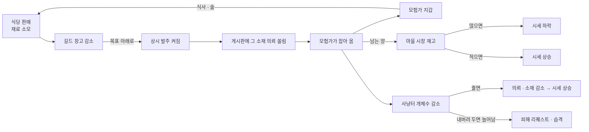

# 소재 시장과 식당 순환 (V4)

> **V4 변경 · 결정 36 (2026-11-19) · 기획: 방향 확정, 규칙 · 수치 제안 / 게임: 미반영** 
> 원본 제안서: `docs/design/proposal_market_v1.md`

**V4는 소재가 "무한히 나오고 무한히 팔리는" 구조를 닫힌 시장으로 바꿉니다.** 결정 36으로 V2 적용 범위의 "완전한 시세 경제 제외"를 뒤집었습니다. 식당이 재료를 쓰고, 재료가 모자라면 발주가 다시 켜지고, 모험가가 가져온 양과 사냥터 개체수에 따라 소재 값이 움직입니다.

## 왜 바꾸나

| 지금 (V3, 코드 확인) | 문제 |
| --- | --- |
| 귀환 때 판매가 70%로 무조건 자동 매입, 판매 창구는 고정가로 무제한 | 70% 매입 → 100% 판매 = 30% 보장 차익. 같은 의뢰를 반복하면 끝없이 이득 |
| 식당은 요리를 발견한 뒤 소재 없이 판매 (의뢰 보상 25% · 마진 60% 고정) | 음식 소재 9종이 발견 뒤 창고에 쌓임. 가격 판단이 없음 |
| 길드 발주는 N개 모으면 끝 | 다시 발주할 이유가 없어 연계 의뢰가 이어지지 않음 |
| 수수료 10 · 15 · 20% | 늦추기만 가능. 빨리 처리하는 선택이 없음 |
| 위탁은 금고가 모자랄 때만 자동 | 플레이어 결정이 없는 장치 |

측정(2026-11-18, 100판 · 48주): 소재 월 16.2개 · 매입 65G · 판매 12G · 식사 약 5그릇 · 48주 금고 중앙 2,646G.

## 목표 순환

## 바뀌는 규칙 7가지

| # | 규칙 | 핵심 [모두 임시] | 단계 |
| --- | --- | --- | --- |
| 1 | 식당 재료 소모 | 레시피 재료 1세트 = 2그릇, 재료 없으면 품절, 요리별 하루 준비량 0~10그릇 | 1 |
| 2 | 메뉴 가격 | 플레이어가 기준가(의뢰 보상 25%)의 60 · 80 · 100 · 120 · 150% 선택. 사 먹을 확률 × 1.4 · 1.2 · 1.0 · 0.7 · 0.4. 메뉴판에 원가 · 마진 표시 | 1 |
| 3 | 잡화 상인 (양념) | 소금 · 향신료 · 신선한 물 · 밀가루는 시세 × 1.5로 언제든 구매. 고기 · 버섯 · 생선 · 열매는 의뢰로만 | 1 |
| 4 | 상시 발주 | 소재별 목표 창고 재고. 아래로 떨어질 때마다 자동으로 켜짐. 1개 값 = 시세 × 1.2 · 1.5 · 2.0, 들어올 때 지급, 동시 3건 | 1 |
| 5 | 수수료 5% | 5 · 10 · 15 · 20%. 5%는 처음부터 열리고 모험가가 먼저 맡음. 카드에 예상 처리 주 | 1 |
| 6 | 소재 시세 | 마을 시장 재고 M, 시세 배수 = 1 + 0.6 × (목표 − M) ÷ 목표 (0.5 ~ 2.0배). 마을 소비 = 주마다 M × 10% + 인구 ÷ 100. 매입 = 시세 × 70%, 판매 창구 = 시세(팔수록 내려감) | 2 |
| 7 | 위탁 정리 · 개체수 | 위탁 없앰 → 모험가 직접 시장 판매, 소재별 매입 켬/끔 · 창고 상한 30 (2단계). 자원지 개체수 0~100: 1개 가져올 때 −3, 주마다 +4, 30 미만이면 의뢰 · 소재 감소, 80 넘으면 피해 리퀘스트 (3단계) | 2 · 3 |

## 플레이어가 하는 일

| 손잡이 | 결과가 보이는 곳 |
| --- | --- |
| 메뉴 가격 · 준비량 | 메뉴판 마진 · 품절 표시 · 식사 판매 |
| 발주 목표 재고 · 1개 값 | 게시판 발주 표시 · 의뢰 쏠림 · 모험가 수입 |
| 수수료 5 ~ 20% | 의뢰 처리 속도(예상 주) · 길드 몫 |
| 팔 때 · 쉬게 할 사냥터 | 시세 화살표 · 개체수 막대(많음 · 보통 · 적음) |

## 어림 (규칙 값 계산, 측정 아님)

| 항목 | 어림 |
| --- | --- |
| 필요한 재료 | 월 약 5그릇 → 2.5세트 → 주재료 2.5 + 양념 2.5~5개 |
| 지금 공급 | 음식 주재료 월 4~6개, 양념은 3종 각 월 약 1개 (희귀 15%) |
| 결론 | 주재료는 남고 **양념이 모자람** → 잡화 상인이 필요 |
| 멧돼지 스테이크 정식 | 원가 (6 + 6) ÷ 2 = 6G, 판매 25G → 마진 19G (지금 고정 마진 15G) |

## 앞선 경제 문제와의 연결

| 문제 ([알려진 문제](issues.md)) | V4가 하는 일 |
| --- | --- |
| 돈이 쌓임 | 재료 · 발주 · 양념이 매주 반복 지출, 인구가 늘수록 시세 상승 |
| 선택이 결과를 못 바꿈 | 메뉴 가격 · 발주 · 수수료 5~20% · 사냥터가 손익과 속도에 바로 보임 |
| 모험가 지갑 | 발주 값 · 시세 상승 · 직접 판매로 수입 증가 (장비값 맞추기는 따로) |
| 길드로 돈이 안 돌아옴 | 매입 수요 → 모험가 수입 → 식사 구매가 실제로 이어짐 |
| 보조금 의존 | 식당 마진 · 판매 타이밍이 운영 실력 수입이 됨 |
| 검증이 문제를 못 잡음 | 새 지표: 48주 금고 1,500G 이하 · 품절 주 10~30% · 발주 재가동 판당 10번+ · 시세 0.7~1.4배 80% · 개체수 끝값 발생 |

## 단계와 결정 대기

1. **1단계 순환 닫기** (규칙 1 · 2 · 3 · 4 · 5) → 100판 측정
2. **2단계 시세** (규칙 6 · 위탁 정리) → 측정
3. **3단계 개체수** (규칙 7 개체수 · 의뢰 레벨 연결)

정할 것 9가지(재료 소모 단위 · 양념 · 메뉴 가격 단계 · 시세 범위 · 발주 방식 · 수수료 5% · 위탁 · 개체수 표시 · 순서)는 [부록 C](../appendix/pending.md)에 있습니다.
