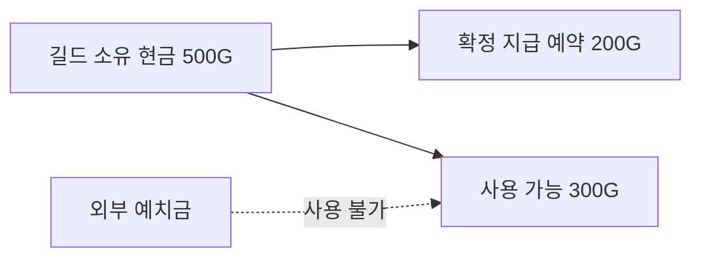

# 길드 지출

> 기존 구현·측정 기록은 2026-11-16 기준입니다. V2 신규 설계의 구현·검증 결과가 아니며, 아래 추가·수정 제안과 구분합니다.

**첫해의 돈 쓸 곳은 "장식 8종 · 테이블 · 집무실 · 관리소 · 섭외비"이고, 설비를 다 사면 8,800G(장식 3,000 · 테이블 800 · 집무실 1,000 · 관리소 2,000 · 업그레이드 2,000)입니다.** 섭외비는 별도로 연 약 1,400G가 나갑니다. 시작 금고는 500G입니다.

| 쓸 곳 | 금액 | 언제 열리나 |
| --- | ---: | --- |
| 장식 8종 | 3,000G | 리퀘스트 보상으로 하나씩 |
| 테이블 4세트 | 800G | 2세트는 처음부터, 3 · 4세트는 리퀘스트 |
| 길드 마스터 집무실 | 1,000G | 처음부터 (지명에 필요) |
| 모험가 관리소 | 2,000G | E급 승급 뒤 |
| 시설 업그레이드 4종 | 각 500G | 처음부터 |
| 지명 섭외비 | 연 약 1,400G | 지명할 때마다 |
| 리퀘스트 "돈 내기" | 퀘스트별 | 리퀘스트 |
| 침공 대비 물약 | 1개 20G | 침공 정비 창 |
| 의뢰 떼기 위약금 | 보상의 10% | 수시 |

- 시설 유지비는 없습니다(2026-11-05 삭제).
- 원래 설계의 정보 구매(100~2,000G), 길드 발주 의뢰, 선물, 강화 · 주문 제작은 프로토타입 밖입니다.
- 그중 길드 발주는 2026-11-18 선지급 모으기 방식으로 들어갔습니다([리퀘스트](../ch04/requests.md), 결정 24~27).

## 첫해 금고 (100판)

| 항목 | 값 |
| --- | ---: |
| 시작 | 500G |
| 1년 뒤 금고 | 3,409G |
| 월 평균 건설 · 투자 지출 | 325G |

**1년 뒤 3,409G가 남습니다.** 자동 플레이는 살 수 있는 것을 대부분 사고도 돈이 남는다는 뜻입니다. 설계 당시 의도(1년 뒤 "다 사면 거의 남지 않음 → 고르는 재미")와 다릅니다.

## V2 추가·수정 규칙 — 제안·미반영

**계약을 선택한 만큼 책임집니다. 예산 예약과 실제 지출을 구분합니다.**

## 지급 규칙 — ECON-02 / 제안·미반영

| 지출 | 발생·지급 기준 |
| --- | --- |
| 보수 | 근무 주수 적립 → 월말 실제 지급 1회 |
| 물약·식사·치료 지원 | 약정 한도 안의 실제 사용액만 |
| 영입금 | 도입 시 계약 성립 때 1회 |
| 길드 발주 | 발주할 때 개수 × 1개 값(판매가 × 1.5 [임시])을 금고에서 바로 냄, 거두면 남은 돈 돌려받음. 장부 '길드 발주' 줄 [결정 24 · 25] |
| 소재 매입 | 거래 때 현금 감소. 판매 시 원가 중복 차감 금지 |
| 자유 지명 | 섭외비 금액은 그대로, **부탁받은 자유 모험가 지갑으로**(거절해도 받음). 길드 지출 · 순이익은 그대로 [결정 2026-11-17] |
| 사망·해지 | 발생 보수·약정 위로금 정산 |
| 금고 마이너스 | 보수 · 지원 자동 지급만 허용. 마이너스인 동안 새 계약 · 건설 · 지명 막힘, 체납 · 유예 규칙 없음 [결정 2026-11-17] |

## 예산 예약

위 숫자는 설명용입니다. 계약 전 8주 지급 전망 확인은 없앴습니다 [결정 2026-11-17] — 계약은 금액 확인 없이 체결하고, 자동 지급(보수 · 지원)만 금고를 마이너스로 내릴 수 있습니다.

| 실수 방지 | 처리 |
| --- | --- |
| 발주 200G 게시 | 예약만 설정. 현금을 먼저 차감하지 않음 |
| 완료 지급 | 현금과 예약액을 함께 200G 감소 |
| 미수주 취소 | 예약만 해제 |
| 확정 지급 취소 | 이미 수주한 보수·발생 급여는 임의 해제 불가 |
| 외부 예치금 | 길드 소유 현금에 합치지 않음 |

## 첫 24주 보호

| 유지 | 별도 검증 |
| --- | --- |
| 시작 500G · 창립 2명 | 반기 보조금 단독 전환 |
| 시설 유지비 0 | F급 정식 계약 단독 |
| 기존 접수원 급여 소급 없음 | 매입·지원·보조금 결합 |
| 광고·보험·공제 적립 제외 | 현금 저점·집무실 건설·F→E 시점 |

자금 부족 시 1회 지원금·첫 반기 분할 지급·필수 시설 비용 조정을 비교하되 아직 확정하지 않습니다.

## V4 변경 — 매주 반복되는 지출

> **V4 변경 · 결정 36 (2026-11-19) · 기획: 제안 / 게임: 미반영** — [소재 시장과 식당 순환](market.md)

| 지출 | V3 | V4 제안 [임시] |
| --- | --- | --- |
| 소재 매입 | 판매가 70%로 무조건 자동 | 소재마다 매입(시세 50 · 70 · 90%) / 위탁 / 안 받음 (결정 43), 창고 상한 30 |
| 길드 발주 | N개 모으면 끝, 판매가 × 1.5 선지급 | **상시 발주**: 목표 재고 아래로 떨어질 때마다 자동으로 켜짐, 시세 × 1.2 · 1.5 · 2.0, 들어올 때 지급 |
| 식당 재료 | 없음 | 창고 재료 사용 + 잡화 상인 양념(시세 × 1.5) |

**한 번 사면 끝나는 설비 대신, 식당을 돌리는 한 계속 나가는 돈이 생깁니다.** 1년 뒤 금고가 많이 남는 문제(48주 중앙 2,646G)를 이 지출로 줄이는 것이 목표입니다(새 지표: 48주 금고 1,500G 이하 [임시]).
