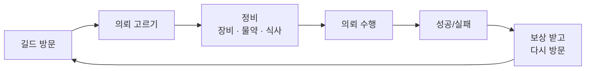

# 모험가

**모험가는 플레이어가 조작하지 못하는 자율 행동 주체입니다.** 능력치 5개 + 행운, 직업, 성향, 애착도로 정의되고, 이 조합이 "어떤 의뢰를 고르고, 돈을 어떻게 쓰고, 언제 떠나는지"를 정합니다.

모험가 한 명의 행동은 다음 순서로 반복됩니다.

- [능력치 · 레벨 · 등급](stats.md)
- [직업과 전직](jobs.md)
- [스킬과 성장 경로](skills.md)
- [성향과 애착도](personality.md)
- [합류 · 파티 · 사망과 계승](lifecycle.md)
- [모험가끼리 대화 · 몸 상태 · 칭호](talk.md)

## 새 설계 (V6) — 이 장에서 바뀌는 것

> 2026-11-26 회의를 거친 개편안입니다. **게임에는 아직 넣지 않았고 숫자는 모두 [임시]입니다.** 이 장의 다른 쪽은 지금 게임의 규칙을 적은 것이고, 아래 쪽이 새 설계입니다. 개발의 순서와 상태는 [V6 개편 개발 관리](../development/v6.md)에 있습니다.

| 새 설계 | 무엇이 바뀌나 | 지금 규칙이 적힌 쪽 |
| --- | --- | --- |
| [09 수행](training.md) | 길드가 돈을 내고 한 주 보내 고른 능력치를 올림 | [능력치 · 레벨 · 등급](stats.md) · [스킬과 성장 경로](skills.md) |
| [14 모험가의 고비](milestones.md) | 고비 레벨의 보너스 5점 · 승급 시험 · 바람 | [능력치 · 레벨 · 등급](stats.md) · [직업과 전직](jobs.md) |
| [11 애착](attachment.md) | 누구나 매주 들름 · 다섯 칸 · 부탁의 식 · 칭호 · 선물 | [성향과 애착도](personality.md) · [모험가끼리 대화 · 몸 상태 · 칭호](talk.md) |
| [12 신입 모험가](newcomers.md) | 오는 레벨 · 인구와 명성 · 찾아온 사람 | [합류 · 계약 · 파티 · 사망과 계승](lifecycle.md) |
| [13 노는 모험가](idle-adventurers.md) | 뿌리는 의뢰의 수와 크기 · 정착한 선배의 동행 | [합류 · 계약 · 파티 · 사망과 계승](lifecycle.md) |
