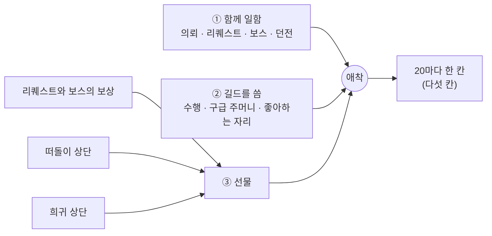

# 새 설계 11 · 애착

> **상태: 초안 (2026-11-26) · 2026-11-26 회의를 거침 / 게임: 미반영 · 이름과 숫자는 모두 [임시]**
>
> 「애착이 낮으면 길드에 잘 안 온다」는 벌을 없애고, 애착을 **보상이 열리는 길**로 바꿉니다([01 원칙](../ch01/principles.md)). 이 쪽을 쓰면서 새로 잰 것은 없습니다. 닿는 때의 숫자는 모두 옛 규칙으로 잰 값입니다.
>
> 대화 기록: 저장소의 `docs/design/세부기획_대화_2026-11-25.md` (「11 애착」 · 2026-11-26 11:23 ~ 14:25)

**이 쪽의 세 줄**

- 애착이 낮아도 벌이 없습니다. 누구나 매주 길드에 들릅니다.
- 애착 20마다 한 칸, 모두 다섯 칸입니다. 칸마다 종류가 다른 보상이 열립니다.
- 부탁은 능력이 되면 애착이 0이어도 들어줍니다. 애착은 그 위에 얹는 보탬입니다.

## 한눈에

| 걸음 | 정한 것 |
| :---: | --- |
| 1 들르기 | 누구나 매주 길드에 들름. 사는지는 [18](../ch09/purchase-judgment.md)의 사는 판단이 정함 |
| 2 다섯 칸 | 애착 20마다 한 칸. 칸마다 종류가 다른 보상 하나 + 부탁의 보탬 |
| 3 부탁 | 수락 확률 = 바탕(능력과 성향) + 애착의 보탬. 애착은 보조 |
| 4 오르는 길 | 셋 — 함께 일함 · 길드를 씀 · 선물. 가만히 있으면 한 해에 60쯤, 마음을 써야 100 |
| 5 선물 | 애착만 올려 주는 물건. 등급이 있음. 리퀘스트와 보스의 보상 · 떠돌이 상단 · 희귀 상단 |
| 6 칭호 | 처음부터 달 수 있음. 숫자 효과가 있음. 한 주에 한 번 바꿈 |
| 7 버릇 | 시설 넷에 단골 버릇을 하나씩 |

## 1. 누구나 매주 들릅니다

| | 지금 | 새 설계 |
| --- | --- | --- |
| 길드에 들를 확률 | 애착에 따라 33 ~ 100% | 누구나 매주 들름 |
| 사는가 | 들른 사람 가운데 씀씀이에 따라 | [18](../ch09/purchase-judgment.md)의 사는 판단 (주머니 · 필요 · 견줌) |

- 18에서 살지를 따로 정하므로, 들르는 확률까지 두면 두 번 거르게 됩니다.
- 지금은 나중에 온 모험가가 57%의 주에 길드에 없습니다. 준비물이 가장 필요한 사람이 없는 셈입니다.
- 옛 규칙으로 잰 값: 패널티를 없애면 한 달 +118 ± 16G, 만료 9.1 → 2.7건, 신입의 한 해 원정 4.7 → 7.8건(결과 25).
- 원정 중이거나 부상 중이면 없는 것은 그대로입니다.

함께 없애는 것 2가지 (눌러서 펼치기)

| 지금 있는 규칙 | 까닭 |
| --- | --- |
| 애착 20 미만으로 2년이 지나면 마을을 떠남 | 새 빠르기에서는 일어날 수 없는 규칙. 「애착이 낮으면 벌」 쪽의 규칙 |
| 애착 단계의 이름 (방랑자 · 새내기 · 동반자 · 토박이) | 넘어도 열리는 것이 없었음. 눈금을 아래의 다섯 칸 하나로 통일 |

- 모험가가 줄어드는 길은 죽음(2세가 태어나므로 일시적) · 은퇴(설계할 것) · 방출입니다. 죽음은 지금 게임에도 있고(F급 의뢰에서 쓰러지면 1%쯤), 은퇴 · 방출 · 2세는 아직 게임에 없습니다. (2026-11-26 15:40 고침: 처음에 「셋 다 아직 없다」고 잘못 적었습니다.)

## 2. 다섯 칸 — 20마다 하나씩

문턱을 넘는 것은 「그 모험가와의 사이가 한 걸음 깊어지는 사건」입니다. 칸마다 보상의 **종류가 다릅니다.**

<svg viewBox="0 0 760 222" role="img" aria-label="애착 다섯 칸: 20 새내기, 40 단골, 60 바람, 80 정착, 100 장식 또는 별">
<line class="pf-track" x1="60" y1="100" x2="700" y2="100" stroke-width="6" stroke-linecap="round"/>
<circle cx="60" cy="100" r="4" fill="currentColor" opacity=".45"/>
<text x="60" y="74" font-size="12" text-anchor="middle" class="pf-soft">0</text>
<g text-anchor="middle">
<text x="188" y="50" font-size="15" font-weight="700">새내기</text><text x="188" y="74" font-size="12" class="pf-soft">20 · 칭호</text>
<text x="316" y="50" font-size="15" font-weight="700">단골</text><text x="316" y="74" font-size="12" class="pf-soft">40 · 돈</text>
<text x="444" y="50" font-size="15" font-weight="700">바람</text><text x="444" y="74" font-size="12" class="pf-soft">60 · 이야기</text>
<text x="572" y="50" font-size="15" font-weight="700">정착</text><text x="572" y="74" font-size="12" class="pf-soft">80 · 마을</text>
<text x="700" y="50" font-size="15" font-weight="700">장식 · 별</text><text x="700" y="74" font-size="12" class="pf-soft">100 · 물건</text>
<text x="188" y="130" font-size="12.5">칭호 「새내기」</text><text x="188" y="148" font-size="12.5">경험치 +10%</text>
<text x="316" y="130" font-size="12.5">조금 비싸도</text><text x="316" y="148" font-size="12.5">길드에서 삼</text>
<text x="444" y="130" font-size="12.5">그 사람만의</text><text x="444" y="148" font-size="12.5">리퀘스트가 열림</text>
<text x="572" y="130" font-size="12.5">집 · 매주 소재 1개</text><text x="572" y="148" font-size="12.5">후배와 함께 감</text>
<text x="700" y="130" font-size="12.5">3성: 장식</text><text x="700" y="148" font-size="12.5">1 · 2성: 별 +1</text>
<text x="188" y="204" font-size="12.5">+5%p</text><text x="316" y="204" font-size="12.5">+10%p</text><text x="444" y="204" font-size="12.5">+15%p</text><text x="572" y="204" font-size="12.5">+20%p</text><text x="700" y="204" font-size="12.5">+25%p</text>
</g>
<circle class="pf-acc pf-ring" cx="188" cy="100" r="10"><title>애착 20 — 새내기</title></circle>
<circle class="pf-acc pf-ring" cx="316" cy="100" r="10"><title>애착 40 — 단골</title></circle>
<circle class="pf-acc pf-ring" cx="444" cy="100" r="10"><title>애착 60 — 바람</title></circle>
<circle class="pf-acc pf-ring" cx="572" cy="100" r="10"><title>애착 80 — 정착</title></circle>
<circle class="pf-acc pf-ring" cx="700" cy="100" r="10"><title>애착 100 — 장식 또는 별</title></circle>
<line class="pf-grid" x1="10" y1="176" x2="750" y2="176" stroke-width="1"/>
<text x="10" y="204" font-size="12" class="pf-soft">부탁의 보탬</text>
</svg>

그림 1. 애착의 다섯 칸 [임시] — 설명을 위한 그림이며, 게임 화면의 시안이 아닙니다. 창립 멤버는 20에서 시작합니다.

| 애착 | 이름 | 받는 것 | 종류 |
| :---: | --- | --- | --- |
| 20 | 새내기 | 칭호 「새내기」를 받음 — 경험치 +10% | 칭호 |
| 40 | 단골 | 조금 비싸도 길드에서 삼 | 돈 |
| 60 | 바람 | 이루고 싶은 것을 털어놓음. 그 사람만의 리퀘스트가 열림 | 이야기 |
| 80 | 정착 | 마을에 집이 생김. 매주 소재 1개를 주고, 쉬는 주에 후배의 파티에 합류 | 마을 |
| 100 | — | 3성: 이름이 붙은 장식 하나 / 1 · 2성: 그 사람의 별이 하나 오름 | 물건 |

- 칸마다 **부탁의 보탬 +5%p**가 함께 붙습니다(3절).
- 옛 규칙으로 잰 닿는 때: 창립 멤버(애착 20에서 시작)는 60에 25주쯤 · 80에 37주쯤 · 100에 49주쯤. 나중에 온 모험가는 온 뒤 20에 16주쯤 · 60에 55주쯤. 프로토타입(48주쯤)에서 뒤의 칸은 창립 멤버만 볼 가능성이 큽니다. 본편에서는 누구나 닿습니다.

### 20 — 새내기

| | 정한 것 |
| --- | --- |
| 받는 것 | 칭호 「새내기」. 누구나 같은 칭호 |
| 효과 | 경험치를 조금 더 받음 [임시 +10%] |

- 창립 멤버는 애착 20에서 시작하므로 첫날부터 「새내기」를 달고 있습니다.
- 크면 보스 칭호로 바꿔 답니다. 「새내기를 뗀다」가 자연스러운 흐름입니다.
- 나중에 온 모험가가 주력을 따라잡는 데 도움이 됩니다(지금 48주에 창립 멤버 Lv 10.7 · 나중에 온 모험가 Lv 5.9).

### 40 — 단골

| | 보통 모험가 | 단골 |
| --- | --- | --- |
| 살 때 | 길드의 값이 마을 가게의 1.25배를 넘으면 「비싸다」고 봄 | 1.5배까지는 삼 [임시] |

- 예: 여관 밥이 20G일 때 보통 모험가는 25G를 넘으면 잘 안 사고, 단골은 30G까지 삽니다.
- 값은 플레이어가 매기므로 「단골이 늘었으니 값을 조금 올려 볼까」가 새 고민이 됩니다.
- (2026-11-26 16:04 고침) 처음에는 「팔 때도 길드 먼저 — 조금 싸게 쳐줘도 소재를 넘긴다」를 함께 정했습니다. 매입가를 없애면서([10 · 15](../ch04/quest-structure.md) 7절) 그 전제가 사라져 「팔 때」를 뺐습니다.

### 60 — 바람

- 그 모험가가 이루고 싶은 것을 말하고, 그 사람만의 리퀘스트가 열립니다.
- 바람의 내용과 이루었을 때 받는 것은 14(모험가의 고비)에서 정합니다. 여기서는 「60에서 나온다」는 자리만 정했습니다.

### 80 — 정착

| 「정착」하면 | 내용 [임시] |
| --- | --- |
| 집 | 마을 지도에 그 사람의 이름이 붙은 집이 생김 |
| 소재 | 매주 소재 1개를 줌 (그 사람의 등급 이하에서 무작위) |
| 후배 | 쉬는 주에, 짝이 모자란 약한 모험가의 파티에 일정 확률(50%)로 합류. 말로 알림 |

- 지금의 「애착 65에서 마을 인구 +2/달」은 없앱니다. 정착 → 인구 → 마을 손님 → 길드의 돈으로 두 번을 거쳐 받은 티가 나지 않았습니다.
- 후배의 파티에 끼는 것은 **쉬는 주에만**, **짝이 모자란 파티에만**입니다. 제 일을 두고 따라가지 않고, 이미 인원이 찬 파티의 몫을 줄이지 않습니다. 짝이 없어 못 떠나던 원정이 떠나게 됩니다.
- 예: 로비에서 「미아, 이번엔 나랑 가자」, 귀환 보고에 「카이가 함께 가 주었습니다」.

### 100 — 장식 또는 별

| 그 모험가가 | 받는 것 |
| --- | --- |
| 3성 (더 오를 곳이 없음) | 그 사람의 이름이 붙은 장식 하나 (예: 「카이의 낡은 검」) |
| 1 · 2성 | 그 사람의 별이 하나 오름. 자신에게만 |

- 성급의 성장 배수는 1성 1배 · 2성 1.25배 · 3성 1.5배입니다. 별이 낮은 모험가도 정을 붙여 키울 까닭이 생깁니다.
- 누구에게 줄지 고르는 「별의 조각」은 [17](../ch04/quest-material-map.md)대로 보스에게서만 나옵니다(전체 7개). 애착 100의 별은 그 사람 자신에게만 듣습니다.

**이름이 붙은 장식**

| | 정한 것 |
| --- | --- |
| 효과 | 그 옆 시설에서는 「몸에 남는 몫」([08](../ch07/grow-with-use.md))이 더 빨리 쌓임 [임시: 열 번 → 여덟 번] |
| 물건 | 직업마다 다름 (전사의 검 · 궁수의 활 등) |
| 속성 | 직업마다 하나. 08의 짝에 낌 |
| 놓는 수 | 한스가 정하는 「놓을 수 있는 장식의 수」에 넣지 않음. 바닥 한 칸은 차지함 |

- 「선배의 물건 곁에서 후배가 더 빨리 큰다」는 뜻입니다. 어느 시설 옆에 놓을지가 육성의 방향이 됩니다.
- 물건 · 속성 · 놓는 수는 확인받지 않은 기본값입니다.

## 3. 부탁을 들어주는 규칙 — 애착은 보조

리퀘스트에 모험가를 지명했을 때 들어주는가의 규칙입니다. F급에서 「부탁」은 리퀘스트 지명 하나뿐입니다(전직은 E급부터 · [수행](training.md)은 거절하지 않음).

**수락 확률 = 바탕 (능력 × 성향) + 애착의 보탬**

| | 무엇으로 보나 |
| --- | --- |
| 능력 | 승산 — 그 사람이 끼었을 때 그 일이 성공할 확률 |
| 성향 | 출발 기준 — 게시판 의뢰를 스스로 떠날 때의 기준 (신중 95% · 보통 85% · 무모 65%) |
| 바탕 | 승산이 기준 이상이면 100%. 모자라면 1%p마다 −2%p [임시] |
| 애착 | 한 칸마다 +5%p [임시]. 100에서 +25%p |

<svg viewBox="0 0 760 335" role="img" aria-label="승산에 따른 바탕 수락 확률. 신중은 승산 95%부터, 보통은 85%부터, 무모는 65%부터 100%">
<g font-size="12.5">
<circle class="pf-sw pf-s1" cx="76" cy="12" r="5"/><text x="88" y="16">신중 — 출발 기준 95%</text>
<circle class="pf-sw pf-s2" cx="266" cy="12" r="5"/><text x="278" y="16">보통 — 85%</text>
<circle class="pf-sw pf-s3" cx="396" cy="12" r="5"/><text x="408" y="16">무모 — 65%</text>
</g>
<g class="pf-grid" stroke-width="1">
<line x1="70" y1="40" x2="700" y2="40"/><line x1="70" y1="88" x2="700" y2="88"/><line x1="70" y1="136" x2="700" y2="136"/><line x1="70" y1="184" x2="700" y2="184"/><line x1="70" y1="232" x2="700" y2="232"/>
</g>
<line class="pf-axis" x1="70" y1="280" x2="700" y2="280" stroke-width="1"/>
<g font-size="12" text-anchor="end" class="pf-soft">
<text x="62" y="44">100%</text><text x="62" y="92">80%</text><text x="62" y="140">60%</text><text x="62" y="188">40%</text><text x="62" y="236">20%</text><text x="62" y="284">0%</text>
</g>
<g font-size="12" text-anchor="middle" class="pf-soft">
<text x="70" y="298">35%</text><text x="166.9" y="298">45%</text><text x="263.8" y="298">55%</text><text x="360.8" y="298">65%</text><text x="457.7" y="298">75%</text><text x="554.6" y="298">85%</text><text x="651.5" y="298">95%</text>
</g>
<text x="385" y="324" font-size="12.5" text-anchor="middle">승산 — 그 사람이 끼었을 때 그 일이 성공할 확률</text>
<text x="16" y="160" font-size="12.5" text-anchor="middle" transform="rotate(-90 16 160)">바탕 수락 확률</text>
<polyline class="pf-line pf-s3" points="70,184 360.8,40 700,40"><title>무모: 승산 65% 이상이면 100%. 1%p 모자랄 때마다 −2%p</title></polyline>
<polyline class="pf-line pf-s2" points="70,280 554.6,40 700,40"><title>보통: 승산 85% 이상이면 100%. 1%p 모자랄 때마다 −2%p</title></polyline>
<polyline class="pf-line pf-s1" points="70,280 166.9,280 651.5,40 700,40"><title>신중: 승산 95% 이상이면 100%. 1%p 모자랄 때마다 −2%p</title></polyline>
<circle class="pf-dot pf-s3" cx="360.8" cy="40" r="5"><title>무모 — 승산 65%부터 100%</title></circle>
<circle class="pf-dot pf-s2" cx="554.6" cy="40" r="5"><title>보통 — 승산 85%부터 100%</title></circle>
<circle class="pf-dot pf-s1" cx="651.5" cy="40" r="5"><title>신중 — 승산 95%부터 100%</title></circle>
<g font-size="13" font-weight="700">
<text x="278" y="96">무모</text><text x="375" y="144">보통</text><text x="472" y="144">신중</text>
</g>
</svg>

그림 2. 부탁의 바탕 [임시] — 승산이 그 사람의 출발 기준에 닿으면 100%, 모자라면 1%p마다 −2%p. 아래 표와 같은 값입니다.

| 승산 | 신중 | 보통 | 무모 |
| :---: | :---: | :---: | :---: |
| 95% 이상 | 100% | 100% | 100% |
| 85% | 80% | 100% | 100% |
| 75% | 60% | 80% | 100% |
| 65% | 40% | 60% | 100% |
| 55% | 20% | 40% | 80% |

- 예: 보통 성향인 사람에게 승산 70%인 일을 맡기면 바탕이 70%입니다. 애착이 80이면 +20%p가 되어 90%입니다.

<svg viewBox="0 0 760 84" role="img" aria-label="예: 바탕 70%에 애착 80의 보탬 20%p를 더해 수락 확률 90%">
<rect x="70" y="36" width="630" height="20" rx="4" fill="currentColor" opacity=".1"/>
<rect class="pf-sw pf-s2" x="70" y="36" width="441" height="20" rx="4"><title>바탕 70% — 보통 성향 · 승산 70%</title></rect>
<rect class="pf-acc" x="513" y="36" width="124" height="20" rx="4"><title>애착 80 — 네 칸 × 5%p = +20%p</title></rect>
<g font-size="12.5" text-anchor="middle">
<text x="290" y="24">바탕 70% (보통 성향 · 승산 70%)</text>
<text x="575" y="24">애착 80 → +20%p</text>
<text x="70" y="76" class="pf-soft">0%</text><text x="700" y="76" class="pf-soft">100%</text>
</g>
<text x="712" y="51" font-size="14" font-weight="700">90%</text>
</svg>

그림 3. 예 — 화면에도 「바탕 70% + 애착 20%」처럼 나눠 보이면 애착이 한 일이 보입니다.

- **애착이 0이어도 능력이 되면 100% 수락합니다.** 「스스로도 갈 만한 일이면 간다」.
- 화면에 「바탕 70% + 애착 20%」로 나눠 보이면 애착이 한 일이 보입니다.
- 센 사람을 먼저 섭외하면 승산이 올라, 망설이던 사람도 따라옵니다.
- **거절당하면 섭외비를 받지 않습니다.** 수락했을 때만 나갑니다.
- 그대로 두는 것: 본인이 낸 리퀘스트 · 튜토리얼 · 계약 모험가는 늘 수락. 버릇(허세꾼 · 헌신)의 보탬.

| | 지금 | 새 설계 |
| --- | --- | --- |
| 식 | 애착 값(40 · 65 · 90 · 100%) × 성향 배수 | 바탕(승산 대 출발 기준) + 애착의 보탬 |
| 능력 | 식에 없음 | 승산으로 들어감 |
| 애착 0 | 40%에서 시작 | 능력이 되면 100% |
| 리퀘스트의 「위험」 칸 | 성향 배수에 씀 | 쓰지 않음 (승산이 대신함) |
| 거절당했을 때의 섭외비 | 나감 | 받지 않음 |

## 4. 오르는 길은 셋

| 길 | 무엇 | 누가 만드나 |
| --- | --- | --- |
| ① 함께 일함 | 의뢰 · 리퀘스트 · 보스 · 던전 성공 | 저절로 (바탕) |
| ② 길드를 씀 | 수행 · 구급 주머니 · 좋아하는 자리 | 플레이어의 경영 |
| ③ 선물 | 플레이어가 골라서 줌 | 플레이어의 마음 |

**빠르기의 목표 [임시]**

<svg viewBox="0 0 760 196" role="img" aria-label="한 해 뒤 닿는 애착의 목표: 가만히 있으면 60쯤, 경영에 마음을 쓰면 80쯤, 그 사람에게 마음을 쓰면 100">
<g class="pf-grid" stroke-width="1">
<line x1="272" y1="16" x2="272" y2="152"/><line x1="344" y1="16" x2="344" y2="152"/><line x1="416" y1="16" x2="416" y2="152"/><line x1="488" y1="16" x2="488" y2="152"/><line x1="560" y1="16" x2="560" y2="152"/>
</g>
<line class="pf-axis" x1="200" y1="16" x2="200" y2="152" stroke-width="1"/>
<g font-size="13.5" font-weight="700">
<text x="10" y="38">가만히 있음</text><text x="10" y="84">경영에 마음을 씀</text><text x="10" y="130">그 사람에게 마음을 씀</text>
</g>
<g font-size="12" class="pf-soft">
<text x="10" y="55">① 함께 일함만</text><text x="10" y="101">① + ② 길드를 씀</text><text x="10" y="147">① + ② + ③ 선물</text>
</g>
<rect class="pf-acc" x="200" y="28" width="216" height="16" rx="3"><title>가만히 있음 — 한 해 뒤 60쯤</title></rect>
<rect class="pf-acc" x="200" y="74" width="288" height="16" rx="3"><title>경영에 마음을 씀 — 한 해 뒤 80쯤</title></rect>
<rect class="pf-acc" x="200" y="120" width="360" height="16" rx="3"><title>그 사람에게 마음을 씀 — 한 해 뒤 100</title></rect>
<g font-size="12.5">
<text x="426" y="41">60쯤 · 바람까지</text><text x="498" y="87">80쯤 · 정착까지</text><text x="570" y="133">100 · 장식 또는 별</text>
</g>
<g font-size="12" text-anchor="middle" class="pf-soft">
<text x="200" y="168">0</text><text x="272" y="168">20</text><text x="344" y="168">40</text><text x="416" y="168">60</text><text x="488" y="168">80</text><text x="560" y="168">100</text>
</g>
<text x="380" y="190" font-size="12.5" text-anchor="middle">한 해 뒤의 애착</text>
</svg>

그림 4. 빠르기의 목표 [임시] — 잰 값이 아니라 맞추려는 값입니다.

| 플레이어가 하는 것 | 한 해 뒤 닿는 곳 | 받는 것 |
| --- | :---: | --- |
| 가만히 있음 (①만) | 60쯤 | 새내기 · 단골 · 바람 |
| 경영에 마음을 씀 (① + ②) | 80쯤 | + 정착 |
| 그 사람에게 마음을 씀 (① + ② + ③) | 100 | + 장식 또는 별 |

- 무거운 보상(매주 소재 · 별 +1)은 마음을 쓴 사람에게만 갑니다.
- 길마다의 크기는 이 목표에 맞춰 재서 정합니다. 너무 느리면 나중에 맞춥니다.

지금 있는 길 7가지를 어떻게 정리했는지 (눌러서 펼치기)

| 지금 있는 길 | 새 설계 |
| --- | --- |
| 마을에 있으면 매달 +0.5 | 없앰. 함께 한 일이 없는데 오르는 것 |
| 던전을 깨면 +5 | 남김. 「함께 일함」에 넣음 |
| 화분이 있으면 의뢰 성공에 +1 더 | 없앰. 장식은 [08](../ch07/grow-with-use.md)의 새 규칙을 따름 |
| 남은 그릇 무료 식사 +1 | 살리지 않음. 그 자리는 선물이 맡음 |
| 한 주에 한 번 눌러 +1 | 없앰. 누르면 말만 함 |
| 장비 · 물약을 선물하면 조금 오름 | 그대로 작게 남김 (기본값) |
| 버릇으로 오르는 것 (술꾼 · 허세꾼) | 그대로. 그 버릇의 장점 (기본값) |

- 「눌러서 +1」은 매주 누르면 한 사람에 한 해 +48이라 위의 목표를 덮어 버립니다. 누르는 쪽이 늘 이득인 숙제이기도 합니다.
- 늦잠 깨우기(술꾼이 늦잠으로 쉬는 주에 눌러 깨움)는 애착과 상관없으므로 그대로 둡니다.

## 5. 선물 — 애착만 올려 주는 물건

장비 · 물약처럼 쓸모가 있는 선물과는 따로, 주면 애착만 오르는 물건입니다.

| | 정한 것 |
| --- | --- |
| 등급 | 있음. 등급에 따라 오르는 애착이 다름 (+1 · +2 · +3 같은 식 · 숫자는 예시) |
| 얻는 길 ① | 리퀘스트와 보스의 보상 ([17](../ch04/quest-material-map.md)의 「정성 꾸러미」가 높은 등급 자리) |
| 얻는 길 ② | 떠돌이 상단. 올 때마다 무작위로 올라옴 |
| 얻는 길 ③ | 희귀 상단. 낮은 확률로 무작위로 찾아오고 더 비싼 물건을 팖. 높은 등급이 나오는 곳 |

- 애착 칸을 넘을 때 선물이 나오는 안은 뺐습니다. 「애착이 오르면 애착을 올리는 물건이 나온다」는 제 꼬리를 무는 모양이기 때문입니다.
- 떠돌이 상단은 지금 게임에 있습니다. F급에는 농산 상단 하나가 5 ~ 8주에 한 번 와서 한 주 머뭅니다.
- 희귀 상단이 팔아서는 안 되는 것: 17에서 보스에게서만 나오게 정한 것(별의 조각 · 비전서).
- 등급과 이름 · 품목 · 값 · 오는 확률 · 모험가마다 「좋아하는 선물」을 둘지는 **아이템의 전체 틀**을 디자인할 때 정합니다.

## 6. 칭호

| | 정한 것 |
| --- | --- |
| 다는 것 | 처음부터 누구나 달 수 있음. 얻은 칭호 가운데 하나를 플레이어가 골라 달아 줌 |
| 얻는 것 | 해낸 일로 얻음 — 보스를 잡으면 보스 칭호 · 애착 20이 되면 「새내기」 |
| 효과 | 칭호마다 숫자 효과가 있음 |
| 바꾸기 | 길드에 있을 때 바꿀 수 있음. 한 번 바꾸면 1주 동안 못 바꿈 |
| 처음 | 칭호가 없음 (기본값) |

- 효과를 붙일 때 지킬 것(확인받지 않은 생각): 칭호마다 효과의 종류가 다르게 · 특성 고르기(14)와 겹치지 않게.
- 보스 칭호 하나하나의 효과는 10 · 15에서 보스를 정할 때 함께 정합니다.
- 17에서 「이름표」라고 적었던 것을 이 쪽에 맞춰 「칭호」로 고쳤습니다.

## 7. 시설마다 단골 버릇

버릇 아홉 가지에는 저마다 「조건이 맞으면 가끔 터지는」 골칫거리가 있습니다. 시설 넷에 그 시설을 유난히 찾는 버릇을 하나씩 둡니다.

| 시설 | 버릇 | 골칫거리 | 시설을 쓰면 |
| --- | --- | --- | --- |
| 식당 | 대식가 | 안 먹고 떠나면 가끔 배고픔 | 먹으면 안 터짐 ([18](../ch09/purchase-judgment.md)) |
| 점술가 | 미신가 | 비 오는 달에 출발을 미룸 | 점을 보면 안 미룸 ([19](../ch07/fortune-teller.md)) |
| 약초 시설 | 헌신 | 동료를 감싸다 쓰러지면 부상이 1주 더 김 | 구급 주머니를 들고 가면 그 덤이 없음 (새로) |
| 정비대 | 겁쟁이 | 위험한 의뢰는 출발 직전에 가끔 빠짐 | 손질을 받으면 안 빠짐 (새로) |

- 규칙은 하나입니다. 그 버릇의 모험가는 그 시설의 필요를 한 단계 높게 보고, 쓰고 떠나면 골칫거리가 터지지 않습니다.
- 나머지 다섯(다혈질 · 술꾼 · 허세꾼 · 이기적 · 경쟁심)은 사람 사이의 버릇이라 지금은 짝을 두지 않습니다.

## 아직 모르는 것

1. 닿는 때. 위의 숫자는 모두 옛 규칙으로 잰 값입니다. 누구나 들르기 · 수행 · 선물을 넣은 새 규칙으로는 재지 않았습니다
2. 부탁의 식에서 바탕이 100%가 안 되는 부탁이 얼마나 되는지. 신중한 사람(기준 95%)은 보스처럼 팽팽한 일의 바탕이 0 ~ 50%입니다
3. 「단골」이 「살 때」 하나만 남아 40의 칸이 가벼워진 것
4. 정착의 매주 소재 1개. 한 사람이 한 해 48개쯤인데 한 묶음의 문턱이 12개입니다. 정착한 사람이 늘면 「소재가 빠듯해서 생기는 고민」이 풀려 버릴 수 있습니다
5. 선물의 양. +1 · +2 · +3이면 선물로 한 해에 20쯤을 더하려면 한 사람에게 열 개쯤이 필요합니다
6. 칭호를 매주 바꿔 다는 것이 숙제가 되는지
7. 짝이 있는 버릇 넷이 유리해져 버릇 아홉의 균형이 바뀌는 것
8. 애착 화면의 모양 (숫자 · 다음 칸까지의 막대 · 다음 칸에서 받는 것) — 시안을 만들지 않았습니다

## 지금 게임과 달라지는 곳

| 지금 | 새 설계 |
| --- | --- |
| 애착이 낮으면 길드에 잘 안 옴 (33 ~ 100%) | 누구나 매주 들름 |
| 단계 이름 넷 (30 · 60 · 90) · 넘어도 열리는 것이 없음 | 다섯 칸 (20마다) · 칸마다 보상 |
| 부탁 수락 = 애착 값 × 성향 배수 | 바탕(승산 대 출발 기준) + 애착의 보탬 |
| 거절당해도 섭외비가 나감 | 받지 않음 |
| 애착 65에서 마을 인구 +2/달 | 80 「정착」 — 집 · 매주 소재 · 후배의 파티에 합류 |
| 애착 60 · 90에서 소재를 길드에 더 잘 팖 | 없앰 (매입가를 없앰 · [10 · 15](../ch04/quest-structure.md)) |
| 애착 20 미만 + 2년 → 떠남 | 없앰 |
| 마을에 있으면 +0.5/달 · 화분 +1 · 눌러서 +1 · 무료 식사 +1 | 없앰 |
| 칭호 없음 (던전 칭호만) | 칭호를 골라 달아 줌 · 숫자 효과 |

## 다른 항목으로 넘긴 것

| 넘긴 것 | 다룰 곳 |
| --- | --- |
| 방출한 뒤 다음 사람이 오는 규칙 · 정든 모험가가 아는 사람을 데려오는 것 | 12 |
| 「약한 모험가」의 기준 · 후배의 파티에 끼었을 때 보상 나누기 | 13 |
| 바람의 내용 · 칭호의 효과와 특성이 겹치지 않게 · 은퇴를 다시 설계 | 14 |
| 보스 칭호의 효과 · 어느 리퀘스트가 어느 등급의 선물을 주는지 | [10 · 15](../ch04/quest-structure.md)의 「지을 것」 |
| 선물의 등급과 이름 · 두 상단의 품목과 값 · 좋아하는 선물 | 아이템의 전체 틀 (한 바퀴 뒤) |
| 지금 게임의 「훈련 원정」(애착 +3)을 수행과 합칠지 | E급을 만들 때 |
| 닿는 때와 길마다의 크기를 새 규칙으로 재기 | 한 바퀴 뒤 [임시] 값을 볼 때 |

## 한석님과 논의할 것

1. 부탁을 들어주는 식 (−2%p · +5%p)
2. 「새내기」의 경험치 +10% · 애착 100의 성급 +1 — 성장 수치
3. 시설의 단골 버릇 — 버릇의 규칙을 건드림
4. 「단골」의 선(1.25배 → 1.5배) · 정착의 매주 소재 — 경제 수치
