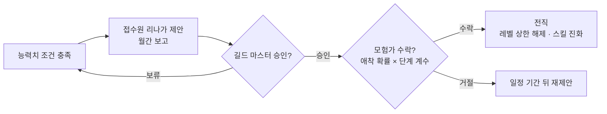

# 직업과 전직

**직업은 48개이고, 전직은 "어느 능력치가 높은가"로만 정해집니다.** 출신 직업과 관계없이 같은 능력치 조합이면 같은 직업이 됩니다. 프로토타입 첫해에는 1차 직업 5개가 주로 등장합니다.

| 단계 | 수 | 정하는 방식 |
| --- | --- | --- |
| 1차 기본 | 5 | 주력 능력치 1개 |
| 1차 종결 특수 | 3 | 특수 조건 |
| 2차 | 15 | 능력치 2개 조합 (5×5 표의 위쪽 절반) |
| 3차 심화 | 12 | 2차를 더 깊게 |
| 3차 확장 | 10 | 능력치 3개 조합 |
| 전설 | 3 | 특별 조건 |

## 1차 직업 5개

| 직업 | 주력 능력치 | 첫 스킬 |
| --- | --- | --- |
| 전사 | 힘 | 더블 스윙 |
| 궁수 | 민첩 | 연사 |
| 마법사 | 지력 | 파이어볼 |
| 성직자 | 정신 | 힐 |
| 도적 | 기교 | 급소 찌르기 |

## 2차 직업 15개 (두 능력치의 조합)

| | 힘 | 민첩 | 지력 | 정신 | 기교 |
| --- | --- | --- | --- | --- | --- |
| **힘** | 광전사 | 레인저 | 마검사 | 기사 | 쌍검사 |
| **민첩** | | 사냥꾼 | 마궁사 | 수도사 | 추적자 |
| **지력** | | | 마도사 | 점성술사 | 연금술사 |
| **정신** | | | | 신관 | 광대 |
| **기교** | | | | | 괴도 |

대각선(같은 능력치 두 번)은 "종결 직업"으로, 3차로 더 올라가지 않습니다.

## 전직은 어떻게 일어나는가

| 애착 단계 | 수락 기본 확률 | 1차 → 2차 (×1.2) |
| --- | --- | --- |
| 방랑자 (0~29) | 40% | 48% |
| 새내기 (30~69) | 65% | 78% |
| 동반자 (70~99) | 90% | 100% |
| 토박이 (100) | 100% | 100% |

- 레벨이 성장의 엔진이고 직업은 방향입니다. 전직해야 레벨 상한이 풀리고, 가진 스킬이 새 직업에 맞게 진화합니다(스킬 82개).
- 첫 2차 전직 제안은 시험 측정에서 중앙 48주(하위 20% 40주 ~ 상위 20% 60주)입니다. 즉 **첫해 끝 무렵이 첫 전직 시점**입니다.
