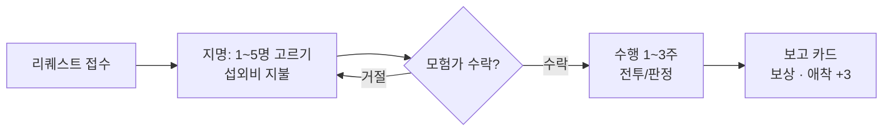

# 지명 퀘스트

**지명은 마스터가 모험가를 직접 골라 보내는, 이 게임에서 거의 유일한 "직접 지시"입니다.** 리퀘스트와 메인 퀘스트가 이 틀을 씁니다.

| 항목 | 규칙 |
| --- | --- |
| 조건 | 퀘스트마다 최소 능력치. **파티 중 1명만** 채우면 됨 |
| 수락 확률 | 전직과 같은 규칙: 애착 단계(40 / 65 / 90 / 100%) × 위험 보정, 정수 %로 표시 |
| 거절당하면 | 다음 주에 바로 다시 지명 가능. 성향 말풍선 한 줄 |
| 섭외비 | 모험가 등급별 F 20G · E 40G · D 80G · C 150G · B 250G · A 400G · S 600G. **거절당해도 나감** |
| 보상 | 게시판처럼 중계료를 떼고 모험가에게도 몫을 줌 |
| 대열 | 항상 자동(직업 순) |
| 성공 | 참가자 애착 +3 |

- 지명 중인 모험가는 그 기간 게시판 의뢰를 받지 않습니다.
- **섭외비는 연 약 1,400G**(첫해 월 평균 62G)로, 처음 어림(550G)보다 컸지만 금액은 그대로 두기로 했습니다(2026-11-16).
