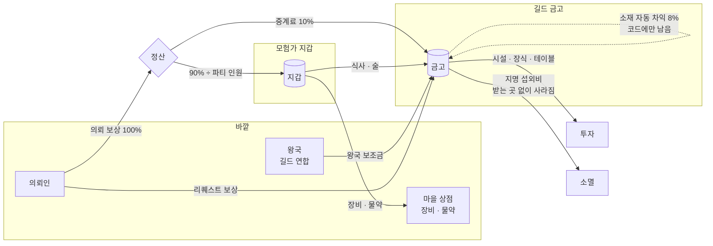

# 돈의 흐름 한눈에 보기

**돈 주머니는 "길드 금고"와 "모험가 지갑" 두 개입니다.** 의뢰 보상은 의뢰인이 내고, 길드는 그중 10%(중계료)만 가져갑니다. 나머지 90%는 모험가 지갑으로 가서 장비 · 물약 · 식사에 쓰입니다.

## 읽는 법

- **길드가 직접 버는 돈:** 중계료, 식사 · 술 마진, 소재 판매, 리퀘스트 보상.
- **길드가 받는 돈:** 왕국 보조금. 의뢰 실적과 거의 무관하게 들어옵니다(지금 코드).
- **모험가가 쓰는 돈 중 길드로 돌아오는 것:** 식사 · 술뿐입니다. 장비 · 물약은 마을 상점으로 빠집니다.
- **섭외비**는 금고에서 빠져나가고 누구에게도 가지 않습니다(지금 코드). 모험가 지갑에 들어가지 않습니다.

## 설계 의도

1. 길드와 모험가의 돈을 나눈 것은 "모험가는 스스로 판단한다"는 원칙 때문입니다. 장비를 사는 것도 모험가입니다.
2. 길드는 모험가를 "부자로 만들어" 식당 · 주점에서 다시 쓰게 하는 구조를 의도했지만, 지금 측정에서 주점 매출은 월 4G로 거의 작동하지 않습니다.
