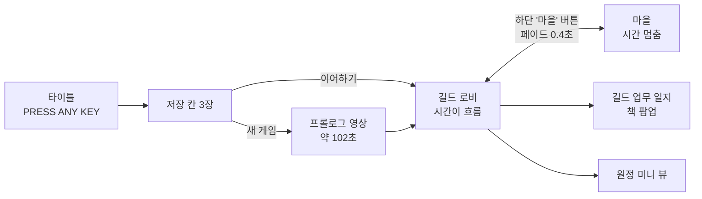

# 화면 흐름

**타이틀 → 저장 칸 → (새 게임이면) 프롤로그 영상 → 길드 로비 ↔ 마을** 순서입니다.

| 화면 | 하는 일 |
| --- | --- |
| 타이틀 | SD 모험가 무리가 달리는 배경, 메뉴(새 게임 · 이어하기 · 설정 · 종료) |
| 길드 로비 | 쿼터뷰 1층. 모험가가 오가고 앉아 먹고 마시며 잡담 |
| 상단 HUD | 금고 · 명성 · 신뢰도 · 길드 등급 · 모험가 수 · 날짜. 마우스를 올리면 설명 카드 |
| 하단 메뉴 | 책갈피 버튼(의뢰 · 모험가 · 시설 · 장부 · 도감 · 기록 · 설정 등), 배속 |
| 마을 | 탑뷰. 건물 슬롯을 누르면 팝업. 침공 때 전투가 펼쳐짐 |
