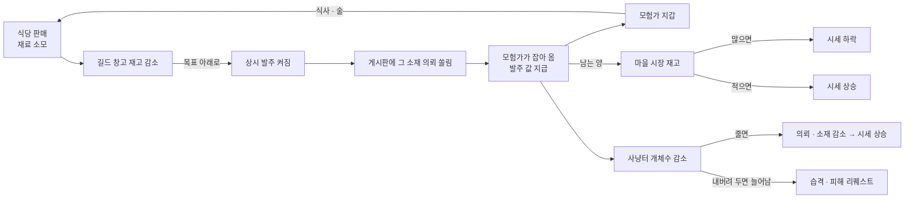

# 제안서: 소재 시장 · 식당 순환 (v1)

작성: Claude · 2026-11-19 · 상태: **방향 결정(결정 36) · 규칙 9가지 결정(결정 37~45) / 1단계 게임 반영 — 브랜치 `feature/market-stage1`(main 미병합), 측정 `docs/balance/market_v4_stage1.md` · 2 · 3단계 미착수 · 수치는 [임시]**
관련: 책 V3 9장 경제 · 6장 물약과 소재 · 6장 요리 · 4장 길드 발주 · `balance/economy_v2_integration.md`(2026-11-18) · 결정 11 · 12 · 24~27 · 35
책 반영: **기획 안내서 V4** (`docs/book-v4/`, 열람 `docs/book/v4/`) — V3 대비 변경은 초록색

> **결정 36 (2026-11-19, 사용자):** V2 적용 범위의 "완전한 시세 경제는 최소판에서 제외" · "큰 시세 변동은 제외"를 **뒤집는다.** 무한 파밍을 막으려면 소재 가격이 공급 · 소비 · 세계 상황에 따라 움직이는 시장이 필요하다. 아래 규칙과 수치는 모두 이 방향을 받은 **제안 · [임시]** 이다.

## 요약

- **지금 소재 경제는 "닫히지 않은 수도꼭지"입니다.** 의뢰에서 소재가 나오면 길드가 판매가의 70%에 무조건 사들이고, 판매 창구는 고정가로 얼마든지 사 줍니다. 식당은 요리를 한 번 발견하면 소재 없이 팔기 때문에, 음식 소재는 발견 뒤 쓸 곳이 거의 없어 쌓입니다. 같은 의뢰를 몇 번을 돌아도 값도, 세계도 변하지 않습니다(1장).
- **목표는 하나의 순환입니다.** 식당이 재료를 쓰고 → 재고가 줄면 발주가 다시 켜져 그 소재 의뢰가 게시판에 올라오고 → 모험가가 가져온 만큼 시장에 풀려 값이 내려가고 → 많이 잡으면 개체수가 줄어 다시 값이 오르는 고리입니다(2장).
- **바꾸는 것 7가지:** ① 식당 재료 소모 ② 메뉴 가격을 플레이어가 정함 ③ 소재 시세(마을 시장 재고) ④ 상시 발주(발주 개편) ⑤ 사냥터 · 채집지 개체수 ⑥ 수수료 5% 추가 ⑦ 소재마다 매입 / 위탁 / 안 받음 선택(3장).
- **피드백 6가지 중 1(돈 쌓임) · 2(선택이 결과를 못 바꿈) · 4(길드로 돈이 안 돌아옴) · 5(보조금 의존)를 정면으로 건드립니다.** 3(모험가 지갑)은 일부만, 6(검증 지표)은 새 지표를 함께 정해야 합니다(4장).
- **순서:** 1단계 순환 닫기(①②④⑥) → 2단계 시세(③⑦) → 3단계 개체수(⑤). 단계마다 게임 · 시뮬레이터 함께 바꾸고 100판 측정합니다(6장).
- **9가지 모두 결정했습니다(결정 37~45, 7장).** 추천과 다르게 정한 것: 그릇 수는 요리마다 따로(결정 37), 메뉴 가격은 1G 단위 자유 입력(결정 39), 위탁은 없애지 않고 소재마다 매입 / 위탁 / 안 받음을 고르는 방식(결정 43).

---

## 1. 지금 구조 (코드 확인, `game_core.js` · `balance.csv`, 2026-11-19)

| 항목 | 지금 규칙 | 문제 |
| --- | --- | --- |
| 소재 얻기 (결정 27) | 몬스터 1마리 · 탐색 포인트 1곳마다 보상표 주 소재 1개, 희귀(30% 미만)는 의뢰당 1번 | 같은 의뢰를 반복해도 나오는 양이 같음 |
| 자동 매입 (결정 12) | 귀환 때 길드가 판매가 × 70%(버림)로 **무조건** 삼. 돈은 파티 지갑으로 | 사는 양에 한도가 없음 |
| 위탁 (결정 12) | 금고가 매입가보다 적을 때만. 월말 판매 창구에서 자동으로 팔려 모험가 90% · 길드 10% | 금고가 넉넉한 지금은 거의 생기지 않음. 플레이어 결정 없음 |
| 판매 창구 | 고정가 F 6 · E 9 · D 12 · C 30 · B 36 · A 48 · S 90G (+ 업그레이드 3G). **얼마든지 다 팔림** | 70% 매입 → 100% 판매 = 30% 보장 차익. 무한 파밍 |
| 식사 판매 | 요리 등급 의뢰 보상 × 25% (F 25G), 길드 마진 60%. **소재를 쓰지 않음** | 음식 소재 9종이 발견 뒤 쌓임. 가격 결정이 없음 |
| 길드 발주 (결정 24~27) | 판매가 × 1.5를 선지급, 다 차면 끝. 그동안 새 의뢰 50%가 그 소재 의뢰로 | **한 번 하고 끝.** 다시 발주할 이유가 없음 |
| 수수료 (결정 11 · 22) | 10% · 15%(집무실) · 20%(게시판 업그레이드). 돈이 필요한 모험가가 높은 수수료를 확률로 거름 | 늦추기만 가능. 10% 아래가 없어 "빨리 처리하기" 선택이 없음 |

**측정 (2026-11-18 통합 점검, 100판 · 48주):** 소재 한 달 16.2개 · 매입 65G · 판매 12G(사들이기만 하고 거의 안 팖) · 식사 판매 약 71G(약 5그릇) · 48주 금고 중앙 2,646G · 96주 10,149G · 2년차 월 순이익 872G.

**음식 소재가 나오는 F · E 의뢰 (보상표 확률)**

| 소재 | 주로 나오는 의뢰 |
| --- | --- |
| 멧돼지 고기 (F) | 오늘 저녁 삼겹살 100 · 장작이 부족해요 70 |
| 들버섯 (F) | 먹어도 되나요 100 · 이거 마석 맞냐 70 · 깨진 마석 파편 30 · 산딸기 싹쓸이 30 |
| 민물고기 (F) | 펄떡이는 생선 100 · 고철이나 줍자 70 |
| 소금 · 향신료 · 신선한 물 (F) | **F급 의뢰 10종 모두 15% (희귀, 의뢰당 1번)** |
| 늑대 고기 (E) | 강제 단백질 수확 100 |
| 산딸기 (E) | 산딸기 싹쓸이 100 |
| 밀가루 (E) | E급 의뢰 7종 모두 15% (희귀) |

> 양념(소금 · 향신료 · 물 · 밀가루)은 모든 레시피에 들어가는데 희귀 뽑기로만 나옵니다. 재료를 소모하게 바꾸면 **양념이 가장 먼저 모자랍니다**(5장 어림). 3-1의 잡화 상인이 이 병목을 풉니다.

---

## 2. 목표: 닫힌 순환

- 플레이어가 만지는 손잡이: **메뉴 가격 · 발주 목표 재고와 값 · 수수료 · 어느 사냥터를 쉬게 할지.**
- 결과가 보이는 곳: 메뉴판 마진, 시세 화살표, 게시판 쏠림, 개체수 막대.

---

## 3. 규칙 제안

### 3-1. 식당 재료 소모 (1단계)

| 항목 | 제안 |
| --- | --- |
| 소모 | 요리 1번 만들 때 레시피 재료 **각 1개 = 1세트 → 요리마다 정한 그릇 수** (결정 37: F 멧돼지 스테이크 정식 2 · 들버섯 수프 3 · 민물고기 구이 정식 2 / E 늑대 고기 스튜 3 · 산딸기 파이 4 · 숲 버섯 파이 4 [임시]). 만든 그릇은 그 주에 팔고 남으면 다음 주로(한 주 뒤 버림 [임시]) |
| 품절 | 재료가 없으면 그 요리는 품절. 모험가는 다른 요리를 고르거나 안 먹음 |
| 자동 조리 | 매주 판매 직전, 메뉴에 올린 요리를 플레이어가 정한 **하루 준비량**(0~10그릇)만큼 재료가 되는 한 만듦 |
| 발견 | 지금처럼 조합으로 발견(재료 소모). 발견은 메뉴에 올릴 권리일 뿐 |
| 잡화 상인 (양념) | 소금 · 향신료 · 신선한 물 · 밀가루는 마을 잡화 상인에게서 **시세 × 1.5 [임시]** 로 언제든 살 수 있음 → 양념 병목을 풀고, 시세의 사실상 상한이 됨. 고기 · 버섯 · 생선 · 열매는 의뢰로만 |
| 발견 수 보너스 | `econ.mealPerDish` +2%/요리는 그대로. 다만 **그 주에 팔 수 있는(품절 아닌) 요리만** 셈 [제안] |

### 3-2. 메뉴 가격을 플레이어가 정함 (1단계)

| 항목 | 제안 |
| --- | --- |
| 기준가 | 지금 값 = 요리 등급 의뢰 보상 × 25% (F 25 · E 37G) |
| 플레이어 설정 | 요리마다 **1G 단위 자유 입력** (결정 39), 범위 1G ~ 기준가 × 3 |
| 사 먹을 확률 | 소비 성향 확률(절약 30 · 보통 60 · 낭비 90%) × **가격 계수** |
| 가격 계수 [임시] | **1 + 1.5 × (1 − 가격 ÷ 기준가), 0.1 ~ 1.6** — 60% → ×1.6 · 80% → ×1.3 · 100% → ×1.0 · 120% → ×0.7 · 150% → ×0.25 (사 먹을 확률 상한 100%) |
| 지갑 확인 | 지갑 < 가격이면 못 삼 (지금과 같음) |
| 원가 표시 | 메뉴판에 **1그릇 원가 = 재료 시세 합 ÷ 그릇 수**, 판매가, **마진 = 판매가 − 원가**. 예전 "마진 60%" 고정 규칙은 없앰 |
| 효과 | 싸게 팔면 많이 팔리고 재료가 빨리 닳아 발주가 자주 켜짐 → 의뢰가 늘어남. 비싸게 팔면 적게 팔리고 재료가 남음 |

> 식사 효과(요리별 능력치, 발견 수 보너스)는 그대로라, **싸게 많이 먹이면 의뢰 성공률이 오르는 쪽**도 선택이 됩니다(침공 전 준비 주 등).

### 3-3. 소재 시세 — 마을 시장 재고 (2단계)

| 항목 | 제안 |
| --- | --- |
| 상태 | 소재마다 **마을 시장 재고 M** (길드 창고와 별개) |
| 목표 재고 T | 소재 등급 · 종류별 [임시] (예: F 음식 주재료 20 · F 양념 15 · F 장비 소재 30) |
| 시세 배수 | **clamp(1 + 0.6 × (T − M) ÷ T, 0.5, 2.0) [임시]** — M이 T의 2배 넘게 쌓이면 0.5배, 0이면 1.6배, 품귀 이벤트로 2.0배까지 |
| 시세 | 기준가(지금 판매가) × 시세 배수, 정수 반올림(작업 규칙: 보이는 값은 정수) |
| M이 늘 때 | 길드가 판매 창구에서 팔 때(팔면 값이 내려감 = 한꺼번에 덤핑하면 손해), 모험가가 시장에 직접 팔 때(3-7) |
| M이 줄 때 | **마을 소비: 매주 M × 10% + 인구 ÷ 100개 [임시]** — 인구가 늘면 수요도 늘어 시세가 오름(마을 성장과 연결), 잡화 상인 구매 |
| 매입가 | 시세 × 70% (결정 12의 비율 유지) |
| 판매 창구 판매가 | 시세 (+ 업그레이드 3G). 판 만큼 M +1 → 다음 개수부터 값이 내려감. 화면에 "N개 팔면 평균 ○G" 미리 보기 |
| 이벤트 | 계절(겨울 채집 소재 +50% 목표 재고 · 여름 생선 풍어 등), 상단 방문(특정 소재 대량 매입 · M −), 리퀘스트 결과(납품 → M −) [후속] |
| 표시 | 판매 창구 · 발주 · 메뉴판에 시세와 화살표(▲▼, 지난 4주 대비). 몬스터 도감에 "최근 시세" 칸 |

### 3-4. 상시 발주 — 길드 발주 개편 (1단계, 결정 24~27 수정)

| 항목 | 지금 (결정 24~27) | 제안 |
| --- | --- | --- |
| 방식 | N개 모으면 끝 | **소재별 목표 창고 재고**(예: 멧돼지 고기 10개)를 걸어 두면, 창고가 목표 아래로 떨어질 때마다 자동으로 다시 켜짐 |
| 1개 값 | 판매가 × 1.5, 발주할 때 선지급 | **시세 × 1.2 · 1.5 · 2.0 [임시] 중 선택.** 소재가 들어올 때마다 금고에서 지급(선지급 없음). 금고가 모자라면 그 주 발주 멈춤 |
| 게시판 쏠림 | 새 의뢰 50%가 그 소재 의뢰로 | 값이 높을수록 쏠림 30 · 50 · 70% [임시] |
| 동시 건수 | 2건 | 3건 [임시] (식당 메뉴 수와 맞춤) |
| 개체수 연결 (3단계) | — | 개체수가 낮으면 쏠림이 약해지고(그 의뢰가 덜 생김), 발주 값을 올려도 잘 안 모임 → "다른 소재로 메뉴를 바꿀지"가 판단이 됨 |
| 장부 | 길드 발주 줄 | 그대로 (들어올 때마다 지출) |

> 이렇게 하면 **식당 판매 → 재고 감소 → 발주 → 의뢰 → 모험가 수입 → 식사** 가 플레이어가 매번 누르지 않아도 계속 돕니다. 플레이어는 목표 재고와 값만 조절합니다.

### 3-5. 사냥터 · 채집지 개체수 (3단계)

| 항목 | 제안 |
| --- | --- |
| 단위 | 의뢰 보상표의 주 소재마다 하나의 **자원지**(예: 멧돼지 숲, 버섯 숲, 강, 늑대 굴, 산딸기 덤불). 0~100 |
| 시작 | 60 [임시] |
| 감소 | 의뢰 성공 때 가져온 그 소재 1개당 −3 [임시] |
| 회복 | 매주 +4 [임시] (계절 보정: 겨울 채집지 +1 · 봄 +6) |
| 낮을 때 (30 미만) | 그 의뢰가 게시판에 덜 올라옴(등장 비중 × 0.5), 소재 뽑기 수 × 0.5, 비전투 판정 기준 +15%("흔적을 찾기 어려움") → 공급이 줄어 시세가 오름 |
| 높을 때 (80 넘음, 사냥형) | 피해 리퀘스트 등장("멧돼지가 밭을 갈아엎었어요", 늑대는 습격 확률 +) · 마을 인구 증가 −1/주 [임시] — **안 잡아도 문제**가 생김 |
| 의뢰 레벨 (결정 35) | 같은 의뢰 3번 성공 → Lv+1(적 +15%, 보상 +20%)은 그대로. 개체수가 낮을 때는 레벨이 오르지 않음 [제안] — "얼마 안 남은 놈들이 강하다"는 이중 벌칙을 막음 |
| 표시 | 의뢰 카드 · 도감에 개체수 막대(많음 · 보통 · 적음 3단계, 숫자 숨김 [제안]) |

### 3-6. 수수료 5% 추가 — 처리 속도 조절 (1단계, 결정 11 · 22 수정)

| 항목 | 지금 | 제안 |
| --- | --- | --- |
| 선택지 | 10 · 15 · 20% | **5 · 10 · 15 · 20% [임시]**. 5%는 처음부터 |
| 5% 의뢰 | — | 모든 모험가가 우선 고려(주당 실수령이 높아져 자연히 먼저 맡음) + 거름 없음 |
| 카드 표시 | 수수료 | 수수료 + **예상 처리 주**(지금 게시판 · 모험가 상태로 추정, 1 · 2 · 3주+) |
| 쓰는 때 | — | 침공 준비 주 전에 밀린 의뢰 정리, 발주 소재 의뢰를 빨리 돌리기, 기한이 얼마 안 남은 의뢰(신뢰도 하락 방지) |

> 5%는 길드 몫이 반으로 줄어드는 대가가 분명합니다. 반대로 20%는 늦게 팔리고 기한이 지나면 신뢰도가 떨어집니다(결정 22 그대로). 이제 수수료가 "돈 ↔ 속도" 양쪽으로 움직입니다.

### 3-7. 소재 처리 선택: 매입 · 위탁 · 안 받음 (2단계, 결정 43 · 결정 12 대체)

> 처음 제안은 "위탁 없앰"이었으나, 사용자 결정으로 **소재마다 플레이어가 세 가지 중 고르는 방식**이 되었습니다(2026-11-19).

| 선택 | 소재는 누구 것이 되나 | 돈 | 쓸 수 있는 곳 |
| --- | --- | --- | --- |
| **매입** | 길드 창고 | 길드가 모험가에게 **시세의 50 · 70 · 90%(소재마다 선택, 기본 70%)** 지급 | 요리 · 납품 · 발주 채우기 |
| **위탁** | 팔릴 때까지 모험가 것 | 길드가 월말에 시장에 시세로 대신 팔고 **수수료 10% [임시]**, 나머지는 모험가에게. 판 만큼 M + | 쓸 수 없음 (중개만) |
| **안 받음** | 모험가 것 | 모험가가 시장에 직접 시세로 팖. 길드 몫 없음. M + | — |

| 항목 | 규칙 [임시] |
| --- | --- |
| 매입률과 모험가 | 돈이 필요한 모험가는 매입률이 낮은 소재가 나오는 의뢰를 확률로 거름: 거를 확률 = (70% − 매입률) ÷ 20% × 0.25 → 50%면 25%, 70% 이상이면 0 (결정 22 수수료 거름과 같은 방식) |
| 창고 상한 | 매입 소재마다 30개 — 넘치면 그 소재는 자동으로 위탁 처리 |
| 금고 부족 | 매입가를 낼 수 없으면 그 개수는 위탁 처리 (지금 결정 12와 같은 흐름) |
| 기본값 | 음식 주재료 · 양념 = 매입 70%, 장비 소재 = 위탁 [제안] |

### 3-8. 주점 (후속)

- 술도 재료를 쓰게(밀가루 · 산딸기 → 맥주 · 과실주) 하면 같은 순환에 들어옵니다. 지금 월 4G라 우선순위는 낮게, 1~2단계 측정 뒤 정합니다.

---

## 4. 피드백 6가지와의 연결

| # | 피드백 (2026-11-19) | 이 제안이 하는 일 | 남는 숙제 |
| --- | --- | --- | --- |
| 1 | 돈이 쌓이고 쓸 곳이 없음 (48주 2,646G, 96주 10,149G) | 재료 매입 · 상시 발주 · 잡화 양념이 **매주 반복 지출**. 인구가 늘수록 시세가 올라 후반 지출도 늘어남 | 후반 등급별 비용 곡선 |
| 2 | 선택이 결과를 거의 바꾸지 못함 | 메뉴 가격 · 발주 목표와 값 · 수수료 5~20% · 사냥터 쉬게 하기 — 모두 **손익 · 속도 · 의뢰 구성에 바로 보임** | 계약(정원 1명, ±30G)은 그대로 작음 → 합치거나 줄일지 |
| 3 | 모험가 지갑이 얇아 장비 성장이 멈춤 | 발주 값(시세 × 1.2~2.0) · 시세 상승 · 직접 판매로 모험가 수입이 늘어남 | 장비값(대장간 결정 34: F 150 · E 300G/칸)과 지갑 맞추기는 따로 측정 |
| 4 | 길드로 돈이 돌아오지 않음 (주점 4G) | 식당이 재료를 써서 **매입 수요 → 모험가 수입 → 식사 구매**가 실제로 이어짐 | 주점 재료(3-8) |
| 5 | 수입의 약 70%가 보조금 | 식당 마진 · 판매 창구 타이밍이 운영 실력 수입이 됨 | 보조금 비율 50% 재측정 |
| 6 | 검증이 문제를 못 잡음 | — | 6장 새 지표를 관문 1 옆에 추가 |

---

## 5. 수치 어림 (규칙 값으로 계산, 측정 아님)

| 항목 | 어림 |
| --- | --- |
| 지금 식사 판매 | 월 약 5그릇 (식사 수입 71G ÷ 1그릇 15G) |
| 재료 소모 뒤 필요량 | F 요리 1세트 = 2~3재료 → 월 2.5세트 ≈ 주재료 2.5 + 양념 2.5~5개 |
| 지금 공급 | 소재 월 16.2개 중 음식 주재료 약 4~6개, 양념은 의뢰당 15% × 3종 → 월 약 1개씩 |
| 결론 | **주재료는 남고, 양념이 모자람** → 잡화 상인(시세 × 1.5) 없이는 품절이 잦음 |
| 메뉴 가격 100% · 그릇 원가 | 멧돼지 스테이크 정식: (6 + 6) ÷ 2 = 6G 원가 → 25G 판매, 마진 19G (지금 15G보다 큼) |
| 양념을 잡화에서 살 때 | 향신료 9G → 원가 (6 + 9) ÷ 2 = 7.5G → 마진 17.5G |
| 길드 몫 변화 | 식사 마진이 커지는 대신 재료 지출이 생김. 그릇 수가 같으면 월 순이익 비슷, 메뉴 가격과 준비량이 승부처 |

> 정확한 값은 1단계 구현 뒤 100판으로 다시 잽니다. 위 표는 방향 확인용입니다.

---

## 6. 단계 · 구현 범위 · 검증

| 단계 | 내용 | 바뀌는 곳 | 측정 |
| --- | --- | --- | --- |
| 1 순환 닫기 | 3-1 재료 소모 · 잡화 양념 / 3-2 메뉴 가격 / 3-4 상시 발주 / 3-6 수수료 5% | `game_core.js` (식사 판매 · `cook` · 발주 · `feeOptions`), `sim_engine.js` 같은 규칙, `balance.csv` `econ.meal*` · `order*` · `feeOpt`, 책 식당 장 · 리퀘스트 발주 책갈피 · 의뢰 카드 | 관문 1 + 새 지표 |
| 2 시세 | 3-3 마을 시장 재고 · 시세 / 3-7 소재마다 매입 / 위탁 / 안 받음 | `matSellPrice` · `matBuyPrice` · `dropMats` · `sellMats` · `consign*` 정리, 저장 데이터에 `market`, 판매 창구 · 매입 화면 | 시세 범위 · 덤핑 손실 |
| 3 개체수 | 3-5 자원지 · 의뢰 등장 · 판정 · 피해 리퀘스트 · 의뢰 레벨 연결 | 게시판 의뢰 뽑기(`boardQuota` 주변), 리퀘스트 표, 도감 | 개체수 분포 · 피해 발생 수 |

**새 지표 (관문 1 옆, 100판 · 48주)**

| 지표 | 목표 [임시] |
| --- | --- |
| 48주 금고 중앙 | 1,500G 이하 (지금 2,646G) |
| 식당 품절 주 비율 | 10~30% (0%면 재료가 남아돈다는 뜻) |
| 상시 발주가 다시 켜진 횟수 | 판당 10번 이상 |
| 시세 배수 분포 | 0.7~1.4 사이에 80% 이상, 끝값(0.5 · 2.0)은 드물게 |
| 개체수 30 미만 · 80 초과 주 | 각각 판당 몇 번씩은 생김 (0이면 연결이 안 보임) |
| 모험가 지갑 평균 · 장비 1칸 이상 비율 | 지금(429G · 42%)보다 높음 |

---

## 7. 결정 (2026-11-19 13:18~13:36, 사용자와 함께 정함)

| # | 결정 | 추천 | **결정** |
| ---: | --- | --- | --- |
| 1 | 식당 재료 소모 단위 | 1세트 = 2그릇, 남은 그릇은 한 주 뒤 버림 | **결정 37: 요리마다 그릇 수 따로** (F 멧돼지 스테이크 정식 2 · 들버섯 수프 3 · 민물고기 구이 정식 2 / E 늑대 고기 스튜 3 · 산딸기 파이 4 · 숲 버섯 파이 4 [임시]) |
| 2 | 양념 병목 | 잡화 상인에서 시세 × 1.5로 구매 가능 | **결정 38: 추천대로** |
| 3 | 메뉴 가격 단계와 수요 | 기준가 60~150% 5단계 | **결정 39: 1G 단위 자유 입력**, 연속 수요 공식(3-2) |
| 4 | 시세 공식 범위 | 0.5 ~ 2.0배, 마을 소비 = M × 10% + 인구 ÷ 100 | **결정 40: 추천대로** |
| 5 | 발주 방식 | 상시 발주로 교체, 선지급 없앰, 동시 3건 | **결정 41: 추천대로** |
| 6 | 수수료 5% | 추가, 처음부터 열림, 카드에 예상 처리 주 | **결정 42: 추천대로** |
| 7 | 위탁 | 없애고 모험가 직접 시장 판매로 대체 | **결정 43: 소재마다 매입(시세 50 · 70 · 90%) / 위탁(수수료 10%) / 안 받음** (3-7) |
| 8 | 개체수 표시 | 많음 · 보통 · 적음 3단계 (숫자 숨김) | **결정 44: 추천대로** |
| 9 | 순서 | 1단계 → 측정 → 2단계 → 측정 → 3단계 | **결정 45: 추천대로** |

---

## 8. 바뀌는 요소 한눈에 보기

| 영역 | 지금 (V3) | 바뀜 (V4 제안) | 단계 |
| --- | --- | --- | --- |
| 범위 결정 | 완전한 시세 경제 제외 | **시세 경제 도입 (결정 36)** | 확정 |
| 식당 판매 | 발견 뒤 소재 없이 무한 판매 | 1세트 = 요리마다 정한 그릇 수(결정 37), 재료 소모 · 품절 · 하루 준비량 | 1 |
| 식사 가격 | 의뢰 보상 25% 고정, 마진 60% 고정 | 플레이어가 1G 단위로 입력(결정 39), 원가 · 마진 표시, 가격에 따라 수요 연속 변화 | 1 |
| 양념 | 의뢰 희귀 뽑기로만 | 잡화 상인에서 시세 × 1.5로 구매 가능 | 1 |
| 길드 발주 | N개 모으면 끝, 판매가 × 1.5 선지급 | 목표 재고 상시 발주, 시세 × 1.2~2.0, 들어올 때 지급, 동시 3건 | 1 |
| 수수료 | 10 · 15 · 20% | 5 · 10 · 15 · 20%, 예상 처리 주 표시 | 1 |
| 소재 가격 | 등급별 고정 | 마을 시장 재고 기반 시세 0.5~2.0배, 화살표 표시 | 2 |
| 소재 처리 | 판매가 70%로 무조건 자동 매입 | 소재마다 매입(시세 50 · 70 · 90%) / 위탁 / 안 받음 (결정 43), 창고 상한 30 | 2 |
| 판매 창구 | 고정가, 무제한 | 시세, 팔수록 값이 내려감, 미리 보기 | 2 |
| 위탁 | 금고 부족 때 자동, 수수료 10% | 플레이어가 고르는 선택지 중 하나(길드가 대신 팔고 수수료 10%) | 2 |
| 마을 인구 | 소재와 무관 | 인구가 마을 소비(시세)에 들어감 | 2 |
| 자원지 개체수 | 없음 | 0~100, 사냥 · 채집으로 감소, 매주 회복, 낮으면 공급 감소 · 높으면 피해 | 3 |
| 의뢰 레벨 (결정 35) | 3번 성공마다 Lv+1 | 개체수 낮을 때는 레벨 오르지 않음 | 3 |
| 장부 | 식사 판매 · 소재 매입 · 길드 발주 | + 식당 재료비 · 잡화 구매 (식사 판매는 매출, 재료는 원가로 따로) | 1~2 |
| 관문 1 | 순이익 · 성공률 | + 금고 상한 · 품절률 · 발주 재가동 · 시세 분포 · 개체수 · 지갑 | 1~3 |

## 9. 다음 개발 단계 (2026-11-19 사용자 결정, 아직 구현 안 함)

| 결정 | 내용 | 구현 메모 [임시] |
| ---: | --- | --- |
| 47 | **남은 그릇 처리를 플레이어가 고름: 마감 할인 / 모험가 무료 식사** | 마감 할인: 만든 다음 주의 남은 그릇은 반값(가격 계수 다시 계산) · 무료 식사: 버릴 그릇을 그 주 마을에 남은 모험가에게(1그릇당 애착 +1 정도) · 메뉴판에 요리별 선택 단추 · 측정 지표에 버린 / 할인 / 무료 그릇 |
| 48 | **계약 최소 조건** (애착 할인 하한 + 등급별 최소 월 보수) | `contractEval`의 요구 비율 하한 1.0 · `need += 최소 보수(F 20 · E 40G)` · 계약 화면에 '최소 보수' 안내 · 계약 검사(K 묶음) 다시 · 관문 1 다시 |
| 아이디어 | FM식 계약 협상 | 결정표 '아이디어' 참고. 48을 넣은 뒤 검토 |

