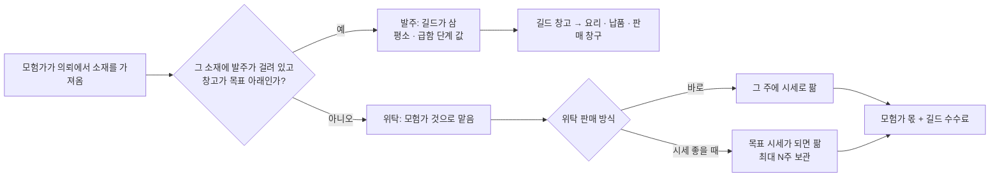

# 제안서: 길드 발주 · 위탁 개선 (v1)

작성: Claude · 2026-11-19 · 상태: **대체됨 → [proposal_order_consign_v2.md](proposal_order_consign_v2.md)** (사용자 논의: 발주는 '의뢰'를 발주, 매입은 모험가가 판단, 위탁은 거래 상대가 없어 없앰)
관련: 결정 24~27(길드 발주) · 41(상시 발주) · 43(매입 / 위탁 / 안 받음) · 46(양념 발주) · 47 · 48 · `proposal_market_v1.md` · 측정 `docs/balance/market_v4_stage1.md`
계기 (2026-11-19 사용자): "매입으로 해 놓으면 굳이 길드 발주 없이도 가져다주지 않나?" · "어떤 소재를 매입하고 어떤 소재를 위탁할지 구분할 기준이 애매하다" → "길드 발주와 위탁 시스템 전반 개선 기획"

## 요약

- **지금은 같은 일을 하는 장치가 세 겹입니다.** 소재가 길드 창고로 들어오는 길이 '자동 매입', '상시 발주', '창고가 차면 위탁'으로 나뉘어 있고, 셋의 차이가 화면에서 잘 보이지 않습니다. 게다가 금고만 넉넉하면 매입이 늘 이득이라 **위탁 · 안 받음은 고를 이유가 거의 없습니다**(1장).
- **추천: 역할을 둘로 나눕니다.** ① **발주 = 길드가 사는 유일한 길** (평소 매입도 발주의 한 단계) ② **위탁 = 길드가 대신 팔아 주는 장사** (사지 않은 소재는 모두 위탁, 언제 팔지 · 수수료를 플레이어가 정함). '안 받음'은 없앱니다(2장).
- **위탁에 할 일을 줍니다.** 시세가 좋을 때까지 들고 있다가 파는 **'위탁 보관'**, 수수료를 정하면 모험가의 만족 · 직접 판매가 달라지는 **'위탁 수수료'**로, "언제 · 얼마에 팔지"가 판단 거리가 됩니다(4장).
- **발주는 쓰는 곳과 바로 이어 붙입니다.** 메뉴에 올린 요리 재료 · 받아 둔 납품 리퀘스트 재료는 **'연결 발주'**로 저절로 평소 매입이 걸리고, 플레이어는 급할 때만 단계를 올립니다(3장).
- 정하실 것 6가지는 7장에 추천과 함께 있습니다.

---

## 1. 지금 상태와 문제 (2026-11-19 브랜치 `feature/market-stage1` 기준)

### 1-1. 소재가 길드로 들어오는 길

| 길 | 규칙 | 길드가 내는 돈 | 게시판 · 뽑기에 주는 영향 |
| --- | --- | --- | --- |
| 자동 매입 | 소재마다 '매입'이면 귀환 때 무조건 | 시세 × 50 · 70 · 90% | 없음 |
| 상시 발주 | 창고가 목표 아래일 때만 | 시세 × 1.2 · 1.5 · 2.0 | 그 소재 의뢰 30 · 50 · 70% 쏠림, 뽑기도 쏠림 |
| 위탁 | 소재마다 '위탁'이거나, 창고 30개가 찼거나, 금고가 모자랄 때 | 없음 (월말 판매 수수료 10%) | 없음 |
| 안 받음 | 소재마다 '안 받음' | 없음 | 없음 (모험가가 직접 팖) |

### 1-2. 문제

| # | 문제 | 근거 |
| ---: | --- | --- |
| 1 | **매입과 발주가 겹쳐 보임.** 둘 다 "길드가 산다"인데 하나는 아무 때나, 하나는 목표 아래일 때만. 실제 차이(발주는 의뢰를 끌어옴)가 화면에서 드러나지 않음 | 발주 없이 매입만: 재료 부족 품절 주 8 → 55%, 식사 매출 113 → 92G, E급 승급 72 → 65판 (100판 · 48주) |
| 2 | **위탁은 고를 이유가 없음.** 매입 후 되팔면 판매가의 30% 차익인데 위탁은 10% 수수료. 금고가 넉넉하면 매입이 늘 이득 | 매입 70% → 판매 100% vs 위탁 수수료 10% |
| 3 | **'안 받음'은 길드에 아무것도 남기지 않음.** 매입가를 낮춘 소재를 모험가가 거르는 것을 피할 때만 의미 | — |
| 4 | **소재마다 세 가지 × 매입 비율 세 가지 = 9가지를 정해야 함.** F급만 아는 소재가 20종 안팎이라 관리할 것이 너무 많음 | 매입 · 위탁 책갈피 목록 |
| 5 | **납품 리퀘스트 · 메뉴 재료와 연결이 약함.** 납품에 필요한 소재를 '위탁'으로 두면 창고에 안 들어와 리퀘스트가 막힘. 요리 재료도 플레이어가 직접 발주해야 함 | 사용자 제보(재료가 있는데 '재료 없음') · 납품 리퀘스트 #20 신선한 물 4개 |
| 6 | **위탁 판매는 월말에 자동으로 전부 팔림.** 시세를 보고 팔 때를 고를 수 없어, 시세 그래프를 만들어도 쓸 데가 판매 창구(길드 소유 소재)뿐 | 결정 43 구현 |

---

## 2. 추천안: 역할을 둘로 나누기

| 역할 | 질문 | 플레이어가 정하는 것 |
| --- | --- | --- |
| **발주 (사기)** | "무엇이 필요한가, 얼마나 급한가?" | 소재 · 목표 재고 · 단계(평소 · 급함 · 아주 급함) |
| **위탁 (팔아 주기)** | "필요 없는 소재를 언제 · 얼마에 팔아 줄까?" | 위탁 수수료율 · 판매 방식(바로 / 시세 좋을 때) |

- **'안 받음'은 없앱니다.** 모험가가 직접 파는 것은 위탁 수수료를 아주 높게 잡았을 때 모험가 쪽에서 고르는 반응으로 남깁니다(4-2).
- **소재마다 고를 것을 9가지 → 0가지로.** 발주를 건 소재만 신경 쓰면 되고, 나머지는 길드 전체 위탁 정책 하나로 처리됩니다.

---

## 3. 발주 개선

### 3-1. 단계: 평소 매입을 발주 안으로

| 단계 | 1개 값 | 게시판 · 뽑기 쏠림 | 쓰는 때 |
| --- | --- | ---: | --- |
| **평소** (새) | 시세 × 70% | 0% | 들어오는 만큼만 사 모음 (지금의 '자동 매입') |
| **급함** | 시세 × 1.2 | 30% | 재고가 자주 바닥날 때 |
| **아주 급함** | 시세 × 1.5 | 50% | 침공 준비 · 리퀘스트 마감 |
| **최우선** | 시세 × 2.0 | 70% | 지금 당장 |

- 평소 단계는 의뢰를 끌어오지 않으므로, **발주 = 의뢰를 끌어온다**는 오해를 막고 단계로 구분해 보여 줍니다. 메뉴판 · 발주 화면에 "평소 단계로는 한 달에 약 ○개 들어옵니다"(최근 4주 평균) 안내.
- 동시 건수: 평소 단계는 제한 없음, 급함 이상은 지금처럼 6건 [임시].
- 매입가를 낮추면 모험가가 의뢰를 거르던 규칙(결정 43)은 평소 단계가 시세 × 70% 고정이므로 없앱니다.

### 3-2. 연결 발주: 쓰는 곳이 생기면 저절로

| 쓰는 곳 | 자동으로 걸리는 발주 | 풀리는 때 |
| --- | --- | --- |
| 메뉴에 올린 요리 (준비량 1 이상) | 재료마다 **평소** 단계, 목표 = 준비량 × 2세트분 | 메뉴에서 내리거나 준비량 0 |
| 받아 둔 납품 · 건물 리퀘스트 | 필요한 소재 **평소** 단계, 목표 = 필요 개수 | 리퀘스트 완료 · 거절 |
| 대장간 제작 재료 (대장간 2단계 뒤) | 평소 단계 | — |

- 연결 발주는 목록에 "메뉴 · 리퀘스트 연결"로 따로 보이고, 플레이어는 **단계만 올리거나 목표만 바꿀 수 있음**(직접 지운 연결 발주는 다시 걸리지 않음).
- 식당이 납품 재료를 남겨 두는 규칙(2026-11-19)은 그대로 둡니다.

### 3-3. 그대로 두는 것

상시 발주의 목표 재고 · 들어올 때 지급 · 같은 의뢰 게시판 2장까지 · 양념 발주(의뢰마다 양념 확률만 올림) · 개체수가 적으면 쏠림이 약해짐.

---

## 4. 위탁 개선: "언제 · 얼마에 팔지"를 판단 거리로

### 4-1. 판매 방식 (길드 전체 1개, 소재마다 예외 가능)

| 방식 | 규칙 [임시] | 모험가 | 길드 |
| --- | --- | --- | --- |
| **바로 팔기** (기본) | 들어온 주에 시세로 팖 (지금의 월말 일괄 대신 매주) | 돈을 바로 받음 | 수수료 |
| **시세 좋을 때** | 목표 시세(기준의 110 · 120 · 130%)가 되면 팖, 최대 4주 보관 뒤 그냥 팖 | 기다리는 동안 애착 −1/2주 (돈이 늦음) | 비싸게 팔려 수수료도 커짐 |

- 시세 그래프(2026-11-19)를 위탁 화면에도 붙여 "지금 팔까, 기다릴까"를 보며 고르게 함.
- 위탁 판매도 시장 재고에 더해져 값이 내려감 → 한꺼번에 몰아 팔면 손해(판매 창구와 같은 규칙).

### 4-2. 위탁 수수료율 (길드 전체 1개)

| 수수료 | 모험가 반응 [임시] |
| ---: | --- |
| 5% | 위탁을 반김: 위탁 1건마다 애착 +1 (4주에 한 번까지) |
| 10% (기본) | 그대로 |
| 15% | 돈이 필요한 모험가는 위탁 대신 직접 팖 25% (길드 몫 0) |
| 20% | 직접 판매 50% |

- 의뢰 수수료(결정 11 · 22 · 42)와 같은 모양이라 배우기 쉬움.

### 4-3. 위탁 수입이 매입보다 못하지 않게

- 지금은 "매입 70% → 판매 100% = 30% 차익"이라 위탁(10%)이 늘 짐. 추천안에서는 **길드가 사는 것은 발주한 소재뿐**이고 나머지는 위탁이므로 둘이 경쟁하지 않음.
- 그래도 판매 창구에서 되팔 목적으로 평소 발주를 거는 '사서 되팔기'가 남으므로: **판매 창구에서 길드 창고 소재를 팔 때도 시장 재고가 늘어 값이 내려가고**(지금 규칙), 평소 단계 발주는 **창고 상한 30개**까지만 → 무한 되팔기를 막음.

---

## 5. 화면

| 곳 | 바뀌는 것 |
| --- | --- |
| 리퀘스트 → 길드 발주 | 목록을 "직접 건 발주 / 메뉴 · 리퀘스트 연결"로 나눔 · 단계 단추 4개(평소 · 급함 · 아주 급함 · 최우선) · 평소 단계 월 유입 어림 |
| 경영 → 매입 · 위탁 → **위탁** | 소재별 매입 / 위탁 / 안 받음 표를 없애고, 길드 위탁 정책(수수료율 · 판매 방식) + 위탁 보관함(소재 · 주인 · 지금 시세 · 목표 시세 · 남은 보관 주 · 시세 그래프) |
| 식당 메뉴판 | 재료 줄에 "연결 발주: 평소 · 창고 n/목표" · "재료 없음"일 때 단계 올리기 단추 |
| 리퀘스트 카드 | 납품 재료 옆에 "연결 발주 중" |

---

## 6. 어림 · 검증 계획

| 지표 | 지금 | 목표 [임시] |
| --- | ---: | --- |
| 재료 부족 품절 주 | 8% | 10% 이하 유지 |
| 위탁으로 판 소재 (판당) | 거의 0 (자동 플레이 매입 70%) | 소재의 절반 이상이 위탁으로 팔림 |
| 위탁 수수료 수입 (월) | 0G 근처 | 20~40G |
| 소재 매입 지출 (월) | 47G | 줄어듦 (필요한 것만 삼) |
| 48주 금고 중앙 | 1,663G | 1,500G 이하 |
| 관문 1 | 437 / 415G | 통과 유지 |

- 자동 플레이는 연결 발주(자동) + 위탁 '바로 팔기 · 10%'로 측정하고, 플레이어 선택(시세 좋을 때 · 수수료 5 / 15%)은 따로 100판씩.
- 위험: 위탁이 늘면 길드 창고에 소재가 덜 쌓여 리퀘스트 납품 · 대장간 해금(고철)이 늦어질 수 있음 → 연결 발주(3-2)로 막고 측정으로 확인.

---

## 7. 정하실 것

| # | 결정 | 추천 |
| ---: | --- | --- |
| 1 | 역할 나누기 | **발주 = 사기 / 위탁 = 팔아 주기, '안 받음' 없앰** |
| 2 | 평소 매입을 발주 단계로 | **평소(× 70%, 쏠림 0) 단계 추가, 소재별 매입 설정 없앰** |
| 3 | 연결 발주 | **메뉴 재료 · 납품 리퀘스트 재료에 평소 단계 자동** |
| 4 | 위탁 판매 방식 | **바로 팔기(기본) / 시세 좋을 때(목표 110 · 120 · 130%, 최대 4주)** |
| 5 | 위탁 수수료율 | **5 · 10 · 15 · 20%, 기본 10%, 모험가 반응 4-2** |
| 6 | 구현 순서 | **① 역할 나누기 + 평소 단계 + 연결 발주 → 측정 → ② 위탁 판매 방식 · 수수료율 → 측정** |

## 8. 바뀌는 요소 한눈에 보기

| 영역 | 지금 | 제안 |
| --- | --- | --- |
| 소재별 처리 | 매입(50 · 70 · 90%) / 위탁 / 안 받음 | 없앰 — 발주한 소재만 사고 나머지는 위탁 |
| 발주 단계 | × 1.2 · 1.5 · 2.0 (모두 쏠림) | 평소 × 0.7(쏠림 0) · 급함 · 아주 급함 · 최우선 |
| 발주 거는 법 | 플레이어가 직접만 | + 메뉴 · 납품 리퀘스트 연결 발주 자동 |
| 위탁 판매 | 월말에 전부 자동, 수수료 10% | 바로 팔기 / 시세 좋을 때 (최대 4주), 수수료 5 ~ 20% |
| 모험가 반응 | 매입가가 낮으면 의뢰를 거름 | 위탁 수수료 · 보관 기간에 따라 애착 · 직접 판매 |
| 화면 | 매입 · 위탁 책갈피에 소재별 표 | 위탁 정책 + 위탁 보관함(시세 그래프), 발주 목록에 연결 발주 |
